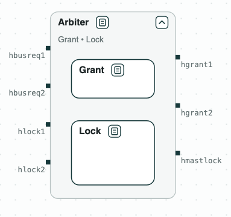
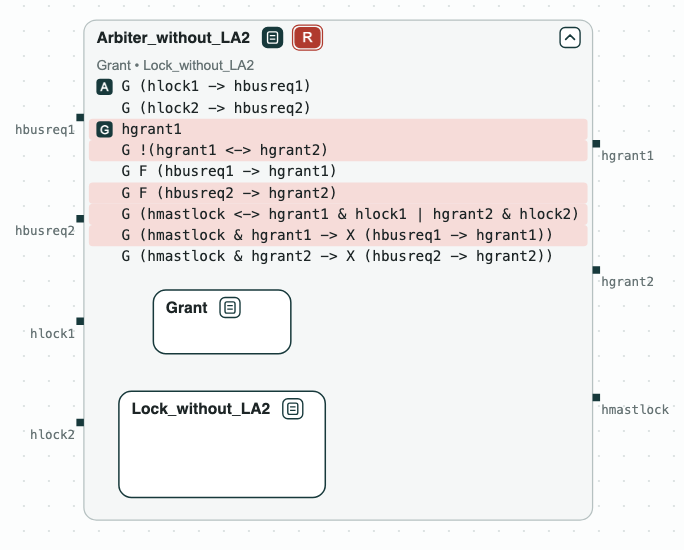
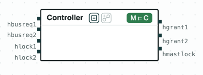

## Bus arbiter: merging two viewpoints

**The question.** Two teams wrote two viewpoints of the same arbiter of the
AMBA AHB bus: one on how the bus is given to the masters, one on how a
master locks it. Is there an arbiter that meets both, and what must it
assume of the masters?


_The arbiter: the merge of the two viewpoints, Grant and Lock._

The arbiter gives the bus to one of two masters. A master asks for the bus
(`hbusreq`), and can ask for a locked access (`hlock`); the arbiter grants
the bus (`hgrant`) and says whether it is locked (`hmastlock`). The
requirements are simplified from Bloem et al., "Specify, Compile, Run:
Hardware from PSL" (COCV 2007), and written in SystemVerilog Assertions.
_Grant_ gives the bus to master 1 at the start (GR1) and to exactly one
master (GR2), and no master waits forever (GR3.1, GR3.2). _Lock_ locks the
bus for a master that asks for a locked access (LK1), and keeps it while
that master asks (LK2.1, LK2.2); it assumes that a master that asks for a
locked access also asks for the bus (LA1.1, LA1.2). The two are put
together by merging (•), the operation for viewpoints of one component.

### The steps

**Step 1. Each viewpoint.** _Grant_ and _Lock_ are each realizable.

**Step 2. The merge.** The merge is unrealizable. When master 1 locks the
bus and keeps asking for it, _Lock_ says that master 1 keeps the bus
(LK2.1), and _Grant_ says that master 2 does not wait forever (GR3.2). The
core is these two, with GR1, GR2, and LK1, which make the conflict
possible.


_Step 2: the merge is unrealizable; the core highlighted in red._

**Step 3. What the arbiter must assume.** The core points to the missing
assumption: a master that has locked the bus stops asking for it sooner or
later (LA2). With LA2 in _Lock_, the merge _Arbiter_ (the diagram at the
top) is realizable, and slugs synthesizes a controller of 81 states.
_Arbiter_ is also written as SVA (`out/arbiter.sv`).

**Step 4. The controller.** The synthesized controller, read as a state
machine, implements _Arbiter_ (M ⊨ C).


_Step 4: the controller implements Arbiter._

### Content of the directory
The directory of the demo contains:
- `requirements.txt`: the requirements, numbered;
- `sva/`: the two viewpoints in SystemVerilog Assertions, one module each,
  whose ports give the inputs and the outputs: _Grant_ (`grant.sv`) and
  _Lock_ (`lock.sv`). The label of each assertion is the number of the
  requirement;
- `ahb.py`: the steps with the CHASE Python package;
- `out/arbiter.sv`: the merge of the viewpoints as SVA, written by
  `ahb.py`;
- `out/arbiter.html`: the diagram, written by `ahb.py`.

### Python Flow
The script needs the CHASE Python package, version 0.5.0, nuXmv, and
slugs. From the directory of the demo:

```
$> pip install chase-cps
$> chase-cps install nuxmv --accept-license
$> chase-cps install slugs
$> python3 ahb.py
```

The script prints the result of each step and writes the diagrams above in
`out/arbiter.html`, a page to open in a browser: a click on a name opens
or closes the contract, and a click on a red tag shows its core. The
viewpoints are in `sva/grant.sv` and `sva/lock.sv`, with the number of each
requirement as its label.

With `--expect` the script exits with code 1 when a result is not the
expected one.
