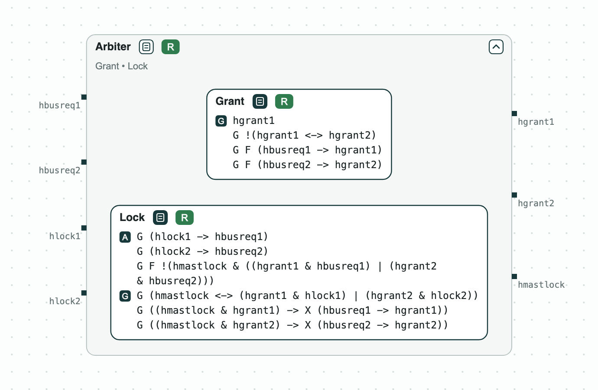
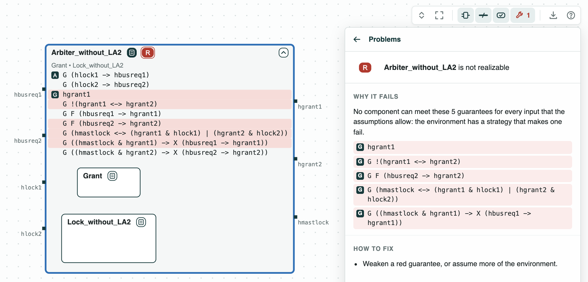
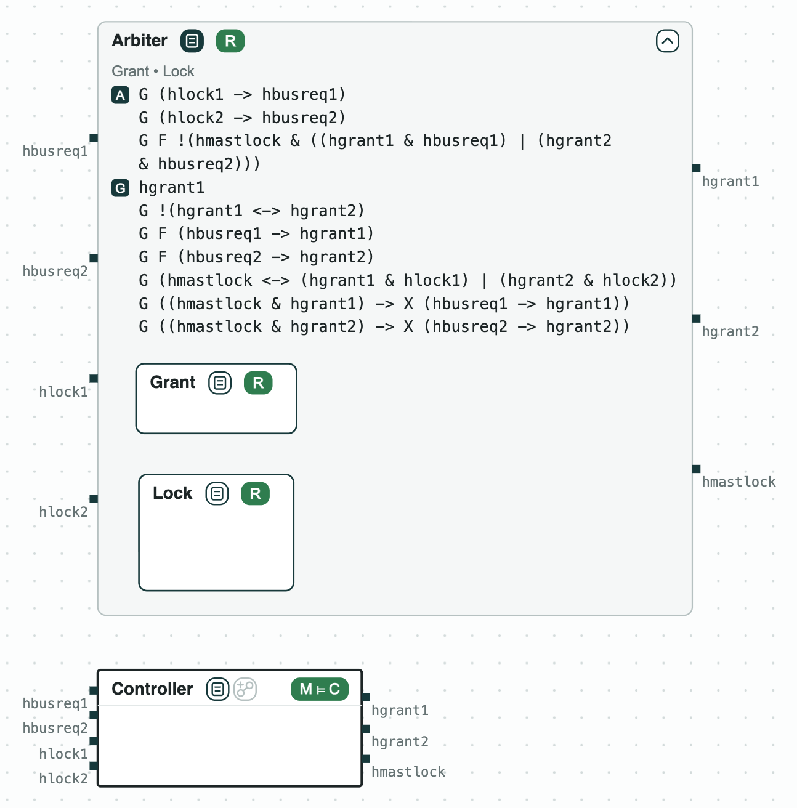

## AMBA AHB bus arbiter: two viewpoints that cannot be merged, and the assumption that fixes them

**The question.** Two teams wrote two viewpoints of the arbiter of the AMBA
AHB bus: how the bus is given to the masters, and how a master locks it. Is
there an arbiter that meets both, and what must it assume of the masters?

**The result.**
- Each viewpoint is realizable, but their merge is not: the unrealizable
  core (the smallest set of requirements in conflict) is 5 of its 7
  guarantees.
- The core points to the missing assumption LA2. With it, the merge is
  realizable, and slugs synthesizes a controller of 81 states.
- The controller implements the merge (M ⊨ C).

<p align="center">
  
  <br>
  <em>The merge with LA2 (R green), the merge without it (R red, its core in red), and the controller (M ⊨ C).</em>
</p>

The arbiter gives the bus to one of two masters (simplified from Bloem et
al., "Specify, Compile, Run: Hardware from PSL", COCV 2007). _Grant_ gives
the bus to exactly one master, and no master waits forever. _Lock_ lets a
master that has locked the bus keep it while it asks for it. Merging (•)
puts together two viewpoints of one component.

### The steps

**Step 1. Each viewpoint.** _Grant_ and _Lock_, read from the
SystemVerilog Assertions (SVA) of `sva/`, are each realizable.

<p align="center">
  
  <br>
  <em>Step 1: Grant and Lock, each realizable (R).</em>
</p>

**Step 2. The merge without LA2.** Without LA2, the merge is unrealizable.
When master 1 locks the bus and keeps asking for it, _Lock_ lets it keep
the bus (LK2.1), and _Grant_ says that master 2 does not wait forever
(GR3.2). GR1, GR2, and LK1 complete the core.

<p align="center">
  
  <br>
  <em>Step 2: the merge without LA2 is unrealizable; the terms of the core are red.</em>
</p>

**Step 3. What the arbiter must assume.** LA2: a master that has locked
the bus stops asking for it sooner or later. With LA2 in _Lock_, the merge
_Arbiter_ is realizable, and slugs synthesizes a controller. _Arbiter_ is
also written as SVA in `out/arbiter.sv`.

<p align="center">
  
  <br>
  <em>Step 3: Arbiter, the merge with LA2, is realizable.</em>
</p>

**Step 4. The controller.** The controller, read as a state machine,
implements _Arbiter_ (M ⊨ C).

<p align="center">
  
  <br>
  <em>Step 4: the controller implements Arbiter (M ⊨ C).</em>
</p>

### Run it

```
pip install chase-cps
chase-cps install nuxmv --accept-license
chase-cps install slugs
python ahb.py --expect
```

### Content of the directory
- `requirements.txt`: the requirements, numbered;
- `sva/grant.sv`, `sva/lock.sv`: the two viewpoints, each assertion
  labeled by its requirement;
- `sva/*.results.json`: the results kept by `chase-cps view --check`;
- `ahb.py`: the steps with the CHASE Python package;
- `out/arbiter.sv`: the merge as SVA, written by `ahb.py`;
- `out/arbiter.html`: the diagrams above, written by `ahb.py`.
