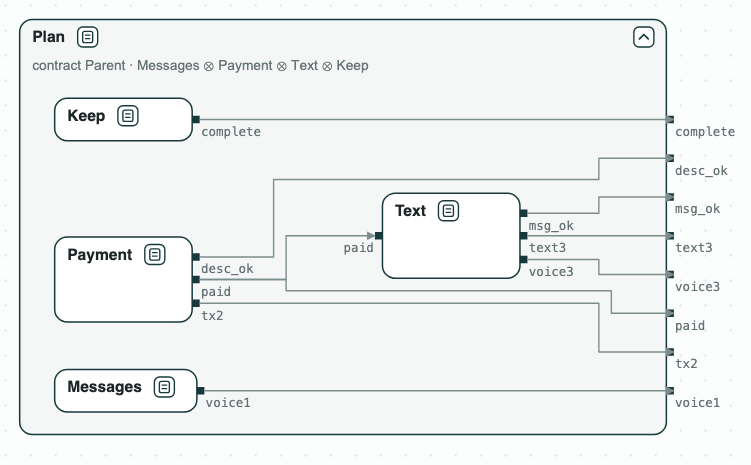
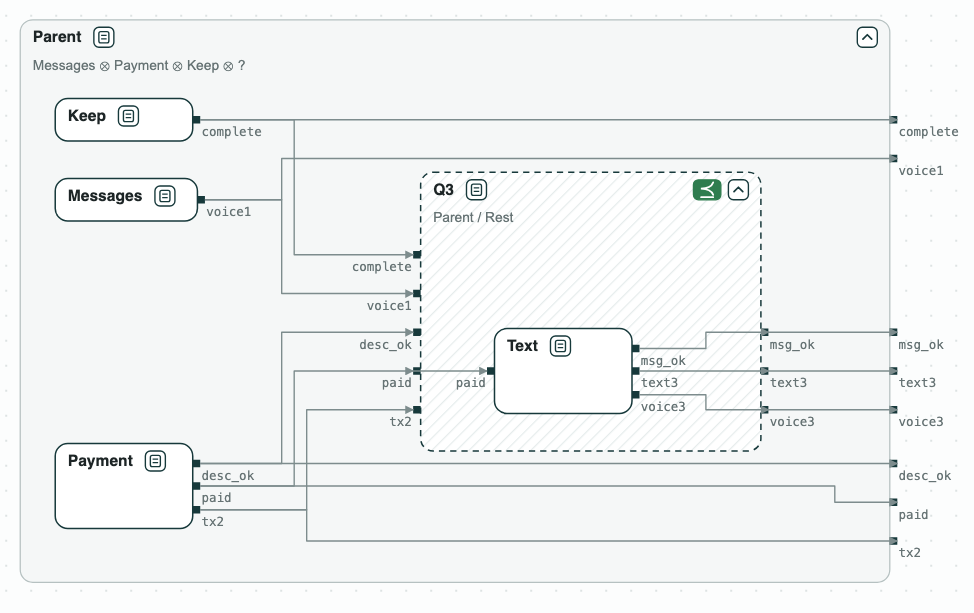

## AI agents: decomposing a task

A user gives an AI agent a task in natural language, with rules: pay a
friend back on Venmo the amount in her text messages, with the note
"Groceries", then text her "It is done." (task 530b157_1 of AppWorld,
Trivedi et al., ACL 2024). The rules and what the user asked for become a
set of contracts over the tool calls of the agent: the contract of the
parent agent. The parent splits the task among three sub-agents, each with
its own contract.

The question: do the contracts of the sub-agents, together, refine the
contract of the parent? If not, what is missing, and which sub-agent must
do it?

_The plan: the four sub-agents inside the contract of the parent, wired by the variables they share._

### Content of the directory
The directory of the demo contains:
- `requirements.txt`: the task, the plan, the variables, the contract of
  the parent (H1 to H8), and the contracts of the sub-agents;
- `agents.py`: the steps with the CHASE Python package.

### From the task to contracts
Each tool call of a sub-agent is a Boolean variable (a call does not say
who makes it, so each sub-agent has its own), and `paid` is the fact that
the Venmo tool writes. The contract of the parent guarantees:

| | Rule | Formula |
|---|---|---|
| H1 | the text comes after the payment | `G (text3 -> paid)` |
| H2 | pay once | `G (paid -> G !tx2)` |
| H3 | the note is "Groceries" | `G (tx2 -> desc_ok)` |
| H4 | the text is "It is done." | `G (text3 -> msg_ok)` |
| H5 | no voice message | `G (!voice1 & !voice3)` |
| H6 | the payment is made | `F tx2` |
| H7 | the text is sent | `F text3` |
| H8 | the task is marked complete | `F complete` |

### The decomposition
- _Messages_ (1) finds the amount; it holds the tool of voice messages, so
  it guarantees `G !voice1`.
- _Payment_ (2) is the only one with Venmo: H2, H3, and the payment (H6).
- _Text_ (3) sends the text: from the rules of its tools, H1, H4, and
  `G !voice3`.
- _Keep_: the parent marks the task complete (H8).

### Python Flow
The script needs the CHASE Python package (`pip install chase-cps`, version
0.4.2) and nuXmv or NuSMV:

`$> python3 agents.py`

It prints the result of each step:
1. Messages ∥ Payment ∥ Text ∥ Keep does not refine _Parent_. In the
   counterexample the payment is made and the text is never sent: two
   sub-agents hold the tools to send it, and no contract asks either one
   to.
2. _Q3_ = _Parent_ / (_Messages_ ∥ _Payment_ ∥ _Keep_), the quotient with
   discharge, is what sub-agent 3 must guarantee: H1, H4, no voice message,
   and `F text3`.
3. _Text_ with `F text3`, which starts when the payment is done (it assumes
   `F paid`), refines _Q3_, so the decomposition refines _Parent_.
4. If the parent also writes "never pay" (`G !tx2`), its contract is not
   consistent, and the unsat core names the two clauses in conflict: `F
   tx2` and the slip.

Once checked, the contracts of the sub-agents can be enforced on their tool
calls at run time, for instance with ContrAgent.

With `--expect` the script exits with code 1 when a result is not the
expected one.

At the end the script writes `out/agents.html`, a page to open in a browser:
the four sub-agents inside the contract of _Parent_, with the result of the
refinement, and _Q3_ with _Text_ in its hole.

_The four sub-agents inside the contract of the parent: their composition refines it._

_Q3 = Parent / Rest, what sub-agent 3 must do: Text refines it._
