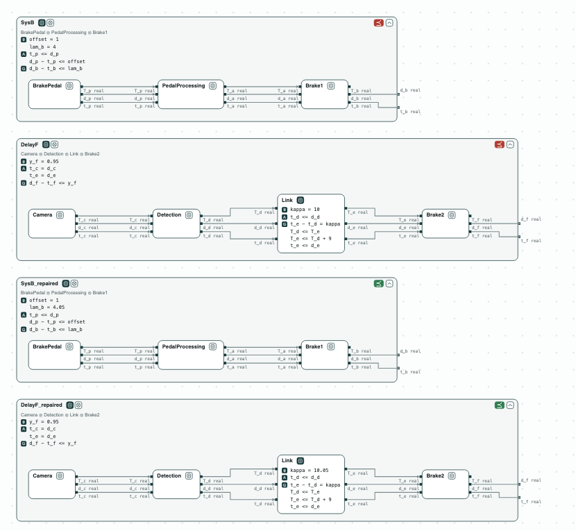
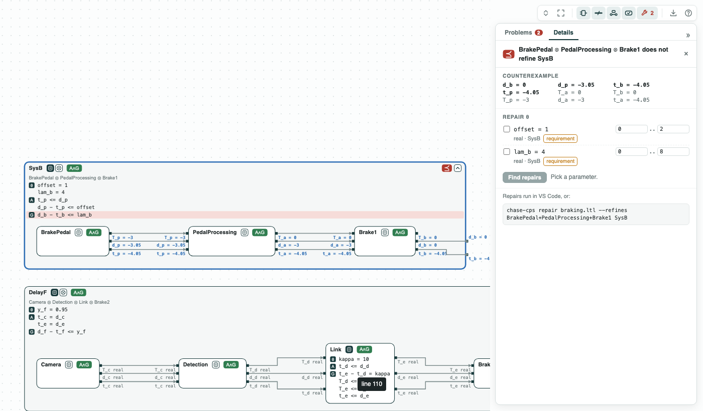
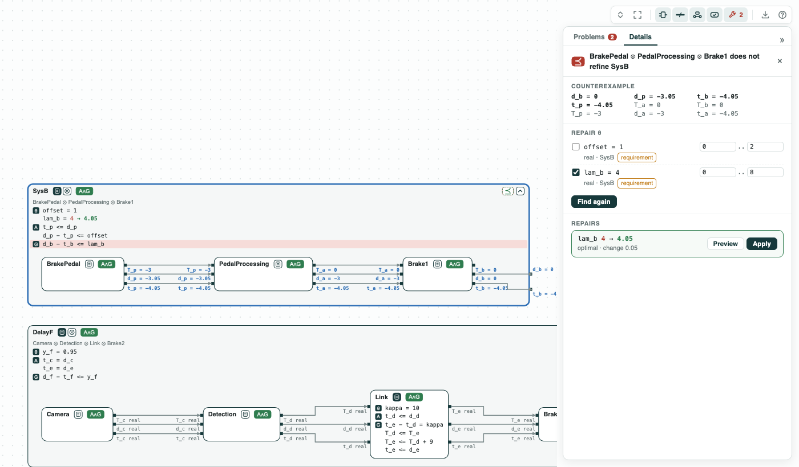
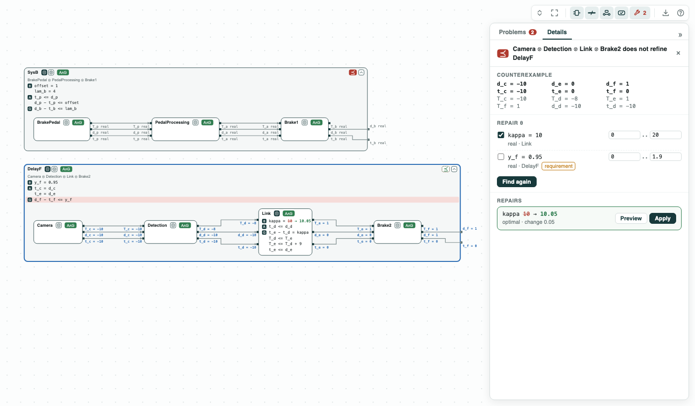

## Emergency braking: how much slack the timing needs, found by repair

**The question.** Brake 1 must start within 4 ms of its schedule, but the
camera path can delay it. How much must its bound grow, or how much must
the inconsistency of the network link grow, for the requirement to hold?

**What it shows.**
- Counterexample: the pedal path does not meet the bound of 4; z3 gives a
  run where Brake 1 starts 4.05 after its timestamp.
- Repair of a bound: `lam_b = 4.05`, the least change (0.05), optimal, in
  0.1 s. The values that fail are computed at once (quantifier
  elimination), with no search.
- Repair of a design constant: the inconsistency of the link `kappa = 11`
  when Brake 1 may take no delay (option B of the paper), or `kappa = 10.05`
  when Brake 1 absorbs the 0.95 it can, a smaller change that the paper did
  not consider.
- Repair in the viewer: a click on the red ⪯ gives the counterexample, and
  with `chase-cps view --serve` (or in VS Code) the button Find repairs
  gives the same values.

<p align="center">
  
  <br>
  <em>The two paths before the repair (⪯ red) and after it (green): lam_b = 4.05 for the pedal path, kappa = 10.05 for the camera path.</em>
</p>

This is the braking system of ContrACT (Xiao, Lutz, Castillo-Effen, Nuzzo,
*Contract-Based Consistency and Availability Analysis for Distributed
Cyber-Physical Systems*, MEMOCODE 2026). `BrakePedal` is processed by
`PedalProcessing`, which triggers `Brake1`; the `Camera` triggers the
obstacle `Detection`, whose result crosses the network `Link` to `Brake2`.
`Brake1` and `Brake2` are two reactions of the same Braking reactor, which
handles its events in the order of their timestamps: while `Brake2` waits
for late camera data, a pedal event that comes after it waits too. This is
how the camera path delays Brake 1 (the offset of the paper).

`braking.ltl` has the timing contracts that ContrACT builds for each node
(Section III-C of the paper), over the timestamp `t`, the start `d`, and
the completion `T` of each event:

- a source (`BrakePedal`, `Camera`) starts at its timestamp or later and
  runs at most its worst-case latency;
- a processor (`PedalProcessing`, `Detection`, `Brake1`) takes the
  timestamp of its trigger and starts when the trigger completes;
- the `Link` schedules the receiver `kappa` (10) after the sender (the
  inconsistency) and delivers the data at most 9 after;
- `Brake2` starts at the later of the release of its event and the arrival
  of the data.

Two system contracts state the requirements:

- `SysB` (equation (8)): given that the pedal event is released at most
  `offset` (1) after its timestamp, Brake 1 starts at most `lam_b` (4)
  after its own.
- `DelayF`: Brake 2 starts at most `y_f` after its timestamp, the delay it
  passes on to Brake 1. Brake 1 can absorb `y_f = 0.95` (4 - 3.05 from its
  own path).

`offset`, `lam_b`, `kappa`, and `y_f` are named constants (`real constant`,
θ in the diagram). The contracts compare reals with no temporal operator,
so z3 checks them, and `repair` computes at once the values for which the
check fails (quantifier elimination), then the least change.

### The steps

**Step 1. The bound is violated.** The pedal path (`BrakePedal`,
`PedalProcessing`, `Brake1` composed) does not refine `SysB`. In the
counterexample the pedal event is released 1 after its timestamp (the
offset), the processing takes 3 and the pedal 0.05: Brake 1 starts 3.05
late on its own path, plus 1 from the camera path, 4.05 after its
timestamp. The term it breaks, `d_b - t_b <= lam_b`, is red, and the values
are on the ports.

<p align="center">
  
  <br>
  <em>The pedal path inside SysB: the counterexample, Brake 1 starts 4.05 after its timestamp.</em>
</p>

**Step 2. Repair the bound.** `repair` gives `lam_b = 4.05`, optimal, a
change of 0.05: the paper's option A. `lam_b` belongs to the requirement,
so the viewer changes it only when it is picked.

<p align="center">
  
  <br>
  <em>Find repairs, lam_b picked: 4 → 4.05, optimal. Pointed at, the repair shows on the diagram.</em>
</p>

**Step 3. Repair the link, no delay.** The camera path (`Camera`,
`Detection`, `Link`, `Brake2` composed) must refine `DelayF`. With `y_f = 0`
the camera path never delays Brake 1, and `repair` gives `kappa = 11`: the
paper's option B (Table II). The detection takes up to 2 + 9 = 11 ms to
reach `Brake2`, so with `kappa = 11` it never waits. The paper asks for no
delay at all: it does not let Brake 1 take part of the delay.

<p align="center">
  
  <br>
  <em>With y_f = 0 (a copy of the file): the data arrives 1 late, and the repair is kappa = 11.</em>
</p>

**Step 4. Repair the link, the delay that Brake 1 absorbs.** Brake 1 starts
at most 3.05 late on its own path, so it can take a delay of 0.95 and still
start within 4. With `y_f = 0.95`, `repair` gives `kappa = 10.05`: the least
change of the link when Brake 1 absorbs 0.95, smaller than the change to 11.
The camera path refines `DelayF` with 10.05 and not with 10.04. Run through
the whole analysis of ContrACT, `kappa = 10.05` gives Brake 1 a worst case
of exactly 4.0, which passes; 10.04 gives 4.01, which fails.

<p align="center">
  
  <br>
  <em>With y_f = 0.95: kappa 10 → 10.05, optimal.</em>
</p>

### Content of the directory
The directory of the demo contains:
- `braking.ltl`: the contracts of the nodes and the two system contracts,
  with their named constants. The lines `# view:` at the top give the
  refinements that `chase-cps view` draws;
- `braking.py`: the steps with the CHASE Python package;
- `braking.results.json`: the results of `chase-cps view braking.ltl --check`;
- `out/braking.html`: the diagram before and after the repair, written by
  `braking.py`.

### Run it

```
pip install "chase-cps[z3]"
python braking.py --expect
chase-cps view braking.ltl --check -o out/braking-view.html   # the # view: lines, before the repair
chase-cps repair braking.ltl --refines BrakePedal+PedalProcessing+Brake1 SysB --param lam_b=0..10
chase-cps view braking.ltl --check --serve                    # Find repairs in the page
```
