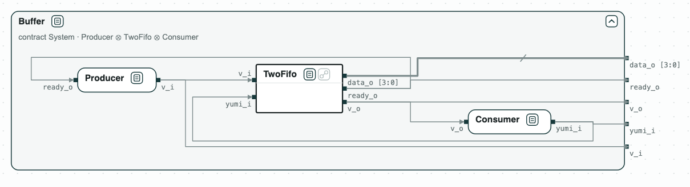
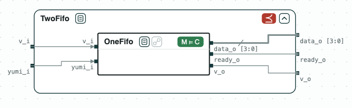
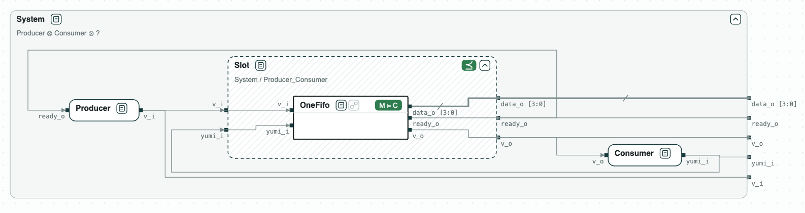
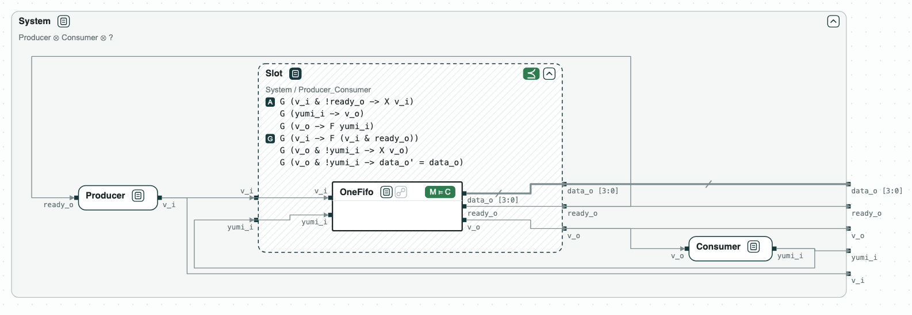

## BufferSwap: replacing a block of a circuit

The question: a buffer of a circuit is replaced by a smaller one, whose
contract does not refine the old one. Can it take its place, and what must
any buffer in that place satisfy?

A producer sends data to a consumer through a buffer, with a ready/valid
handshake. The buffer is `bsg_two_fifo` of BaseJump STL, a FIFO of two
entries. The demo replaces it with `bsg_one_fifo`, a FIFO of one entry,
which is smaller, and checks with CHASE that the system still meets its
requirements. The contracts are written in SystemVerilog Assertions, and
the RTL is that of BaseJump STL.

_The system: a producer, the buffer (bsg_two_fifo, with its RTL), and a consumer, with a ready/valid handshake._

### Content of the directory
The directory of the demo contains:
- `sva/`: the contracts, one module per contract, whose ports give the
  inputs and the outputs: the producer (`producer.sv`), the consumer
  (`consumer.sv`), the two buffers (`two_fifo.sv`, `one_fifo.sv`), and the
  requirements of the system (`system.sv`);
- `rtl/`: the RTL of the two buffers, from BaseJump STL, under the Solderpad
  Hardware License (see `rtl/README.md`);
- `bufferswap.py`: the steps of the replacement with the CHASE Python
  package;
- `out/slot.sv`: the contract of the place of the buffer as SVA, written by
  `bufferswap.py`;
- `out/bufferswap.html`: the diagram, written by `bufferswap.py`;
- `jasper/run.tcl`: the check of `out/slot.sv` on the RTL of `bsg_one_fifo`
  with Jasper.

### The contracts
- _Producer_ keeps offering a value (`v_i`) until the buffer takes it
  (`ready_o`).
- _Consumer_ takes a value (`yumi_i`) only when the buffer offers one
  (`v_o`), and takes what is offered sooner or later.
- _TwoFifo_ and _OneFifo_ assume what the consumer guarantees. They keep what
  they offer until it is taken, take a value when they are empty and after a
  value is taken, and offer at the next cycle what they take. _TwoFifo_ takes
  a second value when it holds one; _OneFifo_ does not.
- _System_: every offer is taken sooner or later, and what the buffer offers
  stays until it is taken.

### Python Flow
The script needs the CHASE Python package with the RTL reader
(`pip install chase-cps[rtl]`, version
0.5.0) and nuXmv:

`$> python3 bufferswap.py`

It prints the result of each step:
1. _Producer_, _TwoFifo_, and _Consumer_, composed with discharge, refine
   _System_: the assumptions of _TwoFifo_ are discharged by the guarantees
   of _Consumer_.
2. _OneFifo_ does not refine _TwoFifo_. The counterexample: _OneFifo_ takes a
   value, and at the next cycle it does not take another one, which
   _TwoFifo_ would. On the strength of the contracts of the two buffers
   alone, _OneFifo_ cannot replace _TwoFifo_.
3. _Slot_, the quotient of _System_ by the composition of _Producer_ and
   _Consumer_, is the contract of the place of the buffer: the weakest
   contract with which the system meets its requirements. With discharge,
   the quotient keeps the terms: it assumes the guarantees of _Producer_
   and _Consumer_, and guarantees the requirements of _System_. _OneFifo_
   refines _Slot_, so it can replace _TwoFifo_, and the composition of
   _Producer_, _OneFifo_, and _Consumer_ refines _System_.
4. _Slot_ is written as SVA (`out/slot.sv`), with a bind statement for
   `bsg_one_fifo`. The RTL of both buffers is read with Yosys and checked
   with nuXmv: `bsg_two_fifo` implements _TwoFifo_, `bsg_one_fifo` implements
   _OneFifo_ and _Slot_, and not _TwoFifo_. Without Yosys this step is
   skipped.

With `--expect` the script exits with code 1 when a result is not the
expected one.

`out/bufferswap.html` draws the three steps on the contracts: the old
system, the new buffer against the old one, and _Slot_ as a hole next to
_Producer_ and _Consumer_, drawn open, with _OneFifo_ inside it. With
Yosys, the two buffers are drawn with their RTL. The page opens in a
browser; a click on a name opens its contract.

_Step 1: Producer, TwoFifo with the RTL of bsg_two_fifo, and Consumer refine System._

_Step 2: OneFifo, with the RTL of bsg_one_fifo, does not refine TwoFifo, so its contract alone does not say that it can take the place._

_Step 3: the place of the buffer, Slot = System / (Producer ∥ Consumer), is the weakest contract with which the system meets its requirements; OneFifo refines it, and its RTL implements it._

### Jasper
`jasper/run.tcl` proves the guarantees of `out/slot.sv` on the RTL of
`bsg_one_fifo`:

`$> jg -fpv -batch -tcl jasper/run.tcl`

The three guarantees of _Slot_ are proven.
