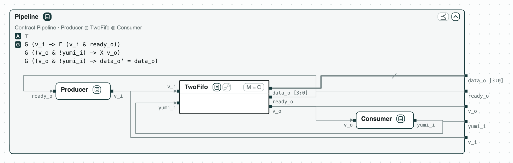

## Circuit buffer swap: the new buffer fails the old contract, but the quotient shows it fits

**The system.** In a circuit, a producer sends data to a consumer through
a buffer, with a ready/valid handshake: the producer offers a value
(`v_i`) and keeps it until the buffer is ready (`ready_o`); the buffer
offers a value to the consumer (`v_o`, `data_o`) until the consumer takes
it (`yumi_i`). The buffer is `bsg_two_fifo`, a FIFO of two entries from
[BaseJump STL](https://github.com/bespoke-silicon-group/basejump_stl), an
open library of hardware blocks in SystemVerilog. The requirement of the
whole, _Pipeline_, says that every offer is taken sooner or later, and
that an offered value stays until it is taken. Each part has a contract
written in SystemVerilog Assertions (SVA); Yosys reads the Verilog of the
buffers into state machines, and nuXmv checks them.

**The question.** The designer wants to replace the buffer with
`bsg_one_fifo`, a FIFO of one entry, which is smaller. Its contract does
not refine the old one. Can it still take the place of the old buffer,
and what must any buffer in that place satisfy? Answering from the
contracts avoids checking the whole circuit again for every candidate.

<p align="center">
  
  <br>
  <em>The system: the producer, the buffer, and the consumer, inside the requirement Pipeline.</em>
</p>

### The steps

The tags on the boxes give the results of the checks: green holds, red
fails; [Diagrams](https://chase-cps.github.io/interfaces/diagrams/) says
how to read them.

**Step 1. The old system.** _Producer_, _TwoFifo_, and _Consumer_,
composed,
[refine](https://chase-cps.github.io/contracts/checks/#verification-tasks)
_Pipeline_, and the Verilog of `bsg_two_fifo` implements _TwoFifo_ (M ⊨ C).

<p align="center">
  
  <br>
  <em>Step 1: the old system refines Pipeline; the Verilog implements TwoFifo.</em>
</p>

**Step 2. The new buffer against the old one.** _OneFifo_ does not refine
_TwoFifo_, so it cannot replace it on the strength of its contract alone.
In the counterexample of 4 steps, the empty buffer takes a value at step
1 and is not ready at step 2, where _TwoFifo_ guarantees that it is.

<p align="center">
  
  <br>
  <em>Step 2: OneFifo does not refine TwoFifo; the guarantee it breaks in red.</em>
</p>

**Step 3. What the place needs.** CHASE computes the
[quotient](https://chase-cps.github.io/contracts/algebra/#example-the-contract-of-a-missing-component)
Slot = Pipeline / (Producer ⊗ Consumer), the dashed box: the weakest
contract any buffer in that place must meet, derived from the contracts.
It has 3 assumptions and 3 guarantees. _Slot_ may assume what the
consumer guarantees, that an offer is taken sooner or later
(`G (v_o -> F yumi_i)`), so one entry is enough: _OneFifo_ refines _Slot_,
and the system with _OneFifo_ refines _Pipeline_.

<p align="center">
  
  <br>
  <em>Step 3: OneFifo refines Slot, the contract of the place.</em>
</p>

**Step 4. On the Verilog.** The Verilog of `bsg_one_fifo` implements
_OneFifo_ and _Slot_, and does not implement _TwoFifo_. The script also
writes _Slot_ as SVA (`out/slot.sv`), so that a commercial tool such as
Jasper can check any new buffer against it (`jasper/run.tcl`, not run by
the script).

<p align="center">
  
  <br>
  <em>Step 4: the Verilog of bsg_one_fifo implements its contract (M ⊨ C).</em>
</p>

### Run it

```
pip install "chase-cps[rtl]"                # with Yosys
chase-cps install nuxmv --accept-license
python bufferswap.py --expect
```

### Content of the directory
- `sva/`: the five contracts, with their `*.results.json`;
- `rtl/`: the two buffers, from BaseJump STL (Solderpad license);
- `bufferswap.py`: the steps with the CHASE Python package;
- `out/`: the diagrams (`bufferswap-system.html`, the system alone) and
  `slot.sv`, written by `bufferswap.py`;
- `jasper/run.tcl`: the check of `out/slot.sv` with Jasper.
