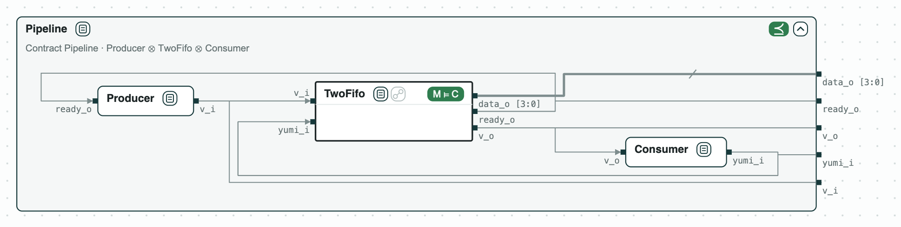
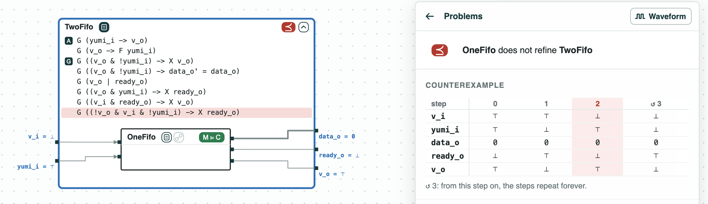
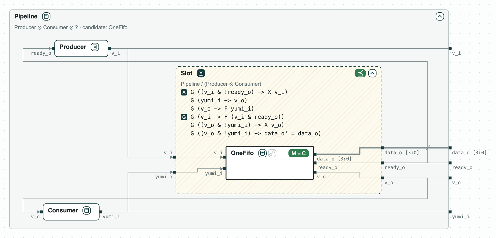
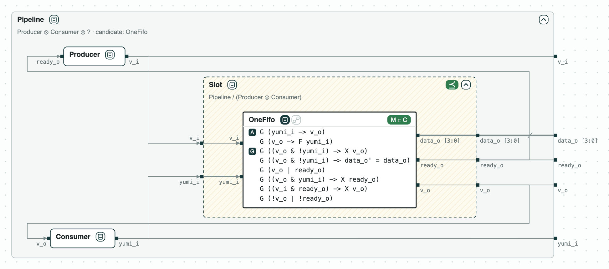

## Circuit buffer swap: a smaller buffer that does not refine the old one, but fits its place

**The question.** A buffer of a circuit is replaced by a smaller one, whose
contract does not refine the old one. Can it take its place, and what must
any buffer in that place satisfy?

**What it shows.**
- SystemVerilog Assertions as contracts: five contracts read from `sva/`.
- Composition with discharge: the producer, the old buffer, and the
  consumer refine the requirements of the system, with no assumption left.
- Refinement with a counterexample: the new buffer does not refine the old
  one; the counterexample has 4 steps, and the panel marks the guarantee
  it breaks.
- Quotient: Slot = System / (Producer ⊗ Consumer), the weakest contract of
  the place of the buffer (3 assumptions, 3 guarantees); the new buffer
  refines it.
- RTL as models: the RTL of BaseJump STL, read with Yosys and checked with
  nuXmv. The RTL of `bsg_one_fifo` implements _OneFifo_ and _Slot_, not
  _TwoFifo_. Each check takes under a second.
- Export: _Slot_ written as SVA bound to `bsg_one_fifo` (`out/slot.sv`),
  for a tool that reads SVA, such as Jasper.

<p align="center">
  
  <br>
  <em>The page of the demo: the old system, OneFifo against TwoFifo (⪯ red), and OneFifo in Slot, the place of the buffer (⪯ green).</em>
</p>

A producer sends data to a consumer through a buffer, with a ready/valid
handshake:

- the producer offers a value (`v_i`), and the buffer takes it when it is
  ready (`ready_o`);
- the buffer offers a value (`v_o`), and the consumer takes it (`yumi_i`).

The buffer is `bsg_two_fifo` of BaseJump STL, a FIFO of two entries. The
demo replaces it with `bsg_one_fifo`, a FIFO of one entry. The contracts are
written in SystemVerilog Assertions: every offer is taken sooner or later,
and what the buffer offers stays until it is taken. The RTL is that of
BaseJump STL.

### The steps

**Step 1. The old system.** The composition of _Producer_, _TwoFifo_, and
_Consumer_, with discharge, refines _System_, and the RTL of
`bsg_two_fifo` implements _TwoFifo_.

<p align="center">
  
  <br>
  <em>Step 1: the old system refines System (⪯), and the RTL of the old buffer implements TwoFifo (M ⊨ C).</em>
</p>

**Step 2. The new buffer against the old one.** _OneFifo_ does not refine
_TwoFifo_: with a value in, it takes no other. In the counterexample, the
empty buffer takes a value at step 1 and is not ready at step 2, where
_TwoFifo_ guarantees that it is. Its contract alone does not say that it
can take the place.

<p align="center">
  
  <br>
  <em>Step 2: OneFifo does not refine TwoFifo; the counterexample in the panel, the guarantee it breaks in red.</em>
</p>

**Step 3. What the place of the buffer needs.** The quotient Slot = System /
(Producer ⊗ Consumer), drawn as a dashed box, is the weakest contract with
which the system meets its requirements. Any buffer that refines it can
take the place, and _OneFifo_ does: _Slot_ may assume what the consumer
guarantees, that an offer is taken sooner or later, so a buffer of one
entry is enough. The system with _OneFifo_ refines _System_.

<p align="center">
  
  <br>
  <em>Step 3: OneFifo refines Slot, the contract of the place.</em>
</p>

**Step 4. On the RTL.** _Slot_ is written as SVA, bound to `bsg_one_fifo`
(`out/slot.sv`). Yosys reads the RTL, and nuXmv checks it: the RTL of
`bsg_one_fifo` implements _OneFifo_ and _Slot_, and does not implement
_TwoFifo_. The RTL of the two buffers has too many states to be drawn.

<p align="center">
  
  <br>
  <em>Step 4: the RTL of bsg_one_fifo implements its contract (M ⊨ C).</em>
</p>

`jasper/run.tcl` proves the guarantees of `out/slot.sv` on the RTL of
`bsg_one_fifo` with Jasper, a commercial tool: the three guarantees of
_Slot_ are proven. Jasper is not run by the script, and was not run for the
present version of this page.

### Content of the directory
The directory of the demo contains:
- `sva/`: the contracts, one module per contract, whose ports give the
  inputs and the outputs: the producer (`producer.sv`), the consumer
  (`consumer.sv`), the two buffers (`two_fifo.sv`, `one_fifo.sv`), and the
  requirements of the system (`system.sv`);
- `sva/*.results.json`: the results kept by `chase-cps view --check` on
  each file;
- `rtl/`: the RTL of the two buffers, from BaseJump STL, under the Solderpad
  Hardware License (see `rtl/README.md`);
- `bufferswap.py`: the steps of the replacement with the CHASE Python
  package;
- `out/slot.sv`: the contract of the place of the buffer as SVA, written by
  `bufferswap.py`;
- `out/bufferswap.html`: the diagrams above, written by `bufferswap.py`;
- `jasper/run.tcl`: the check of `out/slot.sv` on the RTL of `bsg_one_fifo`
  with Jasper.

### Run it

```
pip install "chase-cps[rtl]"                # version 0.5.0 or later, with Yosys
chase-cps install nuxmv --accept-license
python bufferswap.py --expect
chase-cps view sva/system.sv --check -o out/system-view.html
jg -fpv -batch -tcl jasper/run.tcl          # optional, with Jasper
```

The script prints the result of each step and writes `out/bufferswap.html`,
a page to open in a browser: a click on a name opens or closes the
contract, and a click on a red tag shows why the check fails. With
`--expect` the script exits with code 1 when a result is not the expected
one. Without Yosys, the RTL checks are skipped.
