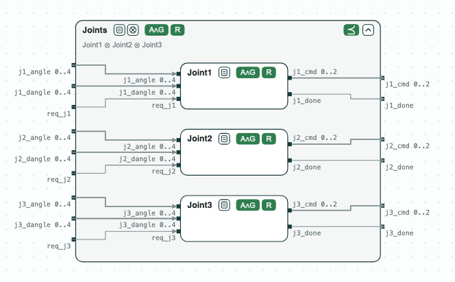
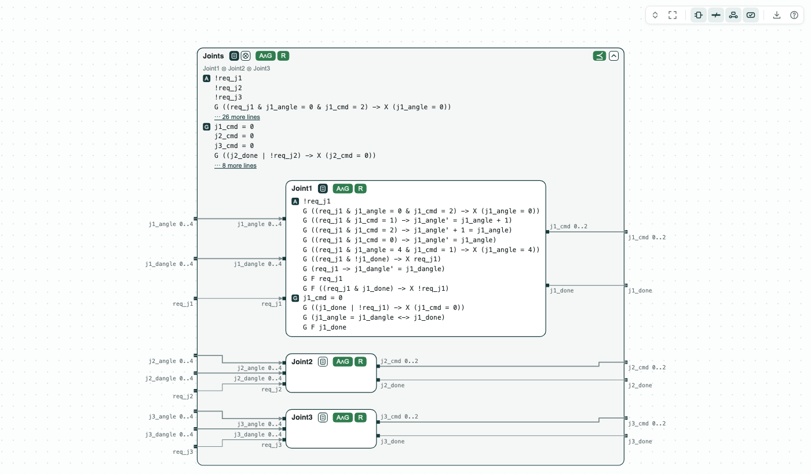

## Robotic arm at CPS-IoT Week 2022: the demo as it was shown

**The question.** Do three joint contracts, composed, refine the contract
of a robotic arm, and can a controller be synthesized for each joint
alone? This is the demo shown at CPS-IoT Week 2022. The contracts are the
same as in `../RoboticJoints`, which has the full page, the Python script
for N joints (`scaling.py`), and the scripts updated to run anywhere.

**What it shows.**
- Composition and refinement (nuXmv): Joint1 ⊗ Joint2 ⊗ Joint3 refines
  _Joints_, the contract of the arm (the two formulas true, 2 s).
- Realizability (slugs, GR(1)): each joint contract and the contract of
  the arm are realizable.
- Synthesis: one controller per joint (72 states each, with the scripts of
  `../RoboticJoints`).

<p align="center">
  
  <br>
  <em>The three joints inside the contract of the arm: for each, the assumptions and the guarantees can hold together (A∧G), and it is realizable (R); together they refine Joints (⪯).</em>
</p>

### The steps

**Step 1. The joints refine the arm.** `verification.chase` composes the
three joints and writes the refinement check against _Joints_; nuXmv
proves both formulas (assumptions and guarantees).

<p align="center">
  
  <br>
  <em>Step 1: Joint1 and Joints open: what one joint and the arm assume and guarantee.</em>
</p>

**Step 2. A controller for each joint.** `synthesis.chase` writes one
file for slugs per joint, and slugs synthesizes the controller of each.

**Step 3. One controller for the whole arm.** `singlemodel.chase` writes
the contract of the arm alone for slugs, to compare with step 2: the arm
is realizable, but its explicit controller has at least 375,000 states,
against 72 for each joint.

The steps, the results, and the time for N joints are on the page of
`../RoboticJoints/RoboticJoints.md`.

### Content of the directory
The directory of the demo contains:
- `specs.ltl`: the contracts of the three joints and of the arm;
- `single_model.ltl`: the contract of the arm alone;
- `specs.results.json`, `single_model.results.json`: the results kept by
  `chase-cps view --check`;
- `verification.chase`, `synthesis.chase`, `singlemodel.chase`,
  `script.chase`: commands of the console;
- `compositional_demo.sh`, `single_model_demo.sh`: the scripts as shown in
  2022. They write in `workdir/` and call the compiler of slugs at
  `/home/lora/third_party/slugs`; on another machine the refinement check
  runs, but the compiler is not found and slugs reads empty files. The
  scripts of `../RoboticJoints` take the working directory as a parameter
  and use `$SLUGSCOMPILER`;
- `diagram.sh`: draws `out/specs.html` with `chase-cps view`;
- `out/specs.html`: the diagrams above, written by `diagram.sh`.

### Run it

```
pip install chase-cps                       # version 0.5.0 or later
chase-cps install nuxmv --accept-license
chase-cps install slugs
sh diagram.sh
```

Console. To run the console flow, use the scripts of `../RoboticJoints`
(same contracts and commands):

```
$> cd ../RoboticJoints
$> sh compositional_demo.sh /tmp/joints
$> sh singlemodel_demo.sh /tmp/joints
```
