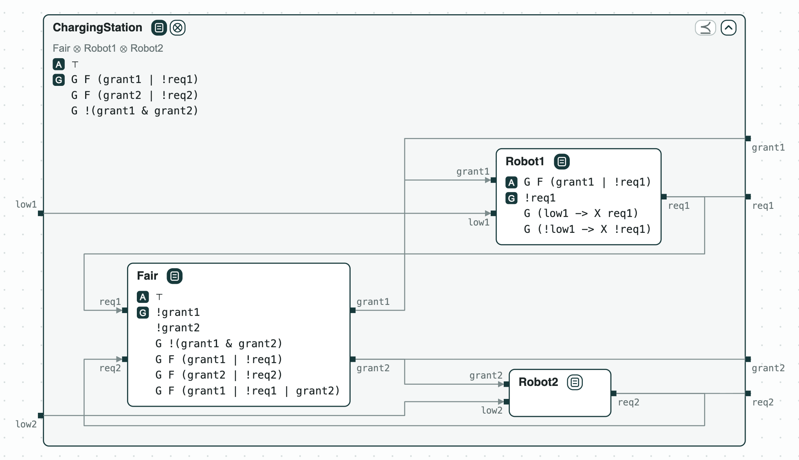

## Robot charging station: refinement does not see the conflict, realizability does

**The system.** Two robots share one charging station, and an arbiter
decides who charges. This is a teaching example, made for these pages;
its requirements are numbered in `requirements.txt`. Robot _i_ asks for
the station (`req_i`) when its battery is low (`low_i`), and assumes
that it gets it (`grant_i`), or stops asking, infinitely often. The
arbiter reads the requests and sets the grants; it must never give the
station to both robots, `G !(grant1 & grant2)`. The contracts are in
LTL over Booleans, in the GR(1) form of the synthesis tool slugs, so
CHASE can ask whether a controller can be built from a contract
(realizable) and build it. _ChargingStation_ is the contract of
the whole system.

**The question.** Five candidate arbiters are written: _Greedy_,
_Fair_, _Pushy_, _Polite_, and _Trusting_. Four of them are flawed in a
different way. Which check catches which flaw, and which arbiter works
with the robots?

<p align="center">
  
  <br>
  <em>The system: an arbiter (here Fair) between the two robots, inside ChargingStation.</em>
</p>

### The steps

**Step 1. Greedy: unrealizable, yet it refines.** _Greedy_ grants each
request at the next step, `G (req1 -> X grant1)` and the same for robot
2. When both robots ask at once it cannot serve both without breaking
`G !(grant1 & grant2)`: it is unrealizable, no arbiter can do it. The
unrealizable core, the smallest set of guarantees in conflict, is these
three formulas. Yet _Greedy_ with the robots refines _ChargingStation_
(the script checks it; not drawn):
refinement only compares formulas (every behavior allowed by the parts
is allowed by the system) and does not ask whether a part can exist.

<p align="center">
  
  <br>
  <em>Step 1: the core of Greedy in red.</em>
</p>

**Step 2. Fair: realizable.** _Fair_ gives the station to each robot, or
the robot stops asking, infinitely often, `G F (grant1 | !req1)` and the
same for robot 2. It is realizable, and slugs builds a controller of 18
states. It is not vacuous: it cannot meet its guarantees without setting
its outputs (¬V). `remove_redundant` removes its last guarantee,
`G F (grant1 | !req1 | grant2)`, implied by the first one.

<p align="center">
  
  <br>
  <em>Step 2: Fair is realizable (R) and not vacuous (¬V); remove_redundant removes its last guarantee.</em>
</p>

**Step 3. Realizable for a bad reason.** _Pushy_ assumes that robot 1
asks infinitely often, `G F req1`, but never right after a grant,
`G (grant1 -> X !req1)`. By granting robot 1 at every step, the arbiter
makes the robot break the first assumption, and then owes nothing. A
contract is well-separated (WS) when the component cannot win this way;
_Pushy_ is not, and the core is the two assumptions. _Polite_, which
assumes `G ((req1 & grant1) -> X !req1)` instead, is well-separated (not
in the picture).

<p align="center">
  
  <br>
  <em>Step 3: Pushy is not well-separated; the core is its two assumptions.</em>
</p>

**Step 4. An arbiter that never grants.** _Trusting_ is _Fair_ with two
more assumptions, `G F !req1` and `G F !req2`: each robot stops asking
infinitely often. Its guarantees then hold with no grant at all: it is
vacuous. The core is the two assumptions and the guarantees they make
true.

<p align="center">
  
  <br>
  <em>Step 4: Trusting is vacuous (¬V red).</em>
</p>

**Step 5. The arbiter with the robots.** _Fair_ and the robots feed each
other. Composed with discharge (an assumption of one part that another
part guarantees is dropped), they leave no assumption, and refine
_ChargingStation_. The ⊗ button of _ChargingStation_ shows the
composition: its assumption is ⊤ (true), and its 11 guarantees are those
of the parts (_Fair_ without its redundant guarantee).

<p align="center">
  
  <br>
  <em>Step 5: the composition, with no assumption left, refines ChargingStation (⪯).</em>
</p>

Each check of steps 1 to 4 is one call; by hand, each flaw means
reasoning about every strategy of the robots. The checks are in [GR(1) synthesis](https://chase-cps.github.io/tools/synthesis/),
the tags of the pictures in
[Diagrams](https://chase-cps.github.io/interfaces/diagrams/#what-is-drawn).

### Run it

```
pip install chase-cps
chase-cps install nuxmv --accept-license
chase-cps install slugs
python charger.py --expect
```

### Content of the directory
- `requirements.txt`: the requirements, numbered;
- `charger.ltl`: the robots, four arbiters, and the system, numbered
  (_Trusting_ is built in `charger.py`);
- `charger.results.json`: the results of `chase-cps view --check`;
- `charger.chase`: steps 1, 2, and 5 with `logics_tool`;
- `charger.py`: the steps with the CHASE Python package;
- `out/charger.html`: the diagrams above, written by `charger.py`;
  `out/charger-system.html`: the system, with no check.
