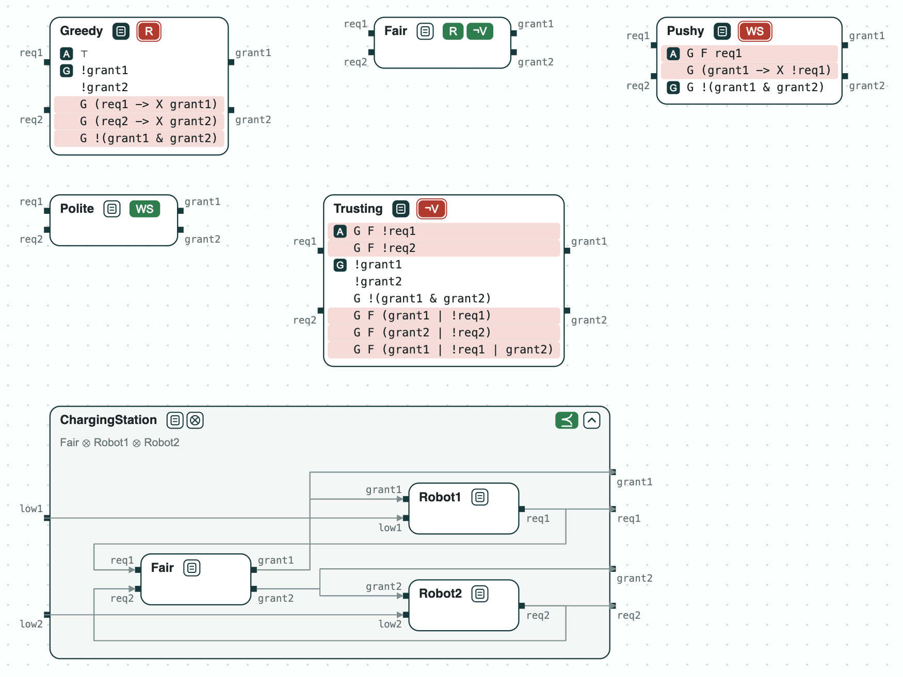
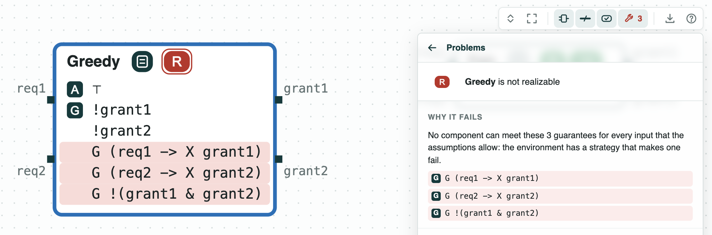
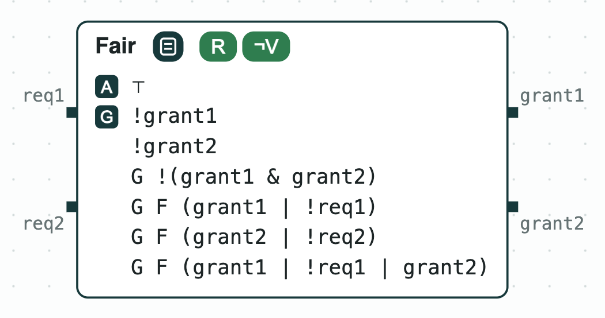
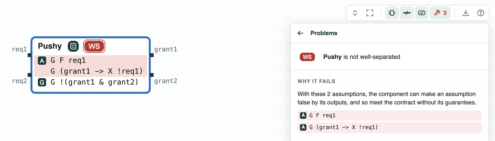
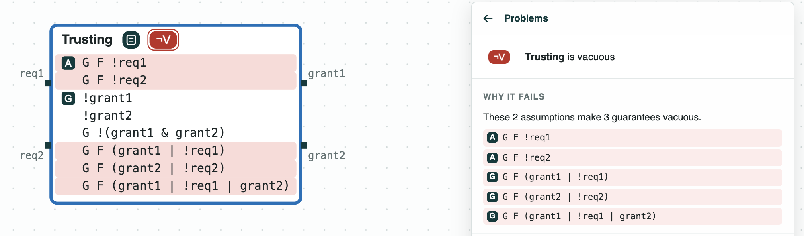
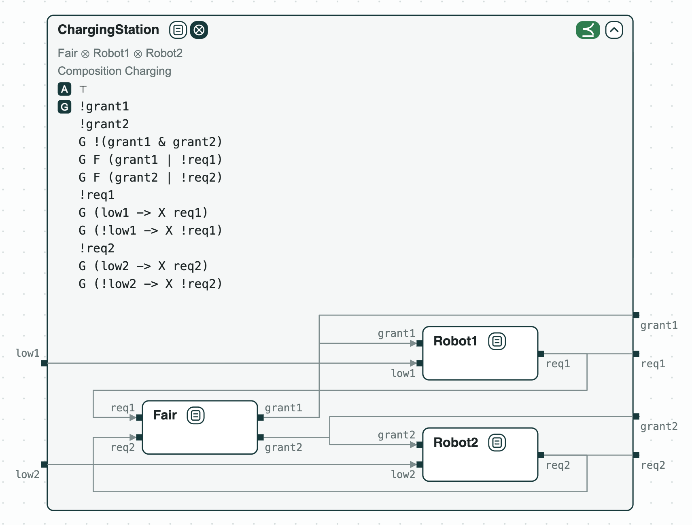

## Charging station: five arbiters, and the check that catches each

**The question.** Two robots share a charging station through an arbiter.
The first contracts written for the arbiter look reasonable, but each has a
problem. Which check of CHASE catches which problem, and which arbiter works
with the robots?

**What it shows.**
- Realizability (slugs, GR(1)): _Greedy_ is unrealizable (0.3 s); the
  unrealizable core is 3 of its 5 guarantees (R5, R6.1, R6.2).
- Synthesis: _Fair_ is realizable, and slugs synthesizes a controller of 18
  states.
- Well-separation: _Pushy_ is realizable only because it can make the
  robots break its assumptions; the core is its two assumptions (A2, A3).
  _Polite_ fixes it.
- Vacuity: _Trusting_ wins without ever giving the station, by its
  assumptions alone; _Fair_ is not vacuous.
- Redundancy: one guarantee of _Fair_ (R8) is implied by R7.1, and is
  removed while _Fair_ stays realizable.
- Composition with discharge and refinement (nuXmv): the arbiter and the
  robots, which feed each other, refine _System_ with no assumption left
  (0.6 s).
- The whole script runs in about 2 s.

<p align="center">
  
  <br>
  <em>The page of the demo: the five arbiters, and Fair with the robots inside System.</em>
</p>

The variables of each robot are:

- `low`: its battery is low;
- `req`: it asks for the station;
- `grant`: the arbiter gives it the station.

The requests of the robots are the inputs of the arbiter, and its grants
are the inputs of the robots. A robot asks when its battery is low, and
assumes that it is given the station, or stops asking, infinitely often.
Each candidate arbiter guarantees that the station is never given to both
robots (R5). The requirements are numbered as in `requirements.txt`.

### The steps

**Step 1. Greedy: unrealizable.** _Greedy_ gives the station to each robot
at the next step after its request (R6.1, R6.2). When both robots ask at
once, it cannot serve both: the unrealizable core is R5, R6.1, and R6.2.
The composition of _Greedy_ with the robots refines _System_ all the same:
refinement does not see the conflict, realizability does.

<p align="center">
  
  <br>
  <em>Step 1: Greedy is unrealizable; the terms of the core are red.</em>
</p>

**Step 2. Fair: realizable.** _Fair_ gives the station to each robot, or
the robot stops asking, infinitely often (R7.1, R7.2), and assumes
nothing. It is realizable, and slugs synthesizes a controller of 18 states.
Its guarantee R8 is implied by R7.1 and is removed (`remove_redundant`,
which keeps realizability).

<p align="center">
  
  <br>
  <em>Step 2: Fair is realizable (R) and not vacuous (¬V).</em>
</p>

**Step 3. Realizable for a bad reason.** _Pushy_ assumes that robot 1 asks
infinitely often (A2), and does not ask at the step after it is given the
station (A3). The arbiter can then give the station to robot 1 at every
step, even when it does not ask: by A3 robot 1 never asks again, A2 is
broken, and the contract holds because an assumption fails. A contract
is well separated when the arbiter cannot win by making the environment
break its assumptions; _Pushy_ is not, with A2 and A3 as the core.
_Polite_ assumes A4 instead of A3 (after a grant it asked for, robot 1 does
not ask at the next step), and is well separated.

<p align="center">
  
  <br>
  <em>Step 3: Pushy is not well separated (the core: A2, A3); Polite is.</em>
</p>

**Step 4. An arbiter that never grants.** _Trusting_ assumes that each robot
stops asking infinitely often (`G F !req1`, `G F !req2`). Its guarantees
then hold without any grant: it is vacuous, since it can win without
setting its outputs. The script finds that `grant1` is not needed (a
controller of 13 states never sets it) because of `G F !req1`, and `grant2`
because of `G F !req2`. The core drawn is the two assumptions and the three
guarantees they make true. _Fair_ is not vacuous.

<p align="center">
  
  <br>
  <em>Step 4: Trusting is vacuous; the terms of the core are red.</em>
</p>

**Step 5. The arbiter with the robots.** _Fair_ (without R8) and the robots
feed each other: the requests go to the arbiter, the grants to the robots.
They are composed with discharge: the guarantees of the arbiter discharge
the assumptions of the robots on the grants, and no assumption is left.
The composition (11 guarantees) refines _System_.

<p align="center">
  
  <br>
  <em>Step 5: Fair ⊗ Robot1 ⊗ Robot2 refines System (⪯ green).</em>
</p>

### Content of the directory
The directory of the demo contains:
- `requirements.txt`: the requirements, numbered;
- `charger.ltl`: the contracts of the robots (_Robot1_, _Robot2_), of five
  arbiters (_Greedy_, _Fair_, _Pushy_, _Polite_, _Trusting_), and of the system
  (_System_). The comment at the end of each line is the number of the
  requirement;
- `charger.results.json`: the results kept by `chase-cps view charger.ltl --check`;
- `charger.chase`: the commands of the console (steps 1, 2, and 5);
- `charger.py`: the steps with the CHASE Python package;
- `out/charger.html`: the diagrams above, written by `charger.py`.

### Run it

```
pip install chase-cps                       # version 0.5.0 or later
chase-cps install nuxmv --accept-license
chase-cps install slugs
python charger.py --expect
chase-cps view charger.ltl --check -o out/charger-view.html
```

The script prints the result of each step, with the cores by the numbers of
the requirements, and writes `out/charger.html`, a page to open in a
browser: a click on a name opens or closes the contract, and a click on a
red tag shows or hides its core and opens the panel of the check. With
`--expect` the script exits with code 1 when a result is not the expected
one.

Console. The console of `logics_tool` writes the files for slugs and
nuXmv (`$SLUGSCOMPILER` is `tools/StructuredSlugsParser/compiler.py` of
slugs; it is set in the Docker image of CHASE):

```
$> logics_tool -i charger.ltl -o /tmp/charger/ -c charger.chase
$> python3 $SLUGSCOMPILER /tmp/charger/greedy.structuredSlugs > /tmp/charger/greedy.slugsin
$> slugs /tmp/charger/greedy.slugsin
RESULT: Specification is unrealizable.
$> python3 $SLUGSCOMPILER /tmp/charger/fair.structuredSlugs > /tmp/charger/fair.slugsin
$> slugs /tmp/charger/fair.slugsin
RESULT: Specification is realizable.
$> nuXmv -int /tmp/charger/refinement.smv
nuXmv > go
nuXmv > build_boolean_model
nuXmv > check_ltlspec_ic3
```

The two formulas of `refinement.smv` are true: the composition of _Fair_
and the robots refines _System_.
