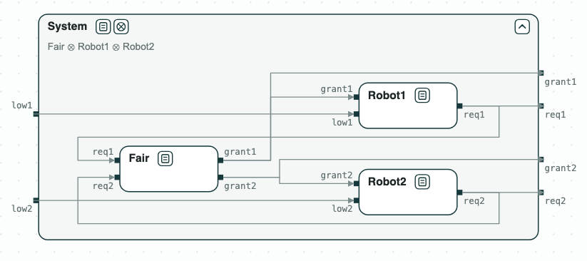
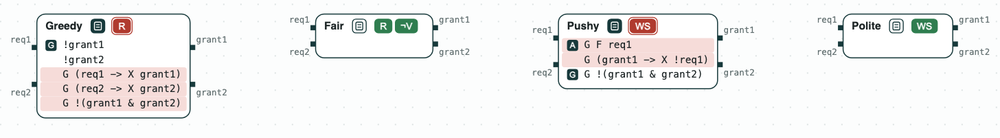
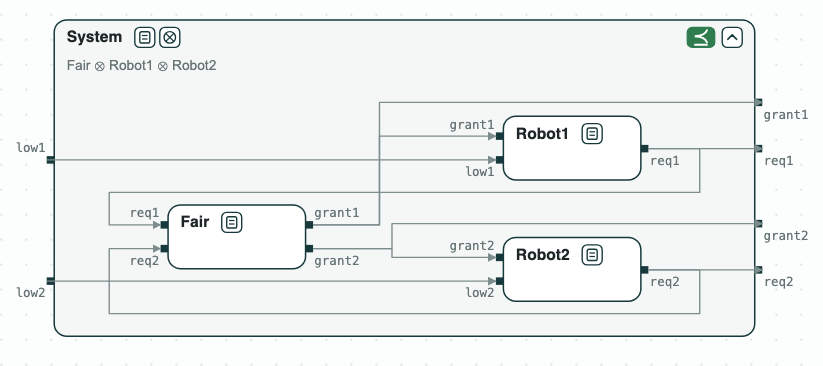
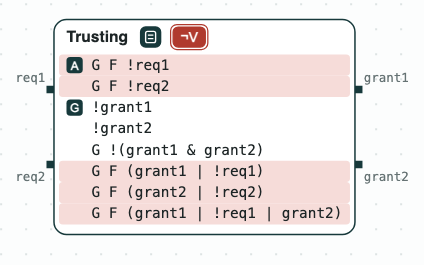

## Charging station: designing an arbiter

**The question.** Two robots share a charging station through an arbiter.
Which checks catch the problems of the first contracts of the arbiter, and
which contract works with the robots?

<p align="center">
  
  <br>
  <em>The system: an arbiter and two robots, which feed each other with requests and grants.</em>
</p>

The variables of each robot are:

- `low`: its battery is low;
- `req`: it asks for the station;
- `grant`: the arbiter gives it the station.

The requests of the robots are the inputs of the arbiter, and its grants
are the inputs of the robots. A robot asks when its battery is low, and
assumes that it is given the station, or stops asking, infinitely often.
Each candidate arbiter guarantees that the station is never given to both
robots (R5). The requirements are numbered as in
`Charger/requirements.txt`.

### The steps

**Step 1. Greedy: unrealizable.** _Greedy_ gives the station to each robot
at the next step after its request (R6.1, R6.2). When both robots ask at
once, it cannot serve both: the unrealizable core is R5, R6.1, and R6.2.

<p align="center">
  
  <br>
  <em>Step 1: Greedy is unrealizable; the core highlighted in red.</em>
</p>

**Step 2. Fair: realizable.** _Fair_ gives the station to each robot, or
the robot stops asking, infinitely often (R7.1, R7.2), and assumes
nothing. It is realizable, and slugs synthesizes a controller of 18 states.
Its guarantee R8 is implied by R7.1 and is removed.

<p align="center">
  
  <br>
  <em>Step 2: Fair is realizable.</em>
</p>

**Step 3. Realizable for a bad reason.** _Pushy_ assumes that robot 1 asks
infinitely often (A2), and does not ask at the step after it is given the
station (A3). The arbiter can then give the station to robot 1 at every
step, even when it does not ask: by A3 robot 1 never asks again, A2 is
broken, and the contract holds because an assumption fails. A contract
is well separated when the arbiter cannot win by making the environment
break its assumptions; _Pushy_ is not, with A2 and A3 as the core.
_Polite_ assumes A4 instead of A3 (after a grant it asked for, robot 1 does
not ask at the next step), and is well separated.

<p align="center">
  
  <br>
  <em>Step 3: Pushy is not well separated (the core: A2, A3); Polite is.</em>
</p>

**Step 4. An arbiter that never grants.** _Trusting_ assumes that each robot
stops asking infinitely often (`G F !req1`, `G F !req2`). Its guarantees
then hold without any grant: it is vacuous, since it can win without
setting its outputs. The core is the two assumptions and the three
guarantees they make true. _Fair_ is not vacuous.

<p align="center">
  
  <br>
  <em>Step 4: Trusting is vacuous; the core highlighted in red.</em>
</p>

**Step 5. The arbiter with the robots.** _Fair_ and the robots are composed
with discharge (the guarantees of the arbiter discharge the assumptions of
the robots), and the composition refines _System_, the diagram at the top.

### Content of the directory
The directory of the demo contains:
- `requirements.txt`: the requirements, numbered;
- `charger.ltl`: the contracts of the robots (_Robot1_, _Robot2_), of four
  arbiters (_Greedy_, _Fair_, _Pushy_, _Polite_), and of the system
  (_System_). The comment at the end of each line is the number of the
  requirement;
- `charger.chase`: the commands of the logics-based flow;
- `charger.py`: the whole iteration with the CHASE Python package;
- `out/charger.html`: the diagram, written by `charger.py`.

### Logic-based Flow

The console of the `logics_tool` writes the files for slugs and nuXmv:

`$> logics_tool -i charger.ltl -o /tmp/charger/ -c charger.chase`

First, the _Greedy_ arbiter gives the station to each robot at the next step
after its request (R6.1, R6.2), and never to both robots (R5). Its
realizability is checked with slugs (`$SLUGSCOMPILER` is the
`tools/StructuredSlugsParser/compiler.py` script of slugs; it is set in the
Docker image of CHASE):

`$> python3 $SLUGSCOMPILER /tmp/charger/greedy.structuredSlugs > /tmp/charger/greedy.slugsin`\
`$> slugs /tmp/charger/greedy.slugsin`\
`RESULT: Specification is unrealizable.`

When both robots ask for the station at once, the arbiter cannot give it to
both. Thus, the _Fair_ arbiter gives the station to each robot eventually
(R7.1, R7.2):

`$> python3 $SLUGSCOMPILER /tmp/charger/fair.structuredSlugs > /tmp/charger/fair.slugsin`\
`$> slugs /tmp/charger/fair.slugsin`\
`RESULT: Specification is realizable.`

Finally, the script composes _Fair_ with the two robots, and writes the
refinement check of the composition against _System_ in
`/tmp/charger/refinement.smv`:

`$> nuXmv -int /tmp/charger/refinement.smv`\
`nuXmv > go`\
`nuXmv > build_boolean_model`\
`nuXmv > check_ltlspec_ic3`

Both formulas are true: the composition refines _System_.

### Python Flow
The script needs the CHASE Python package, version 0.5.0, nuXmv, and
slugs. From the directory of the demo:

```
$> pip install chase-cps
$> chase-cps install nuxmv --accept-license
$> chase-cps install slugs
$> python3 charger.py
```

The script prints the result of each step and writes the diagrams above in
`out/charger.html`, a page to open in a browser: a click on a name opens
or closes the contract, and a click on a red tag shows its core. Steps 1,
2, and 5 with the console of logics_tool are in `charger.chase` (the
Logic-based Flow above).

With `--expect` the script exits with code 1 when a result is not the
expected one.
