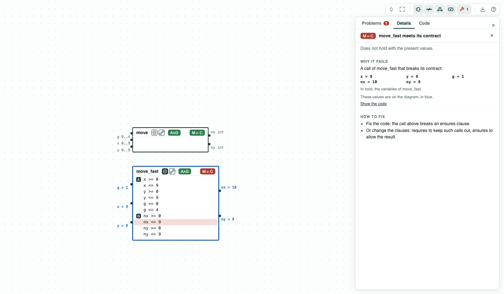
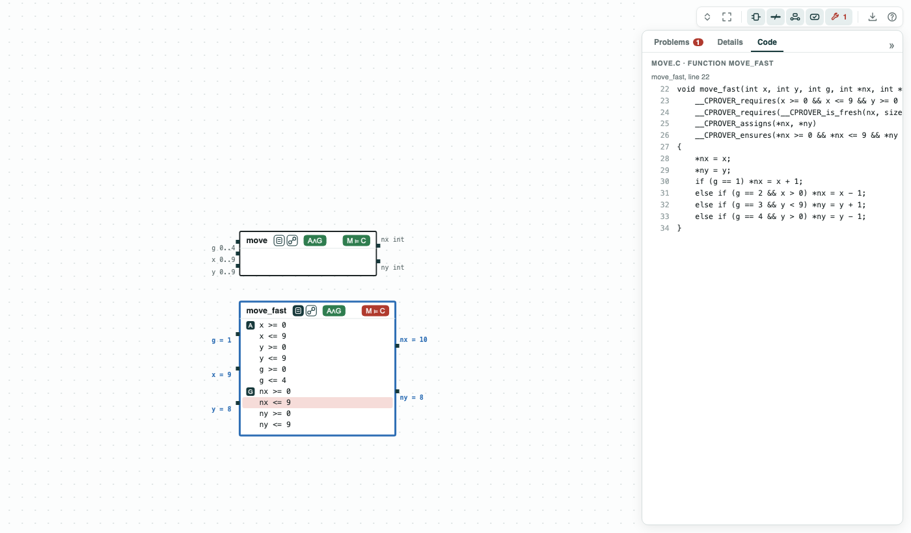
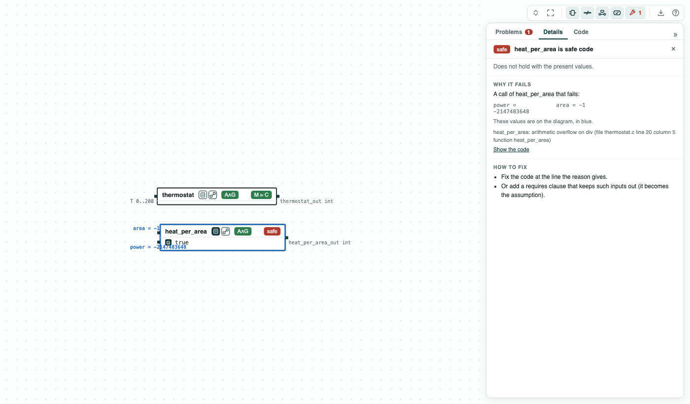

## ContractsInC: contracts written in the C file, next to the code

**The question.** ESBMC and CBMC read a contract written in the C file:
`requires` clauses (what a call may assume) and `ensures` clauses (what
the function must give back). Can CHASE read the same file, draw each
function as a component, and check it, without a specification file?

`chase-cps view FILE.c` reads each function of the file as a contract: the
requires clauses are its assumptions, the ensures clauses its guarantees.
The parameters are the inputs, the return value is the output
`FUNCTION_out`, and a pointer parameter `*p` is the output `p`. The ranges
of the inputs come from their C types, narrowed by the bounds the requires
clauses give (`T >= 0 && T <= 200` gives `T` in 0..200). The function is
the implementation of its contract, checked with ESBMC (or CBMC). A
function with no clause is checked alone: no overflow, division by zero,
access out of bounds, or failed assert (the tag `safe`).

- `thermostat.c`, with the clauses of ESBMC (`__ESBMC_requires`,
  `__ESBMC_ensures`, `__ESBMC_return_value` in the body): the thermostat of
  Heater for one call, and `heat_per_area`, with no clause;
- `move.c`, with the clauses of CBMC (`__CPROVER_requires`,
  `__CPROVER_ensures`, between the signature and the body): the move of a
  drone of DroneGrid, and `move_fast`, the same move without the test at
  the edge of the grid.

Each tool reads only its own clauses, so a file has the clauses of one of
them. CHASE reads both; it checks the function with the clauses taken out
of the code. The clauses on pointers (`__CPROVER_is_fresh`,
`__CPROVER_assigns`) are not part of the contract: the program CHASE
writes passes a valid pointer for each output.

### The steps

**Step 1.** `thermostat` heats (returns 3) while `T < 74`, and returns 0
from 74. It meets its contract. ESBMC on the file alone gives the same
answer (`esbmc thermostat.c --function thermostat --enforce-contract
thermostat`), and with 76 in the clauses both say that it fails.

**Step 2.** `heat_per_area` has no clause, so its code alone is checked.
It fails: `power / area` overflows for `power = -2147483648` and
`area = -1` (the quotient, 2147483648, is not an int), and `area = 0`
divides by zero. ESBMC gives the first one it finds; the reason gives the
line.

**Step 3.** `move` keeps the drone on the 10 x 10 grid and moves it right
when asked, unless it is at the edge. It meets its contract.

**Step 4.** `move_fast` has no test at the edge. It does not meet its
contract: from `x = 9`, the move `g = 1` gives `nx = 10`. The term it
breaks, `nx <= 9`, is red in the box, and the values are on the ports.

<p align="center">
  
  <br>
  <em>move.c: <code>move</code> meets its contract; <code>move_fast</code> does not (x = 9, g = 1 gives nx = 10, the term nx &lt;= 9 in red).</em>
</p>

<p align="center">
  
  <br>
  <em>The Code tab: the function as written, with its clauses.</em>
</p>

<p align="center">
  
  <br>
  <em>thermostat.c: <code>heat_per_area</code> has no clause; its code alone fails (the tag <code>safe</code>).</em>
</p>

### What CHASE reads in a clause

The operators of C on numbers and Booleans: `&& || ! == != < <= > >= + -
* /`, and `*p` for an output passed by pointer. A conditional (`a ? b :
c`) is not read: write it as `(!a || b) && (a || c)`. The clauses are
about one call; a contract over time (a function called once per step) is
written in a specification file, as in Heater.

### Content of the directory
The directory of the demo contains:
- `thermostat.c`, `move.c`: the functions, with their clauses;
- `contractsinc.py`: the steps with the CHASE Python package;
- `thermostat.results.json`, `move.results.json`: the results of
  `chase-cps view FILE.c --check`;
- `out/thermostat.html`, `out/move.html`: the diagrams above, written by
  `contractsinc.py`.

### Run it

```
pip install "chase-cps[z3]"      # and ESBMC or CBMC
python contractsinc.py --expect
chase-cps view move.c --check -o out/move-view.html
```

In VS Code, open `move.c` and press the CHASE button: each function is a
box. The cursor in a function selects its box, and a double click on a
box goes to its function.
