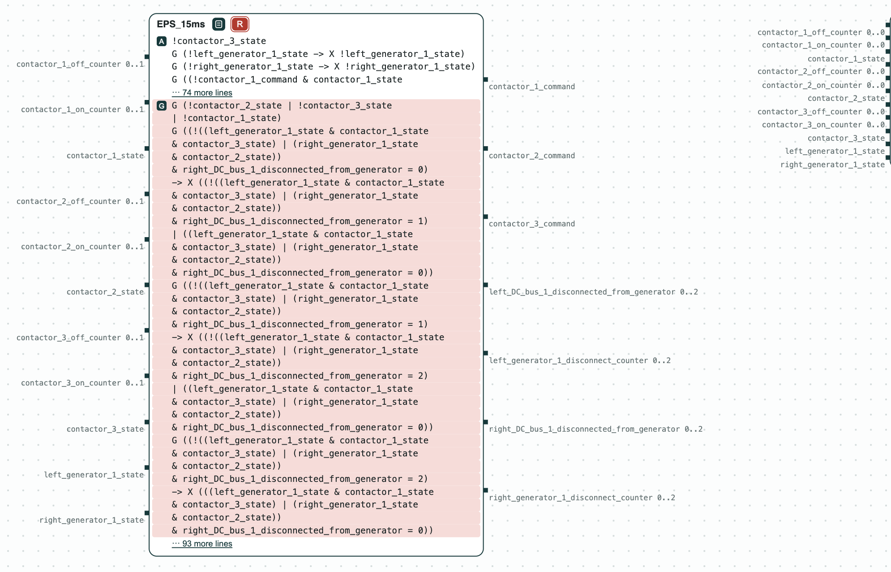

## Aircraft power system: the bounds as written conflict, relaxed they are realizable

**The question.** Can the contactors be switched so that no DC bus stays
without power too long when a generator fails? If not, which requirements
are in conflict?

**The result.**
- As written, the requirements give a GR(1) contract for the controller of
  the contactors (11 inputs, 7 outputs, 30 assumptions, 28 guarantees); it
  is unrealizable.
- The unrealizable core (the smallest set of guarantees in conflict) is 4
  of the 28 guarantees: the generators are never connected in parallel, and
  one DC bus is never without power for more than 15 ms.
- With 20 ms to disconnect a failed generator and 30 ms for a DC bus, the
  contract is realizable, and slugs synthesizes a controller of 97 states.

<p align="center">
  
  <br>
  <em>The two versions of the requirements: as written (R red, the core in red) and relaxed (R green).</em>
</p>

The system is that of Nuzzo et al., "CHASE: Contract-based requirement
engineering for cyber-physical system design" (DATE 2018). A left and a
right generator (`LG1`, `RG1`) feed an AC bus, a rectifier, a DC bus, and a
load on each side. Contactors 1 and 2 connect each generator to its AC bus,
contactor 3 the two AC buses. A contactor switches in 10 ms or
less, and at most one generator fails. The times become counters: one
step is the greatest common divisor of the times, 5 ms as written and 10 ms
relaxed.

### The steps

**Step 1. The requirements as written.** The contract of
`template_0_unrealizable.txt` is unrealizable, and the core is 4 of the 28
guarantees: contactors 1, 2, and 3 are never all closed, and the three
terms of the counter of one DC bus allow it at most 15 ms without power.
When a generator fails, its DC bus can be fed again only through contactor
3, after the contactor of that generator opens: two switchings of up to 10
ms each, more than 15 ms.

<p align="center">
  
  <br>
  <em>Step 1: the requirements as written are unrealizable; the terms of the core are red.</em>
</p>

**Step 2. The relaxed requirements.** `template_0_realizable.txt` changes
two lines: 20 ms to disconnect a failed generator, 30 ms for a DC bus.
The contract (24 assumptions, 26
guarantees) is realizable, and with `solution.sh` slugs synthesizes a
controller of 97 states.

<p align="center">
  
  <br>
  <em>Step 2: the relaxed requirements are realizable (R).</em>
</p>

The same language describes a [factory](../FDL2024/FDL2024.md).

### Run it

```
pip install chase-cps
chase-cps install slugs
python eps.py --expect
```

`sh solution.sh /tmp/eps` runs both versions with `dsl_tool` and slugs.

### Content of the directory
- `requirements.txt`: the requirements and the assumptions, in English;
- `template_0_unrealizable.txt`, `template_0_realizable.txt`: the system
  in the language of CHASE, as written and relaxed;
- `eps.py`: the steps with the CHASE Python package;
- `solution.sh`: the steps with `dsl_tool` and slugs;
- `out/eps.html`: the diagrams above.
