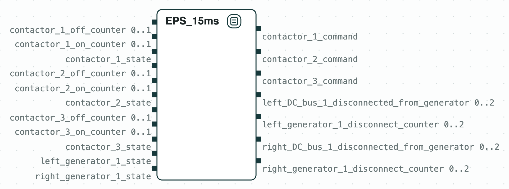
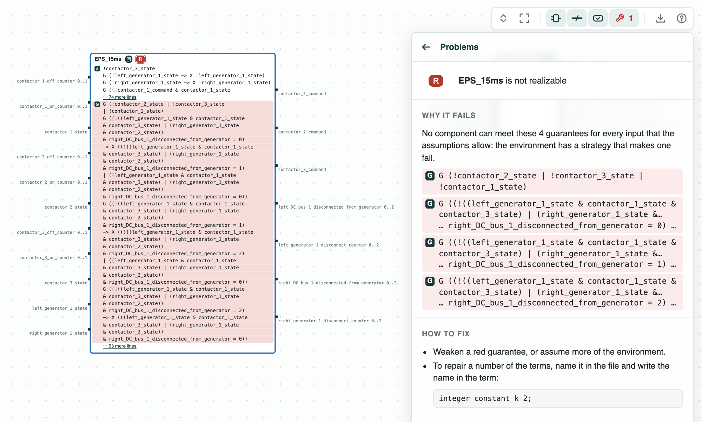
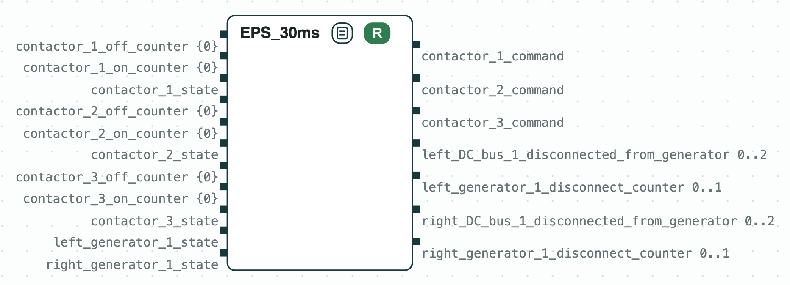

## Aircraft power system: the bounds as written conflict, relaxed they are realizable

**The system.** The electric power system of an aircraft, from Nuzzo et
al., "CHASE: Contract-based requirement engineering for cyber-physical
system design" (DATE 2018). A left and a right generator each feed an AC
bus, a rectifier, a DC bus, and a load. Contactors (switches) connect each
generator to its AC bus (contactors 1 and 2), and the two AC buses to each
other (contactor 3). A controller opens and closes the contactors. The
system and its requirements are written in the language of CHASE for
power systems (read by `load_dsl`), which turns them into a GR(1)
contract for the controller, _EPS_15ms_ (GR(1) is the fragment of LTL
that a synthesis tool such as slugs solves). The contract reads the
states of the generators and of the contactors and the switching counters
of the contactors; it writes the commands of the contactors and the
counters of the time without power (of a DC bus, and of a failed
generator still connected). It assumes that a contactor switches in 10 ms
or less and that at most one generator fails, and guarantees, among
others, that the generators never run in parallel and that no DC bus
stays without power more than 15 ms. Times become counters: a step is
5 ms.

**The question.** Can the contactors be switched so that the
requirements hold whatever fails? If not, which requirements are in
conflict? The answer tells the system engineers which bound to renegotiate
before anyone designs the controller.

<p align="center">
  
  <br>
  <em>The system: the controller of the contactors, with its inputs and outputs.</em>
</p>

### The steps

The tags on the boxes give the results of the checks: green holds, red
fails; [Diagrams](https://chase-cps.github.io/interfaces/diagrams/) says
how to read them.

**Step 1. The requirements as written.** The contract (11 inputs, 7
outputs, 30 assumptions, 28 guarantees) is not
[realizable](https://chase-cps.github.io/tools/synthesis/#realizability-and-synthesis):
no controller meets it whatever the generators do. CHASE finds the
[unrealizable core](https://chase-cps.github.io/tools/synthesis/#unrealizable-cores),
4 of the 28 guarantees: contactors 1, 2, and 3 are never all closed, and
the three terms of the counter of the right DC bus allow it at most
15 ms without power. When a generator fails, its DC bus can be fed again
only through contactor 3, after the contactor of that generator opens: two
switchings of up to 10 ms each, more than 15 ms. The panel suggests to
name a number of the terms as a constant; here the bounds are written in
the requirements, and they are changed in `template_0_*.txt` (step 2).

<p align="center">
  
  <br>
  <em>Step 1: the requirements as written are unrealizable; the terms of the core are red.</em>
</p>

**Step 2. The relaxed requirements.** `template_0_realizable.txt` changes
two lines: 20 ms to disconnect a failed generator, 30 ms for a DC bus (a
step is then 10 ms). With a step of 10 ms a contactor switches within one
step, so its counters are always 0 (the range {0} on the ports). The
contract (24 assumptions, 26 guarantees) is realizable, and slugs
synthesizes a controller of 97 states from it.

<p align="center">
  
  <br>
  <em>Step 2: the relaxed requirements are realizable (R).</em>
</p>

The same language describes a [factory](../FDL2024/FDL2024.md).

### Run it

```
pip install chase-cps
chase-cps install slugs
python eps.py --expect
```

`sh solution.sh /tmp/eps` runs both versions with `dsl_tool` and slugs.

### Content of the directory
- `requirements.txt`: the requirements and the assumptions, in English;
- `template_0_unrealizable.txt`, `template_0_realizable.txt`: the system
  in the language of CHASE, as written and relaxed;
- `eps.py`: the steps with the CHASE Python package;
- `solution.sh`: the steps with `dsl_tool` and slugs;
- `out/eps.html`: the diagrams of the steps, and `out/eps-system.html`:
  the controller alone.
