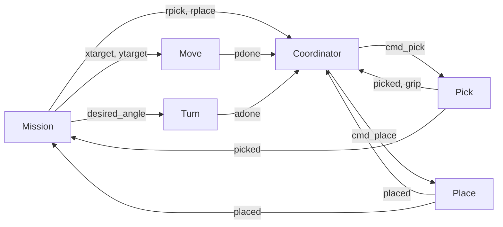

## Pick-and-place arm: the mission refines the target, and the coordinator is synthesized

**The system.** A robotic arm picks a piece, turns, and places it at a
target position. The example is the second part of a tutorial at the
DATE 2021 University Booth; the first part is the
[aircraft power system](../DATE18/DATE18.md). `specs/robotic_arm.ltl`
has seven contracts in LTL over Booleans and small integers:

- _Target_, the requirement: request a pick (`rpick`) until the piece
  is picked, then a place (`rplace`);
- _Mission_, the design of the mission planner: the same requests, and
  also the target position (`xtarget`, `ytarget`) and the angle
  (`desired_angle`) for each phase;
- _Coordinator_: commands the pick and the place (`cmd_pick`,
  `cmd_place`) once the arm is in position and turned;
- _Move_, _Turn_, _Pick_, _Place_: the four actions of the arm, which
  report `pdone`, `adone`, `picked`, `placed`.

nuXmv checks the contracts and slugs synthesizes controllers. The steps
use the console of `logics_tool`, the command-line tool of CHASE.

**The question.** Does the mission meet the requirement? Do the seven
contracts fit together, that is, can their assumptions and guarantees all
hold? And can the coordinator be built from its contract? These are the
checks to run before writing any code for the arm.


_The system: the mission planner, the coordinator, and the four actions, with the signals between them._

### The steps

**Step 1. The mission refines the target.** _Mission_ refines _Target_:
it assumes no more and guarantees at least as much, for every behavior.
The console runs the commands of `solution.script` and writes the checks
for nuXmv, which finds both formulas true:

```
$> logics_tool -i specs/robotic_arm.ltl -o /tmp/ -c solution.script
$> nuXmv /tmp/MT.smv
```

<p align="center">
  
  <br>
  <em>Step 1: Mission refines Target (⪯ green).</em>
</p>

**Step 2. The other direction.** The reverse check shows that _Mission_
says more than _Target_, so the design is a true refinement and not a
copy of the requirement: _Target_ does not refine _Mission_. In
`/tmp/TM.smv` the formula of the guarantees is false. In the
counterexample the piece is picked at step 1, and at step 2 `xtarget`,
`ytarget`, and `desired_angle` are still 0: _Target_ says nothing about
them.

<p align="center">
  
  <br>
  <em>Step 2: Target does not refine Mission; the counterexample at step 2.</em>
</p>

**Step 3. The whole system.** `compose` builds the system of the seven
contracts, and `verify` writes the negation of its assumptions, of its
guarantees, and of both. `nuXmv -bmc /tmp/system.smv` finds a run for
each: the system is compatible (some environment meets its assumptions)
and consistent (the parts can meet their guarantees).

**Step 4. The coordinator.** `synthesize Coordinator coordinator slugs`
writes the coordinator for slugs, which finds it realizable (a
controller exists for every behavior of the arm and the mission) and
synthesizes one of 128 states. By hand this controller would be written
and then tested; here it comes from its contract.

The tags of the pictures are explained on the page
[Diagrams](https://chase-cps.github.io/interfaces/diagrams/#what-is-drawn).

### Run it

```
pip install chase-cps
chase-cps install nuxmv --accept-license
chase-cps install slugs
sh diagram.sh
```

### Content of the directory
- `specs/robotic_arm.ltl`: the seven contracts;
- `specs/requirements_1.txt`, `specs/template_0_*.txt`: the power system;
- `solution.script`: the commands of the console;
- `diagram.sh`: draws `out/robotic_arm.html`, the diagrams above.
