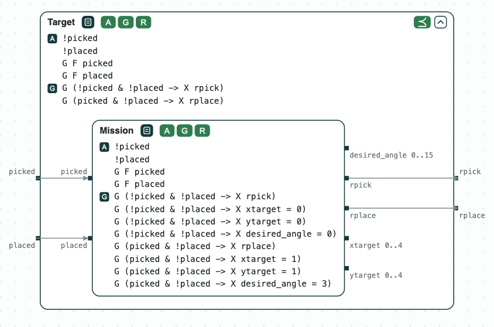
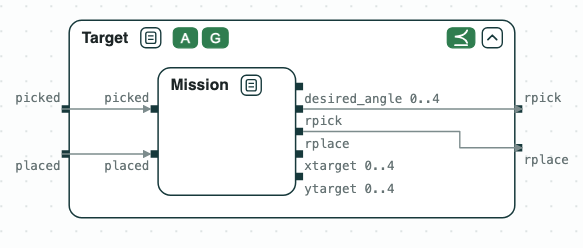
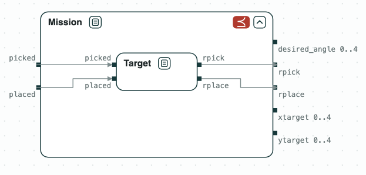

## IEEE/ACM Design Automation and Test in Europe 2021 - University Booth

This demo has been originally presented at the University Booth of the IEEE/ACM
Design Automation and Test in Europe 2021. The demo is meant to guide the user 
in using the two main modes of use provided by CHASE, _i.e._, using the Domain
Specific Language (DSL) provided with the framework, or using the Logic-based
language available in CHASE.

### Content of the directory
The directory of the demo contains:
- `specs/`: the specification files to be used during the demo;
- `solution.script`: the commands of the logics-based flow.

### DSL-based Flow

The first part of the demo is based on the DSL proposed in [1]. The objective
is to realize a controller for a system starting from a set of requirements.
The system is the Electrical Power System (EPS) described in [1]. 

The requirements of the system are the following:
#### Requirements
- If possible, left DC buses shall be powered by left generators
- Failed generators must be disconnected within 15 ms
- Generators shall never connect in parallel through AC buses
- A DC bus shall never be unpowered for more than 15 ms

#### Assumptions
- When a contactor receives an open signal, it opens in 10ms or less
- When a contactor receives an close signal, it closes in 10ms or less
- Generators do not recover from failures
- AC buses do not fail
- Rectifiers do not fail
- DC buses do not fail
- Loads do not fail
- At most 1 generator may fail

The requirements are expressed using the DSL in
`specs/template_0_unrealizable.txt`.

The first step, is to formalize the requirements by using CHASE:

`$> dsl_tool -i specs/template_0_unrealizable.txt -o /tmp/template_0`

The command writes `/tmp/template_0.structuredSlugs`, the specification for
slugs. Then, verify the realizability of the specifications, using slugs.
Slugs reads its own input format, so the file is first translated with the
compiler distributed with slugs (`$SLUGS` is the directory of slugs; with
`chase-cps install slugs`, it is under `~/.chase`):

`$> python3 $SLUGS/tools/StructuredSlugsParser/compiler.py /tmp/template_0.structuredSlugs > /tmp/template_0.slugsin`\
`$> slugs /tmp/template_0.slugsin`\
`RESULT: Specification is unrealizable.`

However, the requirements are not realizable. Thus, replace the second and
fourth requirements with the following:
- Failed generators must be disconnected within 20 ms
- A DC bus shall never be unpowered for more than 30 ms

The file `specs/template_0_synthesizable.txt` specifies these requirements.
Thus, first let's verify its realizability and try to synthesize it:

`$> dsl_tool -i specs/template_0_synthesizable.txt -o /tmp/template_0`\
`$> python3 $SLUGS/tools/StructuredSlugsParser/compiler.py /tmp/template_0.structuredSlugs > /tmp/template_0.slugsin`\
`$> slugs /tmp/template_0.slugsin`\
`RESULT: Specification is realizable.`\
`$> slugs --explicitStrategy --jsonOutput /tmp/template_0.slugsin > /tmp/template_0.json`

The last command writes the Mealy Machine implementing the control strategy
for the system (in JSON).

The same checks can be run with the CHASE Python package, which calls slugs
itself:

`$> python3 -c "from chase_cps import load_dsl, is_realizable; print(is_realizable(load_dsl('specs/template_0_unrealizable.txt')).status)"`\
`unrealizable`

### Logic-based Flow

The second part of the demo is based on the logic-based language of CHASE. In
particular, it is based on a set of contracts expressed in LTL. 
The system being modeled is a robotic arm, which has to pick, turn and place
a piece of material.

The formalization is provided in `specs/robotic_arm.ltl`.
The specification is manipulated using the `logics_tool`:

`logics_tool -i specs/robotic_arm.ltl -o /tmp/`

The command will open the front-end console, which provides a set of commands
that can be seen by using the `help` command.

First, let's read the system specification:

`$> show`

The system is described by seven contracts:
- _Target_: requirements of the mission; 
- _Mission_: modeling the actions to be completed by the robot;
- _Coordinator_: modeling the controller of the system;
- _Move_: modeling the move action;
- _Turn_: modeling the turn action;
- _Pick_: modeling the pick action;
- _Place_: modeling the place action.

The console, allows to verify whether the _Target_ contract refines _Mission_,
or viceversa. To do this:

`$> refinement Target Mission TM.smv`\
`$> refinement Mission Target MT.smv`\
`$> exit`

Once back to the system console:

`$> nuXmv /tmp/TM.smv`

The second formula is false, then _Target_ does not refine _Mission_.

Then:

`$> nuXmv /tmp/MT.smv`

Both formulas are true. _Mission_ refines _Target_.

Then, it is possible to compose the system to create the complete specification.
To do this, it is necessary to re-open the logics tool:

`$> logics_tool -i specs/robotic_arm.ltl -o /tmp/`

The objective is to compose the system by using the logics tool.
  
`$> compose Mission Coordinator Top`\
`$> verify Top top`\
`$> compose Move Turn MT`\
`$> compose MT Pick MTP`\
`$> compose MTP Place Bottom`\
`$> compose Top Bottom System` \
`$> synthesize Coordinator coordinator slugs`

Finally, it is possible to verify the consistency and compatibility of the
_System_ contract.

`$> verify System system`

The last command generates the `system.smv` to be used in nuXmv to verify
the consistency and the compatibility of the contract. The properties are
expected to be false, and bounded model checking (`-bmc`) finds the
counterexamples at once:

`$> exit`\
`$> nuXmv -bmc /tmp/system.smv`

For both assertions, the model checker returns a counter strategy: the
contract is consistent and compatible.

Finally, it is possible to synthesize the coordinator controller by using
slugs, from the file written by `synthesize`:

`$> python3 $SLUGS/tools/StructuredSlugsParser/compiler.py /tmp/coordinator.structuredSlugs > /tmp/coordinator.slugsin`\
`$> slugs /tmp/coordinator.slugsin`\
`RESULT: Specification is realizable.`\
`$> slugs --explicitStrategy --jsonOutput /tmp/coordinator.slugsin > /tmp/coordinator.json`

The last command writes the Finite State Machine implementing the
coordinator specification (in JSON).

The file `solution.script` is a script specifying all the commands for the
logics tool. The script will produce the files: `MT.smv`, `TM.smv`,
`top.smv`, `system.smv`, and `coordinator.structuredSlugs` in the chosen output
directory.

### Diagram
`sh diagram.sh` writes `out/robotic_arm.html`, a page to open in a browser:
_Mission_ inside _Target_ and _Target_ inside _Mission_, drawn open, with the
result of each refinement, and the whole system, _Mission_ ∥ _Coordinator_ ∥
_Move_ ∥ _Turn_ ∥ _Pick_ ∥ _Place_, with the compatibility (A), the
consistency (G), and the realizability (R) of each contract. It needs
`chase-cps` and nuXmv.

  
   
  <em>Mission refines Target: it keeps the assumptions of Target and adds the target position and the angle to its guarantees.</em>

  
   
  <em>Target does not refine Mission: it does not set the target position or the angle.</em>

  
   
  <em>The whole system: the mission and the coordinator, and the move, turn, pick, and place actions, wired by their variables.</em>

### References
[1] Nuzzo, Pierluigi, et al. _CHASE: Contract-based requirement engineering for 
cyber-physical system design._ in Proceeding of the 2018 Design, Automation and 
Test in Europe Conference & Exhibition (DATE). IEEE, 2018.
