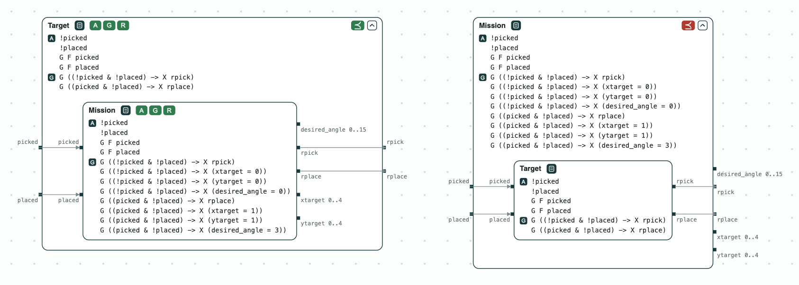
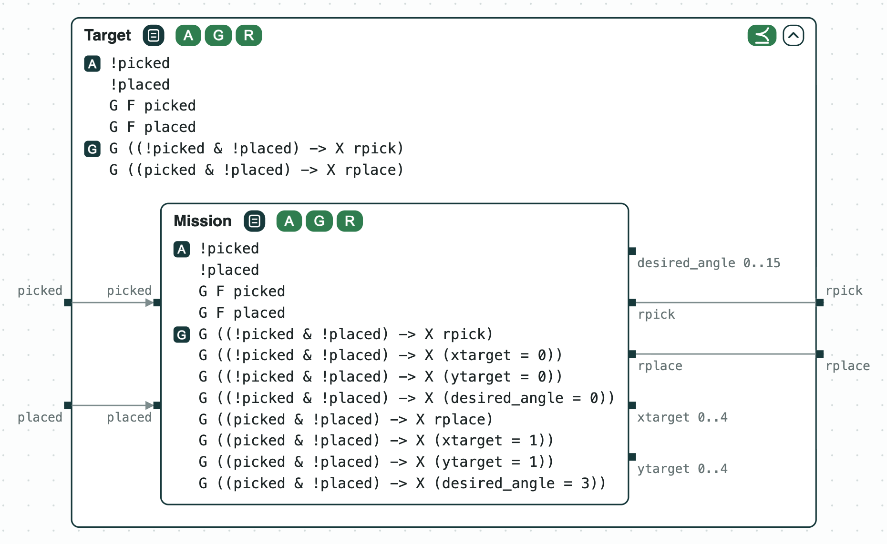
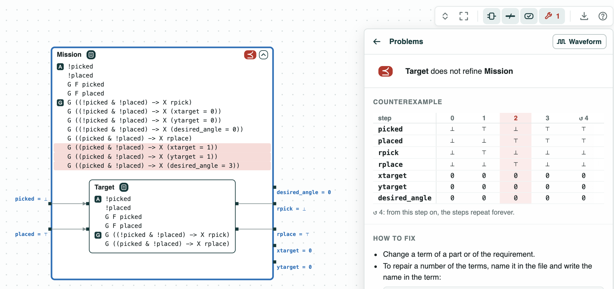
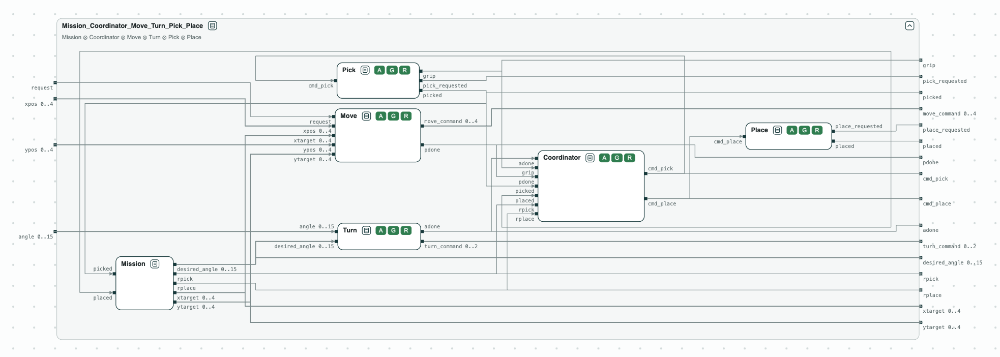

## Tutorial of DATE 2021: from requirements to a controller, with the two languages of CHASE

**The question.** How does one go from requirements to a controller with
CHASE? This hands-on tutorial was presented at the University Booth of the
IEEE/ACM Design Automation and Test in Europe 2021. It guides the user
through the two modes of use of CHASE: the domain-specific language (DSL)
of patterns, on the power system of an aircraft, and the logic language
with its console, on a robotic arm that picks, turns, and places a piece.

**What it shows.**
- The DSL (`dsl_tool`): requirements written as patterns become a GR(1)
  specification for slugs. As written they are unrealizable; relaxed, they
  are realizable, and slugs writes a controller of 97 states.
- The console of the logic language (`logics_tool`): `show`, `refinement`,
  `compose`, `verify`, and `synthesize`, one command per operation.
- Refinement (nuXmv): _Mission_ refines _Target_; _Target_ does not refine
  _Mission_, with a counterexample of five steps.
- Composition and verification: the seven contracts composed into one
  system, which is compatible and consistent (nuXmv finds a run of the
  assumptions, of the guarantees, and of both).
- Synthesis (slugs, GR(1)): the coordinator is realizable, and slugs writes
  a controller of 128 states.
- Diagrams: `diagram.sh` draws the refinements and the whole system with
  the checks of each contract (all of them in 0.7 s).

<p align="center">
  
  <br>
  <em>The page of the demo: the two refinements and the whole system, with the checks of each contract.</em>
</p>

The power system of the first part is that of Nuzzo et al., "CHASE:
Contract-based requirement engineering for cyber-physical system design"
(DATE 2018); `../DATE18` has the same system with the Python package. Its
requirements are:

- If possible, left DC buses shall be powered by left generators.
- Failed generators must be disconnected within 15 ms.
- Generators shall never connect in parallel through AC buses.
- A DC bus shall never be unpowered for more than 15 ms.

Its assumptions are:

- When a contactor receives an open signal, it opens in 10 ms or less.
- When a contactor receives a close signal, it closes in 10 ms or less.
- Generators do not recover from failures.
- AC buses, rectifiers, DC buses, and loads do not fail.
- At most 1 generator may fail.

The robotic arm of the second part is described by seven contracts in
`specs/robotic_arm.ltl`:

- _Target_: the requirements of the mission;
- _Mission_: the actions to be completed by the robot;
- _Coordinator_: the controller of the system;
- _Move_, _Turn_, _Pick_, _Place_: the four actions.

### The steps

**Step 1. The requirements in the DSL.** The requirements are expressed in
`specs/template_0_unrealizable.txt`. The first step is to formalize them
with CHASE:

`$> dsl_tool -i specs/template_0_unrealizable.txt -o /tmp/template_0`

The command writes `/tmp/template_0.structuredSlugs`, the specification for
slugs. Slugs reads its own input format, so the file is first translated
with the compiler distributed with slugs (`$SLUGS` is the directory of
slugs; with `chase-cps install slugs`, it is under `~/.chase`):

`$> python3 $SLUGS/tools/StructuredSlugsParser/compiler.py /tmp/template_0.structuredSlugs > /tmp/template_0.slugsin`\
`$> slugs /tmp/template_0.slugsin`\
`RESULT: Specification is unrealizable.`

The same check with the CHASE Python package, which calls slugs itself:

`$> python3 -c "from chase_cps import load_dsl, is_realizable; print(is_realizable(load_dsl('specs/template_0_unrealizable.txt')).status)"`\
`unrealizable`

`../DATE18` shows the unrealizable core: the pattern that never connects
the generators in parallel, and the 15 ms bound of one DC bus.

**Step 2. Relaxed requirements, and a controller.** The second and the
fourth requirements are replaced by:

- Failed generators must be disconnected within 20 ms.
- A DC bus shall never be unpowered for more than 30 ms.

The file `specs/template_0_synthesizable.txt` specifies these requirements.
Its realizability is checked, and a controller synthesized:

`$> dsl_tool -i specs/template_0_synthesizable.txt -o /tmp/template_0`\
`$> python3 $SLUGS/tools/StructuredSlugsParser/compiler.py /tmp/template_0.structuredSlugs > /tmp/template_0.slugsin`\
`$> slugs /tmp/template_0.slugsin`\
`RESULT: Specification is realizable.`\
`$> slugs --explicitStrategy --jsonOutput /tmp/template_0.slugsin > /tmp/template_0.json`

The last command writes the Mealy machine of the control strategy, in
JSON: 97 states.

**Step 3. Refinement in the console.** The second part uses the logic
language. The specification is read by `logics_tool`, which opens its
console (the command `help` lists the commands, and `show` prints the
contracts):

`$> logics_tool -i specs/robotic_arm.ltl -o /tmp/`

The console checks whether _Target_ refines _Mission_, or the reverse:

`$> refinement Target Mission TM.smv`\
`$> refinement Mission Target MT.smv`\
`$> exit`

Back to the system console:

`$> nuXmv /tmp/TM.smv`

The second formula is false: _Target_ does not refine _Mission_. _Target_
does not set the target position or the angle: in the counterexample, the
piece is picked at step 1, and at step 2 `xtarget`, `ytarget`, and
`desired_angle` are still 0.

`$> nuXmv /tmp/MT.smv`

Both formulas are true: _Mission_ refines _Target_. It keeps the
assumptions of _Target_ and adds the target position and the angle to its
guarantees.

<p align="center">
  
  <br>
  <em>Step 3: Mission refines Target (⪯ green).</em>
</p>

<p align="center">
  
  <br>
  <em>Step 3: Target does not refine Mission; the counterexample at step 2.</em>
</p>

**Step 4. The whole system.** The console composes the contracts into the
complete specification, and checks it:

`$> logics_tool -i specs/robotic_arm.ltl -o /tmp/`\
`$> compose Mission Coordinator Top`\
`$> verify Top top`\
`$> compose Move Turn MT`\
`$> compose MT Pick MTP`\
`$> compose MTP Place Bottom`\
`$> compose Top Bottom System`\
`$> verify System system`\
`$> exit`

`verify` writes `system.smv` with three properties: the negation of the
assumptions, of the guarantees, and of both together. Each is expected to
be false, and bounded model checking (`-bmc`) finds the counterexamples at
once:

`$> nuXmv -bmc /tmp/system.smv`

The three properties are false: the contract is compatible (its
assumptions can hold), consistent (its guarantees can hold), and its
assumptions and guarantees can hold together. `top.smv` gives the same
results for _Top_.

<p align="center">
  
  <br>
  <em>Step 4: the whole system, each contract compatible (A), consistent (G), and realizable (R).</em>
</p>

**Step 5. The coordinator.** In the console, `synthesize` writes the
specification of the coordinator for slugs:

`$> synthesize Coordinator coordinator slugs`

Then slugs synthesizes the controller:

`$> python3 $SLUGS/tools/StructuredSlugsParser/compiler.py /tmp/coordinator.structuredSlugs > /tmp/coordinator.slugsin`\
`$> slugs /tmp/coordinator.slugsin`\
`RESULT: Specification is realizable.`\
`$> slugs --explicitStrategy --jsonOutput /tmp/coordinator.slugsin > /tmp/coordinator.json`

The last command writes the finite state machine of the coordinator, in
JSON: 128 states.

### Content of the directory
The directory of the demo contains:
- `specs/requirements_1.txt`: the requirements of the power system, in
  English;
- `specs/template_0_unrealizable.txt`, `specs/template_0_synthesizable.txt`:
  the power system in the DSL, as written and relaxed;
- `specs/robotic_arm.ltl`: the seven contracts of the robotic arm;
- `specs/robotic_arm.results.json`: the results kept by `chase-cps view`;
- `solution.script`: all the commands of the console, steps 3 to 5;
- `diagram.sh`: draws `out/robotic_arm.html` with `chase-cps view`;
- `out/robotic_arm.html`: the diagrams above.

### Run it

```
pip install chase-cps                       # version 0.5.0 or later
chase-cps install nuxmv --accept-license
chase-cps install slugs
sh diagram.sh
```

`diagram.sh` writes `out/robotic_arm.html`, a page to open in a browser:
_Mission_ inside _Target_ and _Target_ inside _Mission_, drawn open, with
the result of each refinement, and the whole system, _Mission_ ⊗
_Coordinator_ ⊗ _Move_ ⊗ _Turn_ ⊗ _Pick_ ⊗ _Place_, with the compatibility
(A), the consistency (G), and the realizability (R) of each contract. A
click on the red tag opens the counterexample.

Console. `solution.script` has all the commands of steps 3 to 5. It writes
`TM.smv`, `MT.smv`, `top.smv`, `system.smv`, and
`coordinator.structuredSlugs` in the output directory:

```
$> logics_tool -i specs/robotic_arm.ltl -o /tmp/ -c solution.script
```
