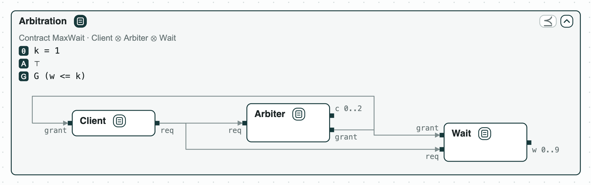
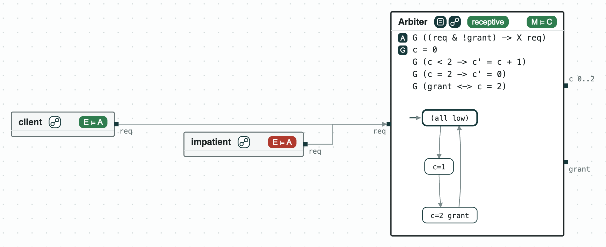

## Resource arbiter: the least bound on a waiting time

**The system.** An arbiter shares a resource, such as a bus or a memory
port, among clients. Here there is one client and an arbiter on a fixed
schedule. _Client_ raises `req` and holds it until it gets `grant`.
_Arbiter_ has a counter `c` that goes 0, 1, 2, 0, ..., and grants when
`c = 2`. _Wait_ is not part of the hardware: it only counts in `w` how
many steps the current request has waited, so that the requirement can
speak of it. The three, composed, are the system _Arbitration_, with
its requirement _MaxWait_: `G (w <= k)`, no request waits more than `k`
steps. `k` is a named constant (θ in the pictures), set to 1 in
`deadline.ltl`. The formulas are LTL over runs that never end, and the
model checker nuXmv checks them.

**The question.** What is the least `k` the arbiter can promise? The
designer of a client needs this number to set its timeouts: too small,
and a correct arbiter is rejected; too large, and the promise is of
little use.

<p align="center">
  
  <br>
  <em>The system Arbitration: the client, the arbiter, and the counter of the wait, with the requirement MaxWait.</em>
</p>

### The steps

The tags on the boxes give the results of the checks: green holds, red
fails; [Diagrams](https://chase-cps.github.io/interfaces/diagrams/) says
how to read them.

**Step 1. The bound is too small.** _Client_, _Arbiter_, and _Wait_,
composed, do not
[refine](https://chase-cps.github.io/contracts/checks/#verification-tasks)
_MaxWait_ with `k = 1`. nuXmv gives a run that loops forever: a request
made at `c = 0` is granted at `c = 2`, after 2 steps (`w = 2`), and the
run goes back to step 0. The pictures of steps 1 and 2 are of the page
that `chase-cps view deadline.ltl --check --serve` serves (see "Run it").
In the picture, A∧G on a box says that the terms
of its contract can hold together, and M ⊨ C on _Arbiter_ that its state
machine meets its contract (see the second question). The panel lists
the named constants a repair may change; the orange chip says that `k`
is a constant of the requirement.

<p align="center">
  
  <br>
  <em>Step 1: w reaches 2 at step 2, when the grant comes.</em>
</p>

**Step 2. Repair the bound.** [`repair`](https://chase-cps.github.io/contracts/repair/)
finds `k = 2` and shows that no smaller value works. Each round looks for
the least `k` under the condition that the counterexamples found so far
are no longer counterexamples (the one of step 1, with `w = 2`, gives
`k >= 2`), then checks that `k` with nuXmv. Two rounds: `k = 1` fails,
`k = 2` passes. Each condition only removes values that cannot work, so
the value that passes is the least. Checking each `k` from 0 to 9 gives
the same answer with ten runs of nuXmv; the repair needs two, and works
the same on real numbers, where there is nothing to enumerate. In the
panel, `k` is picked and its range set to 0 to 9, the range of the
script.

<p align="center">
  
  <br>
  <em>Step 2: the repair, k picked in 0 to 9: 1 to 2, optimal; the mouse on the repair, which the diagram shows.</em>
</p>

### A second question: the arbiter and the client as state machines

_Arbiter_ assumes that a request is held until it is granted. Does an
arbiter written as a state machine meet its contract, and does it accept
every request the client may send? `arbiter.smv` writes the arbiter in
SMV, the language of nuXmv, with `req` as an input (`IVAR`): it implements
_Arbiter_ (M ⊨ C) and is receptive, that is, it takes every request the
assumption allows. Each state of its machine is named by the signals
high in it; (all low) is `c = 0`. `refusing.smv` adds the constraint
`TRANS c = 0 -> !req`: it still implements _Arbiter_, but only because it
refuses a request after `c = 2`, and the check of receptiveness says so.
It is not drawn: the script and the last command of "Run it" check it.
On the other side, `client.smv` is an environment of _Arbiter_ (E ⊨ A: it
meets the assumption); `impatient.smv`, which may stop asking before the
grant, is not: its counterexample asks at step 0 and stops at step 1.

<p align="center">
  
  <br>
  <em>The arbiter as a state machine, and the two clients.</em>
</p>

### Run it

```
pip install "chase-cps[z3]"
chase-cps install nuxmv --accept-license
python deadline.py --expect
chase-cps view deadline.ltl --check --serve
chase-cps check deadline.ltl --recep refusing.smv Arbiter --env impatient.smv Arbiter
```

### Content of the directory
- `deadline.ltl`: the contracts of the client, the arbiter, the counter of
  the wait, and the requirement;
- `arbiter.smv`, `refusing.smv`: the arbiter as a state machine, and one
  that refuses a request;
- `client.smv`, `impatient.smv`: two clients as state machines;
- `deadline.py`: the steps with the CHASE Python package;
- `deadline.results.json`: the results of `chase-cps view --check`;
- `out/deadline.html`: the diagram before and after the repair, and
  `out/deadline-system.html`: the system alone.
