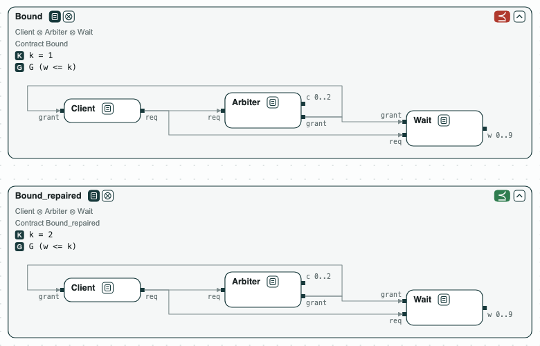

## Deadline: the least bound on a waiting time

**The question.** A client waits for a resource that an arbiter grants every
third step. What is the least bound `k` such that no request waits more
than `k` steps?

The contracts are in `deadline.ltl`:

- `Client`: once it asks (`req`), it keeps asking until it is granted.
- `Arbiter`: a counter `c` goes 0, 1, 2, 0, ...; it grants (`grant`) when
  `c = 2`.
- `Wait`: `w` counts the steps a request has waited, and is 0 again once
  the request is granted or withdrawn.
- `Bound`: the requirement `G (w <= k)`, with the constant `k` at 1.

The formulas are LTL over an infinite run, so nuXmv checks them.

### The steps

**Step 1. The bound is too small.** The composition of `Client`, `Arbiter`,
and `Wait` does not refine `Bound`. In the counterexample, a request at
`c = 0` is granted at `c = 2`: it waits 2 steps.

**Step 2. Repair the bound.** `repair` finds `k = 2`, the least value. Each
round optimizes `k` under the conditions that the counterexamples found so
far are no longer counterexamples (a counterexample with `w = 2` gives
`k >= 2`), then checks the refinement with nuXmv. Two rounds: `k = 1`
fails, `k = 2` passes. Because each condition only removes values that
cannot work, the value that passes is the least.

**Step 3. Check every value.** Checking `k = 0, 1, ..., 9` one by one with
nuXmv gives the same answer: 2 is the least that passes.

<p align="center">
  
  <br>
  <em>Before the repair (k = 1, red) and after it (k = 2, green).</em>
</p>

### Content of the directory
The directory of the demo contains:
- `deadline.ltl`: the contracts of the client, the arbiter, the counter of
  the wait, and the requirement. The line `# view:` at the top gives the
  refinement that `chase-cps view` draws;
- `deadline.py`: the steps with the CHASE Python package;
- `deadline.results.json`: the results of `chase-cps view deadline.ltl --check`;
- `out/deadline.html`: the diagram above, written by `deadline.py`.

### Run it

```
pip install "chase-cps[z3]"      # and nuXmv: chase-cps install nuxmv --accept-license
python deadline.py --expect
chase-cps view deadline.ltl --check -o out/deadline-view.html
```
