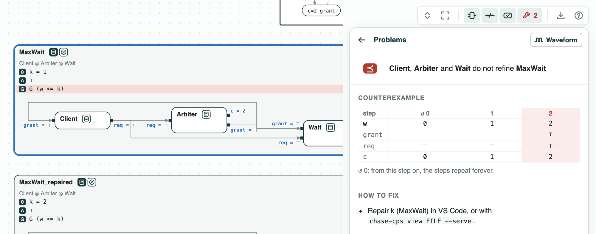
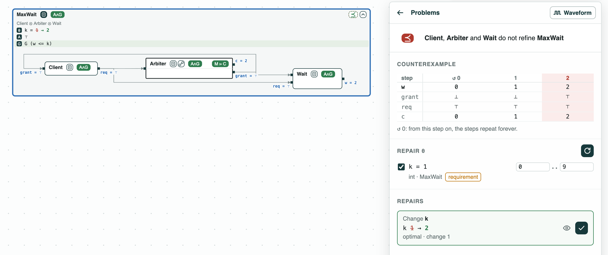

## Resource arbiter: the least bound on a waiting time

**The question.** A client waits for a resource that an arbiter grants
every third step. What is the least bound `k` such that no request waits
more than `k` steps?

**The result.**
- Counterexample over an infinite run (LTL, nuXmv): with `k = 1`, a
  request waits 2 steps, and the run loops.
- Repair by counterexamples: `k = 2`, the least value, in 2 rounds, each
  candidate checked by nuXmv.
- The same answer by brute force, checking each `k` from 0 to 9.

<p align="center">
  
  <br>
  <em>Before the repair (k = 1, ⪯ red) and after it (k = 2, green).</em>
</p>

The contracts are in `deadline.ltl`. _Client_ keeps asking (`req`) until
it is granted. _Arbiter_ counts `c` = 0, 1, 2, 0, ... and grants when
`c = 2`. _Wait_ counts in `w` the steps a request has waited. _Bound_ is
the requirement `G (w <= k)`, with the named constant `k` at 1. The
formulas are LTL over an infinite run, so nuXmv checks them.

### The steps

**Step 1. The bound is too small.** _Client_, _Arbiter_, and _Wait_
composed do not refine _Bound_. In the counterexample, a request at
`c = 0` is granted at `c = 2`: it waits 2 steps (`w = 2`), and the run
goes back to step 0.

<p align="center">
  
  <br>
  <em>Step 1: w reaches 2 at step 2, when the grant comes.</em>
</p>

**Step 2. Repair the bound.** `repair` finds `k = 2`. Each round
optimizes `k` under the condition that the counterexamples found so far
are no longer counterexamples (one with `w = 2` gives `k >= 2`), then
checks the refinement with nuXmv. Two rounds: `k = 1` fails, `k = 2`
passes. Each condition only removes values that cannot work, so the
value that passes is optimal. Checking `k = 0, 1, ..., 9` one by one
with nuXmv gives the same answer.

<p align="center">
  
  <br>
  <em>Step 2: Find repairs, k picked: 1 to 2, optimal.</em>
</p>

### Run it

```
pip install "chase-cps[z3]"
chase-cps install nuxmv --accept-license
python deadline.py --expect
chase-cps view deadline.ltl --check --serve
```

### Content of the directory
- `deadline.ltl`: the contracts of the client, the arbiter, the counter of
  the wait, and the requirement;
- `deadline.py`: the steps with the CHASE Python package;
- `deadline.results.json`: the results of `chase-cps view --check`;
- `out/deadline.html`: the diagram before and after the repair.
