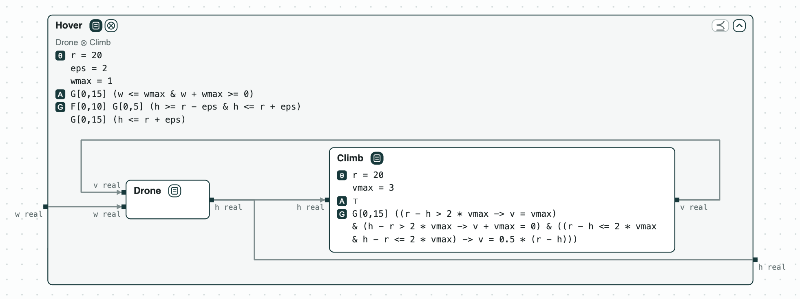

## Drone climb: no controller beats the wind

**The system.** A drone of a fire-suppression mission climbs to the
altitude where it drops its water, `r` = 20 m. The fire makes a vertical
wind `w` (up or down, at most `wmax` per step) that pushes the drone. The
drone comes from the mission of ContrACT (Xiao, Lutz, Castillo-Effen,
Nuzzo, MEMOCODE 2026). _Drone_ starts on the ground at height `h` = 0
and moves by `v + w` each step. _Climb_, the controller, sets the climb
rate `v` to half the error to `r`, at most `vmax` (3 m per step). The
requirement _Hover_: while the wind stays within `wmax`, the drone is
within `eps` (2 m) of `r` for 6 steps (steps t to t+5), starting at one
of the steps 0 to 10, and is never above `r + eps`. `r`, `vmax`, `eps`,
and `wmax` are named constants (θ in the pictures). The contracts are in signal temporal logic
in discrete time, checked by z3.

**The question.** Does the drone get there in time and stay long enough?
If not, should the controller change, or the requirement? A faster
controller costs a stronger motor; a looser requirement costs water
dropped from farther away.

<p align="center">
  
  <br>
  <em>The system: the drone and its controller inside the requirement Hover.</em>
</p>

### The steps

**Step 1. The wind decides.** _Drone_ and _Climb_ composed refine
_Hover_ (every behavior of the two meets it) in a wind of 0.5 m per
step, not of 1. The robustness of _Hover_, the margin by which it holds
in the worst case, is 0.75 m in a wind of 0.5. In a wind of 1 it fails.
In the counterexample the wind pushes down from step 4 on, and the drone
only creeps up to 18 m: at step 10, the last step where the band can
start, it is at 17.9375 m, just under 18. The worst case over all winds
is 0.5 m below. The pictures are of the page that
`chase-cps view altitude.ltl --check --serve` serves (see "Run it").
In the picture, A∧G on a box says that its terms can
hold together. The panel lists the named constants a repair may change;
the orange chip marks a constant of the requirement.

<p align="center">
  
  <br>
  <em>Step 1: a counterexample in a wind of 1, step 10, where it fails, on the ports.</em>
</p>

**Step 2. The controller cannot fix it.** `repair` looks for values of
named constants that make the check pass at the least change. For
`vmax` it finds none in [0, 9], and the reason holds for any `vmax`:
near the target, with the wind down, the error goes as `e' = e/2 + 1`,
so it stays above 2 m however fast the drone climbs. The picture shows
the panel alone: the diagram is the one of step 1.

<p align="center">
  
  <br>
  <em>Step 2: vmax picked, its range widened to [0, 9]: no value works.</em>
</p>

**Step 3. The requirement.** The least tolerance is `eps = 2.5` m (2.49
fails): the 0.5 m of step 1. Or, keeping `eps = 2`, the strongest wind
is `wmax = 17/21`, about 0.81 m per step (0.82 fails).

<p align="center">
  
  <br>
  <em>Step 3: eps 2 to 2.5, or wmax 1 to about 0.8095 (17/21); the mouse on the first repair, which the diagram shows.</em>
</p>

**Step 4. Both at once.** With two constants free, a cost says which
change is worse: `(eps - 2) + c (1 - wmax)`, a change of the wind
counting `c` times a change of the tolerance. With `c = 2` the repair
lowers the wind to 17/21 (cost 8/21); with `c = 3` it widens the
tolerance to 2.5 (cost 1/2). Each answer is the least cost over every
mix of the two changes, which is hard to find by trying values.

```
r = repair("refines", drone, hover, parameters={"eps": (2, 10), "wmax": (0, 1)},
           minimize="(eps - 2) + 3 * (1 - wmax)")
```

The tags of the pictures are explained on the page
[Diagrams](https://chase-cps.github.io/interfaces/diagrams/#what-is-drawn).

### Run it

```
pip install "chase-cps[z3]"
python altitude.py --expect
chase-cps view altitude.ltl --check --serve
```

### Content of the directory
- `altitude.ltl`: the three contracts;
- `altitude.py`: the steps with the CHASE Python package;
- `altitude.results.json`: the results of `chase-cps view --check`;
- `out/altitude.html`: the diagram before and after the repair;
  `out/altitude-system.html`: the system, with no check.
