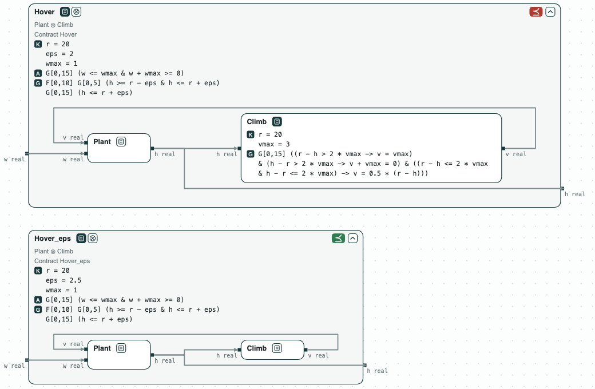
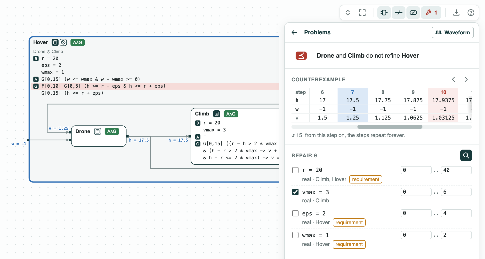
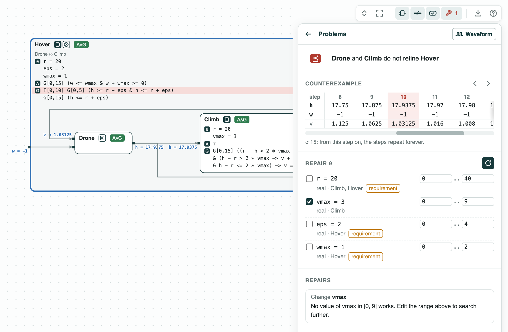
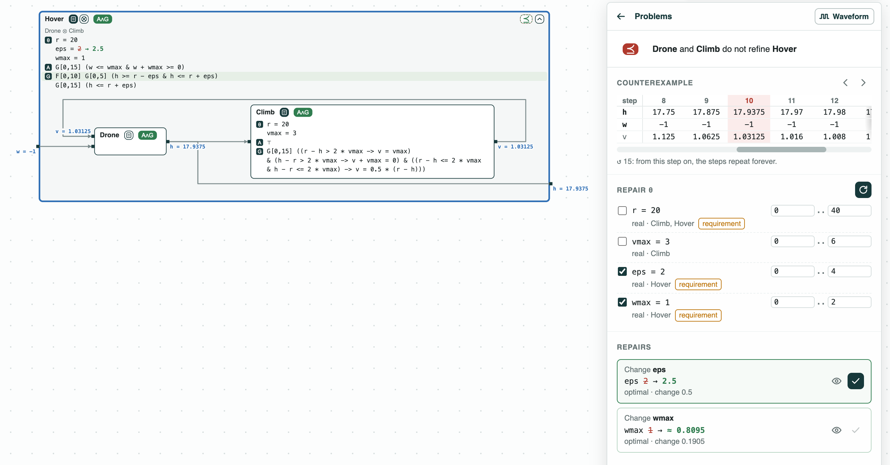

## Fire-suppression drone climb: no controller beats the wind

**The question.** A drone climbs to the altitude where it drops its
water, in the updraft of the fire. Does it get there in time and stay
long enough? If not, is it the controller to change, or the requirement?

**The result.**
- In a wind of 0.5 m per step the drone meets the requirement with
  0.75 m to spare; in a wind of 1 m per step it misses the band by 0.5 m.
- No climb rate `vmax` works: repair proves it impossible.
- Repair of the requirement: the least tolerance `eps = 2.5` m, or, with
  2 m, the strongest wind `wmax = 17/21`, about 0.81 m per step.

<p align="center">
  
  <br>
  <em>The drone inside Hover in a wind of 1 (red), and with eps = 2.5 (green).</em>
</p>

The drone is part of the fire-suppression mission of ContrACT (Xiao, Lutz,
Castillo-Effen, Nuzzo, MEMOCODE 2026). `altitude.ltl` has its contracts
in signal temporal logic in discrete time, so z3 checks them. _Plant_
starts on the ground and moves by `v + w` each step. _Climb_ sets `v` to
half the error to `r` (20 m), at most `vmax`. _Hover_ asks, in a wind
`w` of at most `wmax`, for 5 steps within `eps` of `r` (18 to 22 m),
starting at one of the first 10 steps.

### The steps

**Step 1. The wind of the fire.** _Plant_ and _Climb_ composed refine
_Hover_ in a wind of 0.5, not of 1. The worst case of _Hover_ (its
robustness: the margin by which it holds) is 0.75 m in a wind of 0.5. In
a wind of 1 it is -0.5 m: with the wind always down, the drone is at
17.5 m at step 10, the last step where the 5 steps can start, 0.5 m
below the band.

<p align="center">
  
  <br>
  <em>Step 1: a counterexample in a wind of 1, step 7 on the ports.</em>
</p>

**Step 2. The controller cannot fix it.** Repair of `vmax` finds no
value that works. Near the target, with the wind down, the error goes
as `e' = e/2 + 1`: it stays above 2 m, below the band, however fast the
drone climbs.

<p align="center">
  
  <br>
  <em>Step 2: vmax picked, its range widened to [0, 9]: no value works.</em>
</p>

**Step 3. The requirement.** Each value is checked on both sides. The
least tolerance is `eps = 2.5` (2.49 fails): the 0.5 m of step 1. Or,
keeping `eps = 2`, the strongest wind is `wmax = 17/21` (0.82 fails).

<p align="center">
  
  <br>
  <em>Step 3: eps 2 to 2.5, or wmax 1 to about 0.8095 (17/21).</em>
</p>

### Run it

```
pip install "chase-cps[z3]"
python altitude.py --expect
chase-cps view altitude.ltl --check --serve
```

### Content of the directory
- `altitude.ltl`: the three contracts;
- `altitude.py`: the steps with the CHASE Python package;
- `altitude.results.json`: the results of `chase-cps view --check`;
- `out/altitude.html`: the diagram before and after the repair.
