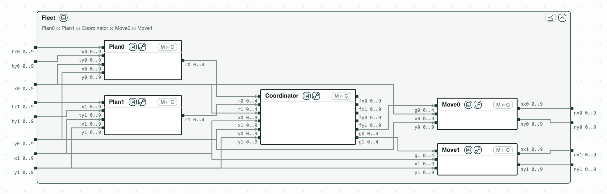
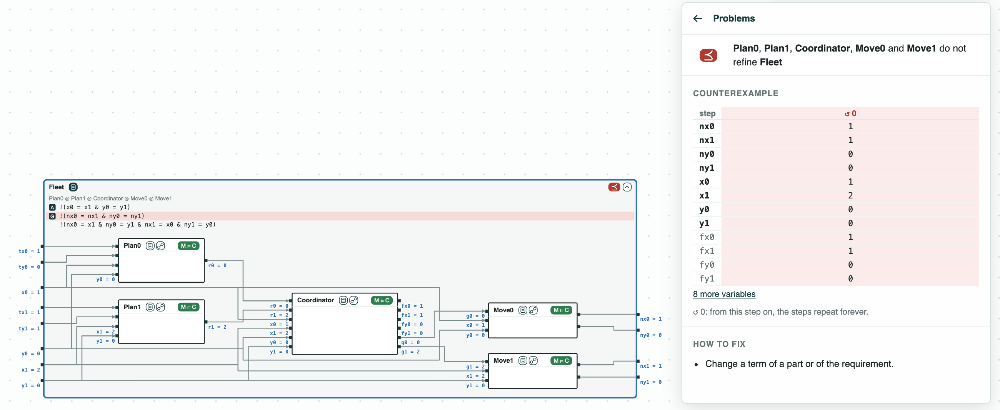
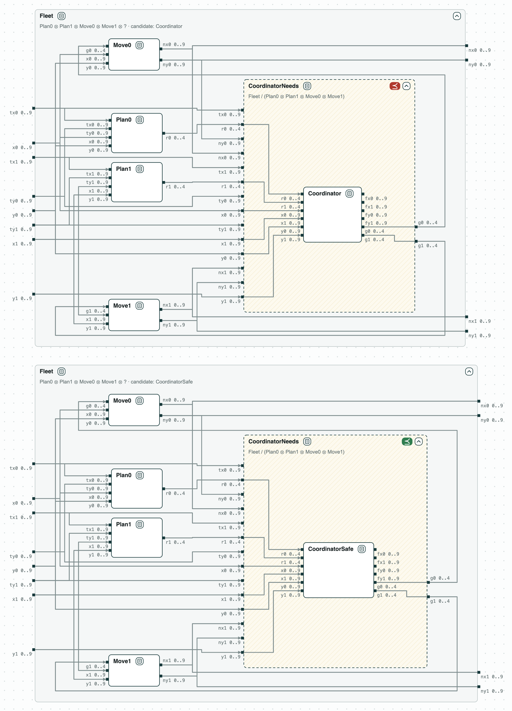
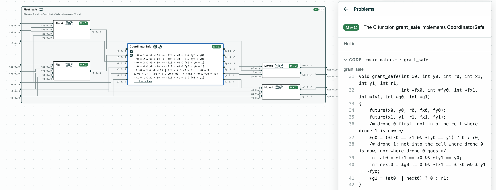

## Fire-suppression drones in C: a collision found and fixed on the contracts, then checked one function at a time

**The system.** Two drones of a fire-suppression mission move on a
10 x 10 grid, one cell per step. They come from the multi-drone fire
suppression of ContrACT (Xiao et al., MEMOCODE 2026), whose software is
written as reactions, pieces of code run at each step. Each step has five
parts, each with a contract and a C function:

- _Plan0_ and _Plan1_ (`plan.c`): each drone at `(x, y)` asks for a move
  `r` toward its target `(tx, ty)`: 0 stay, 1 right, 2 left, 3 down, 4 up;
- _Coordinator_ (`coordinator.c`, function `grant`): computes the cell
  each drone would reach (`fx`, `fy`), and grants the moves `g`, refusing
  two moves into the same cell or a swap;
- _Move0_ and _Move1_ (`move.c`): each drone moves as granted, to
  `(nx, ny)`.

The requirement _Fleet_: two drones in different cells are, after the
step, in different cells, and do not cross. The contracts are on
integers, checked by z3; the C functions by ESBMC.

**The question.** Can two drones end in the same cell? And can each C
function be checked alone, without checking the whole program? A whole
program check grows with every function; one function at a time does not.

<p align="center">
  
  <br>
  <em>The system: one step of the two drones inside the requirement Fleet; each part has its C function.</em>
</p>

### The steps

**Step 1. The contracts do not refine the requirement.** The five parts
composed do not refine _Fleet_ (some behavior of the parts breaks it).
In the counterexample of the diagram, drone 0 is at its target (1, 0)
and stays, and drone 1 at (2, 0) moves left into its cell: the
coordinator compares only drones that both move. The script prints two
others: in one, the two drones would swap cells, the coordinator stops
drone 1, and drone 0 moves into the cell where drone 1 stays; in the
other, drone 1 is at its target (0, 0) and drone 0 at (1, 0) moves left
into it. The tag M ⊨ C on a part says that its C function meets its
contract (step 3).

<p align="center">
  
  <br>
  <em>Step 1: the parts with <code>Coordinator</code> do not refine <code>Fleet</code>.</em>
</p>

**Step 2. The fix.** No number can be tuned: the rule must change.
CHASE computes the quotient _CoordinatorNeeds_ of _Fleet_ by the other
four parts: the weakest contract the coordinator must meet so that the
step meets _Fleet_ (see [the contract algebra](https://chase-cps.github.io/contracts/algebra/)).
The picture draws it twice: _Fleet_ with the four parts and a hole for
the coordinator, with a coordinator in the hole ("candidate: X" names the
part tried in the hole). _Coordinator_ does not refine it (⪯ red).
_CoordinatorSafe_, which grants a move only into a cell that is free
after the step, does (⪯ green), and the parts with it refine _Fleet_
(the picture of step 3).

<p align="center">
  
  <br>
  <em>Step 2: the quotient <code>CoordinatorNeeds</code>, with <code>Coordinator</code> in its hole (⪯ red), then <code>CoordinatorSafe</code> (⪯ green).</em>
</p>

**Step 3. The code.** ESBMC checks each function against its contract
(the tag M ⊨ C). The five functions of the step
(`plan0`, `plan1`, `grant`, `move0`, `move1`) implement theirs. `grant`
does not implement _CoordinatorSafe_; `grant_safe` does. With steps 2
and 3, the C code with `grant_safe` keeps the drones apart, and the
whole program is never checked at once.

<p align="center">
  
  <br>
  <em>Step 3: <code>grant_safe</code> implements <code>CoordinatorSafe</code>, and the parts with it refine <code>Fleet</code>.</em>
</p>

The tags of the pictures are explained on the page
[Diagrams](https://chase-cps.github.io/interfaces/diagrams/#what-is-drawn).

### Run it

```
pip install "chase-cps[z3]"      # and ESBMC or CBMC
python dronegrid.py --expect
```

### Content of the directory
- `plan.c`, `coordinator.c`, `move.c`: the reactions in C;
- `dronegrid.ltl`: the contracts of the functions and the requirement;
- `dronegrid.py`: the steps with the CHASE Python package;
- `dronegrid.results.json`, `out/dronegrid.html`: the results and the
  diagram; `out/dronegrid-quotient.html`: the quotient with each
  coordinator in its hole; `out/dronegrid-system.html`: the system, with
  no check.
