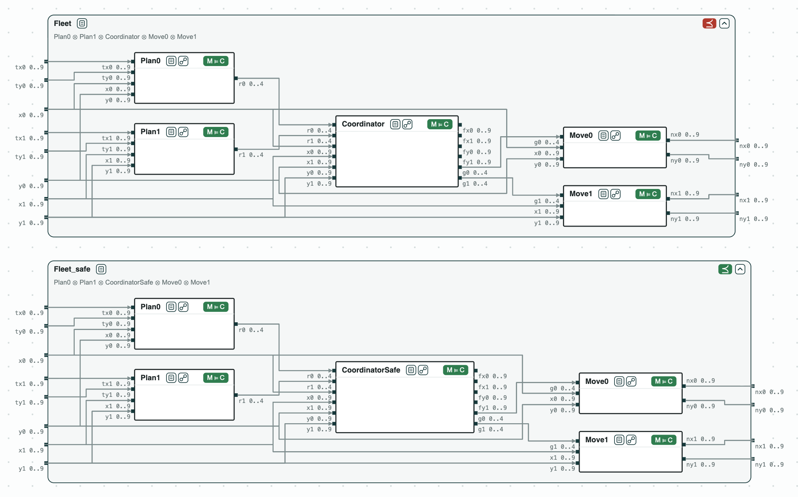
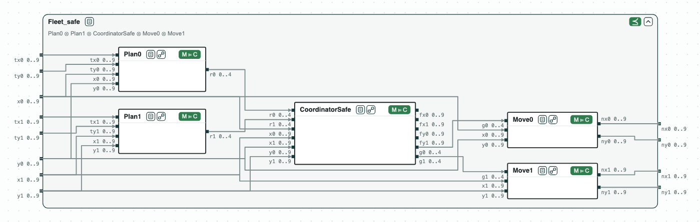
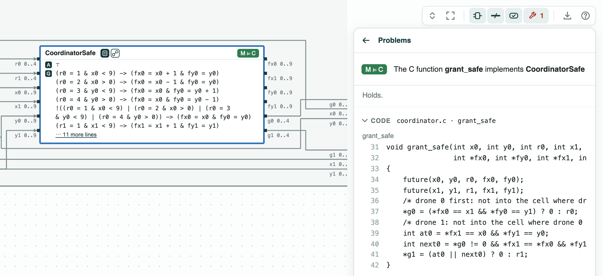

## Fire-suppression drones in C: a collision found and fixed on the contracts, then checked one function at a time

**The question.** Two drones of a fire-suppression mission move on a grid.
Each step, each drone asks for a move, the coordinator grants the moves,
and each drone moves. Can two drones end in the same cell? Can each C
function be checked alone, not the whole program?

**The result.**
- Refinement on integers (z3): the five contracts of the step, composed,
  do not refine the requirement _Fleet_: drone 1 moves into the cell of
  drone 0, which stays.
- Quotient of _Fleet_ by the other parts (the weakest contract the
  coordinator must meet): _Coordinator_ does not refine it;
  _CoordinatorSafe_ does, and the step refines _Fleet_.
- C code (ESBMC): the five functions of the step implement their
  contracts, in about 0.1 s each; `grant` does not implement
  _CoordinatorSafe_, and `grant_safe` does.

<p align="center">
  
  <br>
  <em>The step before the fix (⪯ red) and after it (green); each function implements its contract (M ⊨ C).</em>
</p>

The drones are those of the fire suppression (MDFS) of ContrACT (Xiao et
al., MEMOCODE 2026), on a 10 x 10 grid. `plan.c`, `coordinator.c`, and
`move.c` port one reaction each: the move asked, the moves granted, and
the new cell. _Fleet_: two drones in different cells are, after the step,
in different cells, and do not cross.

### The steps

**Step 1. The contracts do not refine the requirement.** With
_Coordinator_, drone 0 is at its target (1, 0) and stays, and drone 1 at
(2, 0) moves left into its cell: the coordinator compares only drones that
both move. The script finds the same failure for a swap.

<p align="center">
  
  <br>
  <em>Step 1: the parts with <code>Coordinator</code> do not refine <code>Fleet</code>.</em>
</p>

**Step 2. The fix.** No constant can be tuned: the rule must change.
_Coordinator_ does not refine the quotient of _Fleet_ by the other parts.
_CoordinatorSafe_ grants a move only into a cell that is free after the
step; it refines the quotient, and the parts with it refine _Fleet_. The
code is not looked at yet.

<p align="center">
  
  <br>
  <em>Step 2: the parts with <code>CoordinatorSafe</code> refine <code>Fleet</code>.</em>
</p>

**Step 3. The code.** ESBMC checks each function against its contract.
The five functions of the step (`plan0`, `plan1`, `grant`, `move0`,
`move1`) implement theirs. `grant` does not implement _CoordinatorSafe_;
`grant_safe` does. Thus the C code with `grant_safe` keeps the drones
apart, with no check on the whole program.

<p align="center">
  
  <br>
  <em>Step 3: <code>grant_safe</code> implements <code>CoordinatorSafe</code>.</em>
</p>

### Run it

```
pip install "chase-cps[z3]"      # and ESBMC or CBMC
python dronegrid.py --expect
```

### Content of the directory
- `plan.c`, `coordinator.c`, `move.c`: the reactions in C;
- `dronegrid.ltl`: the contracts of the functions and the requirement;
- `dronegrid.py`: the steps with the CHASE Python package;
- `dronegrid.results.json`, `out/dronegrid.html`: the results and the diagram.
