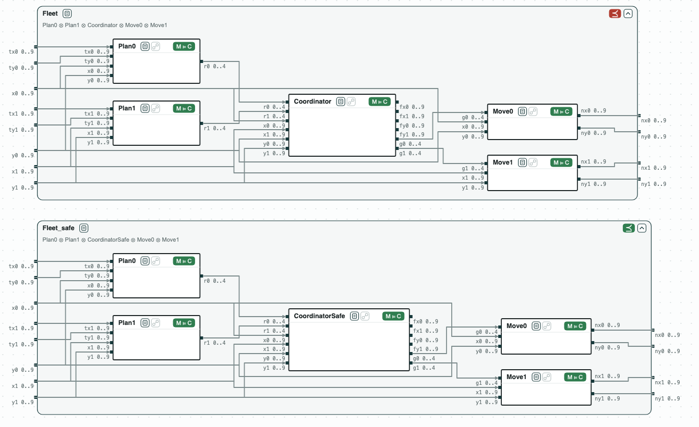

## DroneGrid: checking the C code of two drones, one function at a time

**The question.** Two drones of a fire-suppression mission move on a grid.
Each step, the controller of each drone asks for a move, the coordinator
grants the moves, and each drone moves. Can two drones end in the same
cell? And can the answer be found by checking each function of the C code
alone, not the whole program?

The drones are those of the multi-drone fire suppression (MDFS) of ContrACT
(Xiao, Lutz, Castillo-Effen, Nuzzo, MEMOCODE 2026), written in Lingua
Franca. The C files port one reaction each, for two drones on a 10 x 10
grid (a move is 0 stay, 1 right, 2 left, 3 down, 4 up):

- `plan.c`: `GridDroneControl`, the move a drone asks for, toward its
  target, horizontal first (`plan0`, `plan1`: the same function with the
  ports of each drone);
- `coordinator.c`: `FireCoordinator`, the moves granted. `grant` is the
  reaction as written: when the two drones would reach the same cell, or
  swap cells, while both move, drone 1 stays. `grant_safe` grants a move
  only into a cell that is free after the step;
- `move.c`: `GridDroneSim`, the cell of a drone after the move granted.

`dronegrid.ltl` has a contract for each function (`Plan0`, `Plan1`,
`Coordinator`, `CoordinatorSafe`, `Move0`, `Move1`), and the requirement
`Fleet`: two drones in different cells are, after the step, in different
cells, and do not cross each other. The contracts are about one call (no
temporal operator), so z3 checks them, and ESBMC (or CBMC) checks the C
code against them.

### The steps

**Step 1. The contracts do not refine the requirement.** The contracts of
the parts with `Coordinator`, composed, do not refine `Fleet`. The
counterexample: drone 0 at (0, 8) goes down, drone 1 at (0, 9) goes up.
They would swap cells, so drone 1 stays; drone 0 still moves, into the
cell of drone 1.

**Step 2. A drone that stays.** With drone 1 at its target (it stays), the
refinement fails too: drone 0 moves into its cell. The coordinator compares
only drones that both move.

**Step 3. The fix.** `CoordinatorSafe` grants a move only into a cell that
is free after the step: drone 0 not into the cell of drone 1, drone 1
neither into the cell of drone 0 nor where drone 0 goes. The parts with
`CoordinatorSafe` refine `Fleet`. Both failures were found on the contracts,
before looking at the code.

**Step 4. The code.** ESBMC checks each function against its contract:
`plan0`, `plan1`, `move0`, and `move1` implement theirs; `grant`
implements `Coordinator` (the contract says what the reaction does) but not
`CoordinatorSafe`; `grant_safe` implements `CoordinatorSafe`. With
`grant_safe`, each function implements its contract, and the contracts
together refine `Fleet`: the step of the C code keeps the drones apart.
No check runs on the whole program.

<p align="center">
  
  <br>
  <em>The step before the fix (⪯ red) and after it (green): each function is a component with its C code, and implements its contract (M ⊨ C).</em>
</p>

### Content of the directory
The directory of the demo contains:
- `plan.c`, `coordinator.c`, `move.c`: the reactions in C;
- `dronegrid.ltl`: the contracts of the functions and the requirement. The
  lines `# view:` at the top draw the parts inside `Fleet`, each with its C
  function;
- `dronegrid.py`: the steps with the CHASE Python package;
- `dronegrid.results.json`: the results of `chase-cps view dronegrid.ltl --check`;
- `out/dronegrid.html`: the diagram above, written by `dronegrid.py`.

### Run it

```
pip install "chase-cps[z3]"      # and ESBMC or CBMC for step 4
python dronegrid.py --expect
chase-cps view dronegrid.ltl --check -o out/dronegrid-view.html
```
