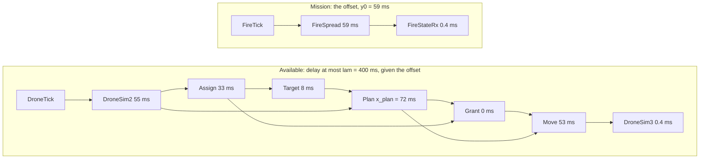
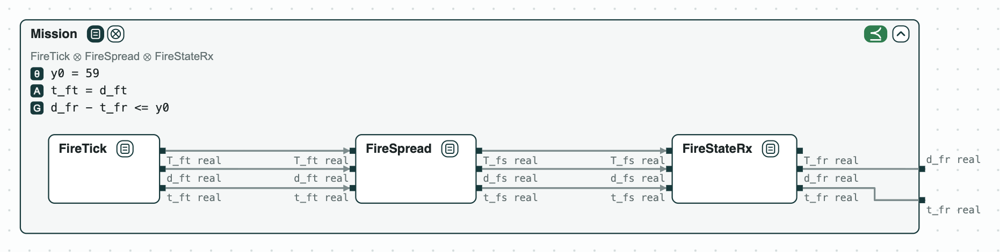
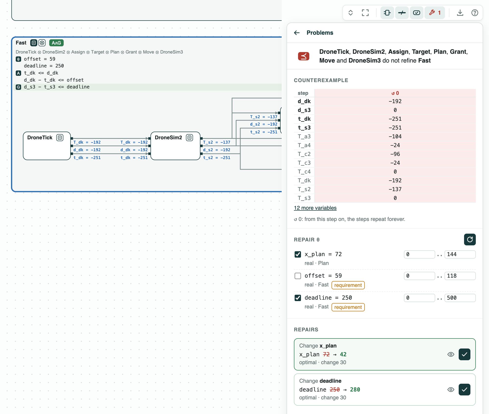
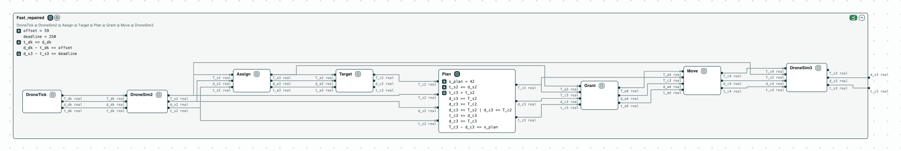

## Drone timing: the bound, a faster timer, and its repair

**The system.** Three drones put out fires on a grid, coordinated over a
network. The software is written in Lingua Franca, where each component
runs reactions (pieces of code triggered by an event). This is the
multi-drone fire suppression of ContrACT (Xiao, Lutz, Castillo-Effen,
Nuzzo, MEMOCODE 2026), with the worst-case times of each reaction of its
Table III. Each event `v` has three times: its timestamp `t_v` (when it
is due, on the logical clock), its start `d_v`, and its completion
`T_v`. An event is named by its reactor and the number of its reaction:
`dk` the drone timer, `s2` and `s3` the drone (GridDroneSim), `c2` to
`c4` its controller (GridDroneControl), `a3` and `a4` the coordinator
(FireCoordinator). So `T_c3` is the completion of the planner, and
`d_s3 - t_s3` the delay of the move of a drone.

The mission subgraph (the fire spreads, the coordinator reads it)
delays the timer of the drones by an offset, at most `y0`. The pipeline
of a drone goes from its timer to a move: report the cell, get a target,
plan, have the move granted, move. The drones do not wait for each
other, so one pipeline gives the bound of each. Each reaction is a
contract over these times (it starts when its inputs complete and takes
at most its latency), on real numbers, checked by z3. _Available_ asks
the move within `lam` of the timestamp, given the offset. _Mission_ calls
the offset `y0`; _Available_ and _Fast_ call it `offset`. _Fast_ is
_Available_ with `deadline = 250` in place of `lam`.

**The question.** Each drone must move within 400 ms of its timer. Is
the bound met, and by how much? With a faster timer of 250 ms, what
fails, and what is the least change that fixes it? The answer says how
fast the timer of the drones can run.


_The system: the reactions of the mission and of a drone with their latencies, inside their requirements. A reaction with two arrows in waits for both._

### The steps

**Step 1. The mission.** The mission subgraph refines _Mission_ (every
behavior of the three reactions meets it): it delays the drones by at
most 59 ms, its worst case. This is the offset of step 2. The assumption
of _Mission_, `t_ft = d_ft`, says that the fire timer is released on
time; θ marks the named constants.

<p align="center">
  
  <br>
  <em>Step 1: the mission subgraph inside Mission (y0 = 59).</em>
</p>

**Step 2. The bound holds.** The pipeline refines _Available_ with
`lam = 400`. One optimization over all its behaviors gives the worst
case, 280 ms: 59 ms of offset, 55 to report the cell, 33 to assign a
target and 8 to take it, 72 to plan, and 53 to send the move. By hand
this means following the longest path through the waits.

**Step 3. A faster timer fails.** The pipeline does not refine _Fast_,
which asks for 250 ms. The counterexample gives each event a time: the
drone timer starts 59 ms late and the move starts 251 ms after its
timestamp. z3 sets the move at time 0, so the earlier events have
negative times. The picture shows the panel of the check alone: _Fast_
is too wide to be drawn next to it. The orange chip marks a constant of
the requirement.

<p align="center">
  
  <br>
  <em>Steps 3 and 4: the panel of the check of Fast, the counterexample at the top, the two repairs at the bottom.</em>
</p>

**Step 4. Repair.** `repair` changes one named constant as little as
possible so that the check passes, and proves that no smaller change
works. On the requirement: `deadline = 280`, 30 ms more. On the planner:
`x_plan = 42`, 30 ms less, since planning is on the longest path. The
pipeline with `x_plan = 42` refines _Fast_ (`Fast_repaired` in the
picture: _Fast_ with this pipeline inside).

<p align="center">
  
  <br>
  <em>Step 4: the pipeline with x_plan = 42 (Plan open) refines Fast.</em>
</p>

**Step 5. The margins.** Under the bound of 400 ms, repair as an
optimization gives the slowest planner, `x_plan = 192` ms, and the
largest delay of the mission, `offset = 179` ms: each 120 ms more than
now, the slack of step 2.

The tags of the pictures are explained on the page
[Diagrams](https://chase-cps.github.io/interfaces/diagrams/#what-is-drawn).

### Run it

```
pip install "chase-cps[z3]"
python dronetiming.py --expect
chase-cps view dronetiming.ltl --check --serve
```

### Content of the directory
- `dronetiming.ltl`: the contracts of the reactions and the requirements;
- `dronetiming.py`: the steps with the CHASE Python package;
- `dronetiming.results.json`: the results of `chase-cps view --check`;
- `out/dronetiming.html`: the diagram of the mission, and of a drone
  before and after the repair.
