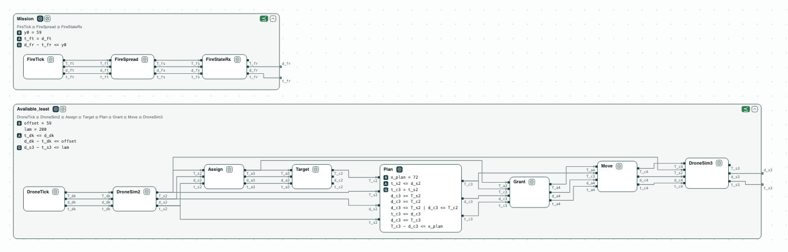
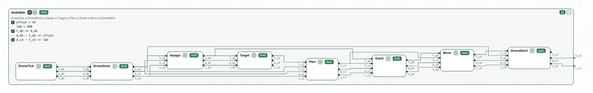
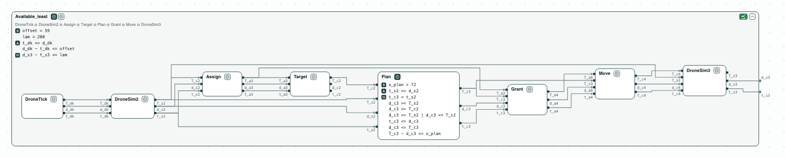

## Fire-suppression drones: the timing margins, as a linear program

**The question.** Three drones put out fires; each must move within 400 ms
of its timer. Is the bound met, by how much, and how much slower may a
reaction be, or the rest of the mission, before it is not?

**What it shows.**
- Refinement over the reals: the mission subgraph refines `Mission`, and
  the pipeline of a drone refines `Available` (z3, in place of the Gurobi
  MILP of the paper).
- Optimization: the worst case of the pipeline is 280 ms, the bound of the
  paper, in one call.
- Repair as optimization over named constants, each value checked by the
  refinement itself: the least bound `lam = 280`, the slowest planner
  `x_plan = 192` ms (72 + 120), the largest delay of the mission
  `offset = 179` ms (59 + 120), each optimal in 0.1 s or less.

<p align="center">
  
  <br>
  <em>The mission subgraph inside Mission, and the pipeline of a drone inside Available at its least bound (lam = 280).</em>
</p>

This is the multi-drone fire suppression (MDFS) of ContrACT (Xiao, Lutz,
Castillo-Effen, Nuzzo, *Contract-Based Consistency and Availability
Analysis for Distributed Cyber-Physical Systems*, MEMOCODE 2026, Section
V.B), a federation in Lingua Franca. `dronetiming.ltl` has the timing
contracts that ContrACT builds for each reaction (Section III-C), over the
timestamp `t`, the start `d`, and the completion `T` of each event, with
the worst-case latencies of Table III:

- the mission subgraph (D_0 in the paper): the mission timer, the fire
  spreading (59 ms), and the coordinator reading the fire (0.4 ms);
- the pipeline of a drone: the drone timer, the drone reporting its cell
  (55 ms), the coordinator assigning a target (33 ms), the controller taking
  it (8 ms), planning (`x_plan`, 72 ms), the move granted (0 ms) and sent
  (53 ms), and the drone moving (0.4 ms). A reaction that waits for an
  earlier reaction of its reactor starts at the later of the two: the
  planner waits for the target;
- `Mission`: the mission subgraph delays the drones by at most `y0` (59);
- `Available`: given that delay (`offset`, 59), the drone moves at most
  `lam` (400) after its timestamp.

The three drones run the same pipeline on one timer and do not wait for
each other, so one pipeline gives the bound of each. The contracts are
linear constraints over the reals, and "the later of the two" is a
disjunction (a binary variable in the MILP of ContrACT): z3 checks and
optimizes them, in place of Gurobi.

### The steps

**Step 1. The mission.** The mission subgraph refines `Mission`; its worst
case is 59 ms: the offset of the drones.

<p align="center">
  
  <br>
  <em>The mission subgraph inside Mission (y0 = 59): ⪯ green.</em>
</p>

**Step 2. The bound holds.** The pipeline refines `Available`. Repair of
`lam` finds nothing to change: holds.

<p align="center">
  
  <br>
  <em>The pipeline of a drone inside Available (lam = 400): ⪯ green.</em>
</p>

**Step 3. The worst case.** One optimization over the behaviors of the
pipeline: the drone moves at most 280 ms after its timestamp, the bound of
the paper (why its timer could go from 500 ms to 300 ms). 59 of offset,
then 55 to report the cell; the planner waits for the target (55 + 33 + 8 =
96), plans 72, and the move is sent 53 later: 59 + 96 + 72 + 53 = 280.

**Step 4. The margins, by repair.** Repair is an optimization over the
constants, each value checked by the refinement itself:
- the least bound that holds: `lam = 280`;
- the slowest the planner may be: `x_plan = 192` ms (72 + 120);
- the largest delay of the mission subgraph: `offset = 179` ms (59 + 120).

<p align="center">
  
  <br>
  <em>At its least bound, lam = 280, the refinement still holds; Plan open, with x_plan = 72.</em>
</p>

### Content of the directory
The directory of the demo contains:
- `dronetiming.ltl`: the timing contracts of the reactions and the two
  requirements, with their named constants. The lines `# view:` at the top
  draw each subgraph inside its requirement;
- `dronetiming.py`: the steps with the CHASE Python package;
- `dronetiming.results.json`: the results of `chase-cps view dronetiming.ltl --check`;
- `out/dronetiming.html`: the diagram of the mission and of a drone at its
  least bound, written by `dronetiming.py`.

### Run it

```
pip install "chase-cps[z3]"
python dronetiming.py --expect
chase-cps view dronetiming.ltl --check -o out/dronetiming-view.html
chase-cps repair dronetiming.ltl --refines DroneTick+DroneSim2+Assign+Target+Plan+Grant+Move+DroneSim3 Available --param x_plan=0..1000 --maximize x_plan
```
