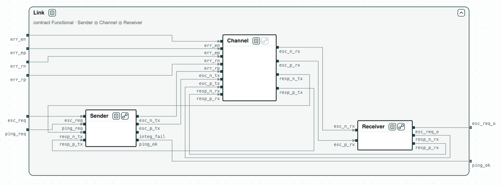

## Security chip: checked module by module

**The question.** The escalation link of a security chip is made of a
sender, the wires, and a receiver. Does it meet its requirements, and can we
show it by checking each module on its own?

<p align="center">
  
  <br>
  <em>The link: the sender, the channel, and the receiver, each with its RTL, inside the requirements.</em>
</p>

The link is a toy version of the escalation link of OpenTitan:

- the sender raises a differential pair to make the receiver escalate, and
  pings the receiver with one-cycle pulses;
- the receiver answers on a response pair;
- a pulse that lasts two cycles means an escalation;
- the error inputs of the channel (`err_*`) flip a wire, as a fault would.
  The two wires of the pair are then equal, which the receiver and the
  sender detect.

The requirements follow the end-to-end assertions of OpenTitan:

- _Functional_: escalation and ping, without wire errors;
- _Integrity_: a single wrong wire is detected.

The contracts are written in
SystemVerilog Assertions, and each module has
its RTL in Verilog.

### The steps

**Step 1. Each module.** The RTL of the sender, of the channel, and of the
receiver implements its contract.

**Step 2. The composition.** _Sender_ ∥ _Channel_ ∥ _Receiver_ refines
_Functional_ and _Integrity_. So the three modules together meet the
requirements, with no check on the whole design.

<p align="center">
  
  <br>
  <em>Steps 1 and 2: each RTL implements its contract, and the composition refines Functional; the receiver with its four states.</em>
</p>

**Step 3. A cross-check.** The whole RTL, checked directly, meets
_Functional_ and _Integrity_ too.

**Step 4. What any sender must do.** The quotient SenderSlot = Functional
/ (Channel ∥ Receiver) is the contract that any sender must meet in this
link; the contract of the sender refines it.

**Step 5. A faster sender.** A sender that pings at every cycle of a ping
request does not implement the contract of the sender: its ping pulses last as long as
the ping request, two cycles or more, which the receiver reads as an
escalation.

### Content of the directory
The directory of the demo contains:
- `sva/`: the contracts in SystemVerilog Assertions, one module each:
  _Sender_ (`sender.sv`), _Channel_ (`channel.sv`), _Receiver_
  (`receiver.sv`), and the requirements _Functional_ (`functional.sv`) and
  _Integrity_ (`integrity.sv`);
- `rtl/`: the Verilog of the modules, of the whole link, and of a faster
  sender (`esc_sender_fast.v`) that does not meet its contract;
- `escalation.py`: the steps with the CHASE Python package;
- `out/escalation.html`: the diagram of the link, written by
  `escalation.py`.

### Python Flow
The script needs the CHASE Python package with the RTL reader, version
0.5.0, and nuXmv. From the directory of the demo:

```
$> pip install "chase-cps[rtl]"
$> chase-cps install nuxmv --accept-license
$> python3 escalation.py
```

The script prints the result of each step and writes the diagram above in
`out/escalation.html`, a page to open in a browser: a click on a name opens
or closes the contract, a click on the state icon the model. The contracts
are in `sva/`, and the RTL in `rtl/`.

With `--expect` the script exits with code 1 when a result is not the
expected one.
