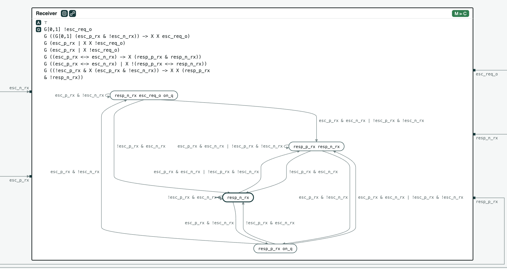
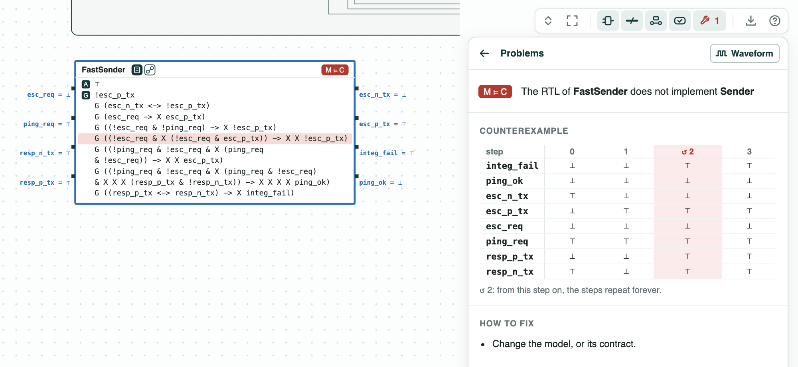

## Security chip: the RTL of a link checked module by module

**The question.** The escalation link of a security chip is made of a
sender, the wires, and a receiver. Does it meet its requirements, and can we
show it by checking each module on its own?

**What it shows.**
- SystemVerilog Assertions as contracts: the contracts of the three modules
  and the two requirements, read from `sva/`.
- RTL as models: the Verilog of each module, read with Yosys as a state
  machine (the sender 23 states, the receiver 4, the channel no registers)
  and checked with nuXmv: each implements its contract (M ⊨ C).
- Composition with discharge: the three contracts together refine both
  requirements, _Functional_ and _Integrity_, so the link meets them with
  no check on the whole design. Each check takes under a second.
- Quotient: SenderSlot = Functional / (Channel ∥ Receiver), what any sender
  must do in this link; the contract of the sender refines it.
- A counterexample on the RTL: a faster sender does not implement the
  contract of the sender; the panel shows the 4 steps and the guarantee it
  breaks.

<p align="center">
  
  <br>
  <em>The page of the demo: the link inside Functional (⪯), each module with its RTL (M ⊨ C), and the fast sender, which fails (M ⊨ C red).</em>
</p>

The link is a toy version of the escalation link of OpenTitan:

- the sender raises a differential pair to make the receiver escalate, and
  pings the receiver with one-cycle pulses;
- the receiver answers on a response pair;
- a pulse that lasts two cycles means an escalation;
- the error inputs of the channel (`err_*`) flip a wire, as a fault would.
  The two wires of the pair are then equal, which the receiver and the
  sender detect.

The requirements follow the end-to-end assertions of OpenTitan
(`prim_esc_rxtx_assert_fpv`):

- _Functional_: escalation and ping, without wire errors;
- _Integrity_: a single wrong wire is detected.

The contracts are written in SystemVerilog Assertions, and each module has
its RTL in Verilog.

### The steps

**Step 1. Each module.** The RTL of the sender, of the channel, and of the
receiver implements its contract. The receiver is drawn open: its contract
and its state machine of 4 states, read from the RTL.

<p align="center">
  
  <br>
  <em>Step 1: each RTL implements its contract (M ⊨ C); the receiver with its four states.</em>
</p>

**Step 2. The composition.** _Sender_ ∥ _Channel_ ∥ _Receiver_ refines
_Functional_ and _Integrity_. So the three modules together meet the
requirements, with no check on the whole design.

<p align="center">
  
  <br>
  <em>Step 2: the composition of the three modules refines Functional (⪯).</em>
</p>

**Step 3. A cross-check.** The whole RTL, checked directly, meets
_Functional_ and _Integrity_ too.

**Step 4. What any sender must do.** The quotient SenderSlot = Functional
/ (Channel ∥ Receiver) is the contract that any sender must meet in this
link; the contract of the sender refines it.

**Step 5. A faster sender.** A sender that pings at every cycle of a ping
request does not implement the contract of the sender: its ping pulses
last as long as the ping request, two cycles or more, which the receiver
reads as an escalation. In the counterexample, the ping request stays high,
and the pair is high from step 1 on; the guarantee "the pair is high two
cycles in a row only for an escalation request" fails. The whole RTL with
the fast sender does not meet _Functional_: a ping makes the receiver
escalate.

<p align="center">
  
  <br>
  <em>Step 5: the fast sender does not implement Sender; the counterexample in the panel, the guarantee it breaks in red.</em>
</p>

### Content of the directory
The directory of the demo contains:
- `sva/`: the contracts in SystemVerilog Assertions, one module each:
  _Sender_ (`sender.sv`), _Channel_ (`channel.sv`), _Receiver_
  (`receiver.sv`), and the requirements _Functional_ (`functional.sv`) and
  _Integrity_ (`integrity.sv`);
- `sva/*.results.json`: the results kept by `chase-cps view --check` on
  each file;
- `rtl/`: the Verilog of the modules, of the whole link, and of a faster
  sender (`esc_sender_fast.v`, with `esc_link_fast.v`) that does not meet
  its contract;
- `escalation.py`: the steps with the CHASE Python package;
- `out/escalation.html`: the diagrams above, written by `escalation.py`.

### Run it

```
pip install "chase-cps[rtl]"                # version 0.5.0 or later, with Yosys
chase-cps install nuxmv --accept-license
python escalation.py --expect
chase-cps view sva/sender.sv --implementation rtl/esc_sender_fast.v sender --check -o out/fast-sender-view.html
```

The script prints the result of each step, with the counterexamples of
step 5, and writes `out/escalation.html`, a page to open in a browser: a
click on a name opens or closes the contract, a click on the state icon
the model, and a click on a red tag shows why the check fails. With
`--expect` the script exits with code 1 when a result is not the expected
one. `chase-cps view` checks one module against its contract: here the
fast sender against _Sender_.
