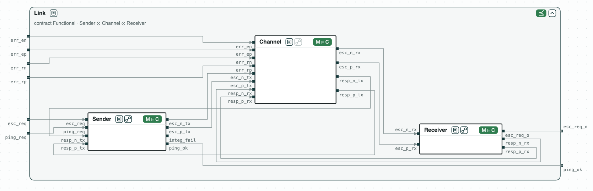

## Escalation: a hardware design checked module by module

The question: the escalation link of a security chip (a toy version of the
one of OpenTitan) is made of a sender, the wires, and a receiver. Does it
meet its requirements, and can we show it by checking each module on its
own?

The sender raises a differential pair (`esc_p`/`esc_n`) to make the
receiver escalate, and pings the receiver with one-cycle pulses; the
receiver answers on a response pair (`resp_p`/`resp_n`). A wrong wire, a
fault or an attack, makes the two wires of a pair equal, which the receiver
and the sender detect. The requirements follow the end-to-end assertions of
OpenTitan (`prim_esc_rxtx_assert_fpv`): _Functional_ (escalation, no false
escalation, ping) and _Integrity_ (a single wrong wire is detected).

### Content of the directory
The directory of the demo contains:
- `sva/`: the contracts in SystemVerilog Assertions, one module each:
  _Sender_ (`sender.sv`), _Channel_ (`channel.sv`), _Receiver_
  (`receiver.sv`), and the requirements _Functional_ (`functional.sv`) and
  _Integrity_ (`integrity.sv`);
- `rtl/`: the Verilog of the modules, of the whole link, and of a faster
  sender (`esc_sender_fast.v`) that does not meet its contract;
- `escalation.py`: the steps with the CHASE Python package;
- `out/escalation.html`: the diagram of the link, written by
  `escalation.py`.

### Python Flow
The script needs the CHASE Python package with RTL (`pip install
chase-cps[rtl]`), and nuXmv or NuSMV:

`$> python3 escalation.py`

It prints the result of each step:
1. The RTL of each module implements its contract (Yosys and nuXmv).
2. _Sender_ || _Channel_ || _Receiver_ refines _Functional_ and
   _Integrity_. By the theory of contracts, the three modules together
   meet the requirements, with no check on the whole design.
3. The same holds for the whole RTL, checked directly (a cross-check).
4. _SenderSlot_ = _Functional_ / (_Channel_ || _Receiver_) is what any
   sender must do; the contract of the sender refines it.
5. A faster sender, which pings at every cycle of a ping request, does not
   implement the contract of the sender: its pulses last more than one
   cycle. In the whole link, a ping escalates the receiver.

`$> python3 escalation.py --expect` exits with code 1 when a result is not
the expected one.

### Diagram
`out/escalation.html` draws the link inside _Functional_: the three modules
with their RTL as state machines, wired by their ports, and the result of
each check (M ⊨ C on each module, ⪯ on _Functional_). It opens in a
browser; a click on a name shows the contract, a click on the state icon
shows the model.

_The link inside Functional: the RTL of each module implements its contract (M ⊨ C), and the composition refines Functional (⪯)._
