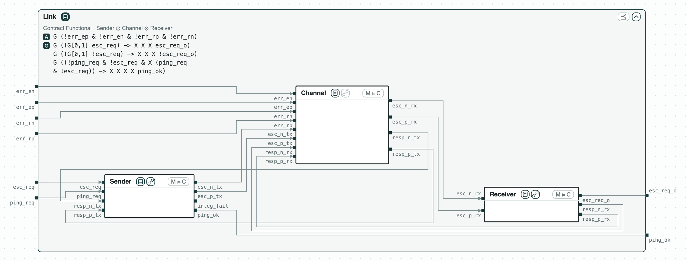
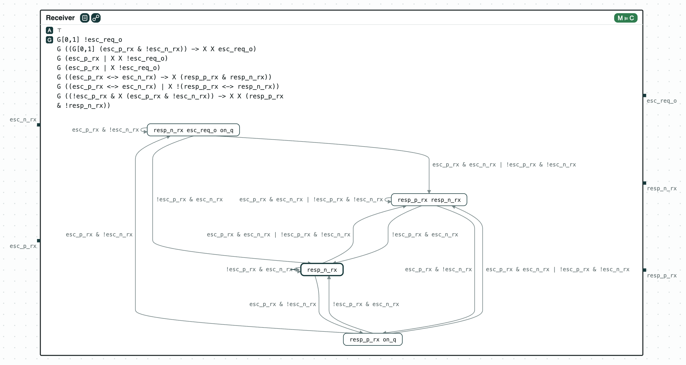
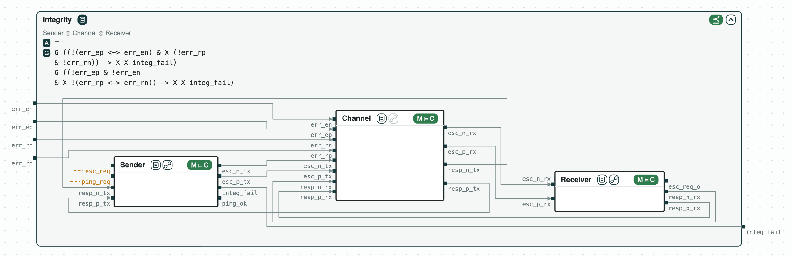
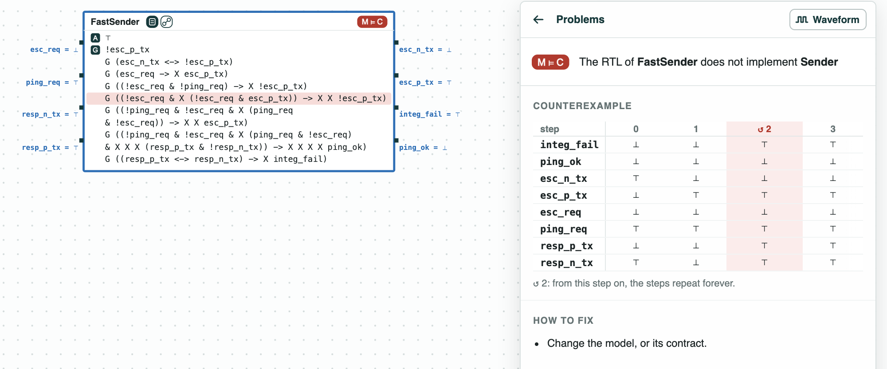

## OpenTitan security chip: the escalation link proven module by module from its RTL

**The system.** [OpenTitan](https://opentitan.org) is an open source
security chip. When it detects an attack, an alert handler sends an
escalation (an order to react, for instance to wipe the keys) to a
receiver, over an escalation link. This demo is a small version of that
link: _Sender_, _Channel_ (the wires), and _Receiver_, each a Verilog
module. To escalate, the sender raises a differential pair: two wires
with opposite values (`esc_p_tx`, `esc_n_tx`), so a single wrong wire
makes them equal, which both ends detect. To ping (test that the receiver
is alive), it sends one-cycle pulses; a pulse of two cycles is an
escalation. The receiver answers on a response pair (`resp_p`,
`resp_n`), and makes them equal when the escalation pair is wrong; the
sender raises `integ_fail` when the response pair is equal, and `ping_ok`
when a ping is answered. The inputs `err_ep`,
`err_en`, `err_rp`, `err_rn` flip one wire of the channel, to model a
fault or an attack. The contracts of the
modules and the two requirements are written in SystemVerilog Assertions,
after the assertions of OpenTitan (`prim_esc_rxtx_assert_fpv`):
_Functional_ (with no wrong wire, a request held two cycles escalates the
receiver, nothing else does, and a ping is answered) and _Integrity_ (a
single wrong wire is detected). Yosys reads the Verilog into state
machines, and nuXmv checks them.

**The question.** Does the link meet both requirements, and can we show
it by checking each module on its own? Checking modules one by one scales
to designs too large to check at once, and a module can then be replaced
by any other that meets its contract.

<p align="center">
  
  <br>
  <em>The system: the three modules, each with its Verilog, inside the requirement Functional.</em>
</p>

### The steps

The tags on the boxes give the results of the checks: green holds, red
fails; [Diagrams](https://chase-cps.github.io/interfaces/diagrams/) says
how to read them.

**Step 1. Each module.** The Verilog of the sender, of the channel, and of
the receiver implements its contract (M ⊨ C: every behavior of the module
meets the contract). The receiver is drawn open: its contract and its
state machine of 4 states, read from the Verilog. Each state is named by
the outputs and registers high in it; `on_q` is the register of the
receiver.

<p align="center">
  
  <br>
  <em>Step 1: the receiver implements its contract (M ⊨ C); its state machine of four states.</em>
</p>

**Step 2. The link.** The contracts of the three modules, composed,
[refine](https://chase-cps.github.io/contracts/checks/#verification-tasks)
_Functional_ and _Integrity_. With step 1, this proves that the link meets
both requirements, without a check of the whole design. Checked as a
whole, the Verilog of the link meets both too, as it should. The picture
shows the link inside _Integrity_; `out/escalation-link.html` draws it
inside _Functional_ too. _Integrity_ says nothing of the requests
`esc_req` and `ping_req`: they are drawn in orange as not driven, and the
check takes any value for them.

<p align="center">
  
  <br>
  <em>Step 2: each module implements its contract, and the link refines Integrity.</em>
</p>

**Step 3. A faster sender.** A sender that pings at every cycle of a ping
request does not implement _Sender_. In the counterexample, the ping
request stays high and so does the pair, which only an escalation may do.
The module check finds the fault in the sender alone; in the whole link,
the same sender makes the receiver escalate on a ping.

<p align="center">
  
  <br>
  <em>Step 3: the fast sender does not implement Sender; the guarantee it breaks in red.</em>
</p>

### Run it

```
pip install "chase-cps[rtl]"                # with Yosys
chase-cps install nuxmv --accept-license
python escalation.py --expect
```

### Content of the directory
- `sva/`: the contracts of the three modules and the two requirements, in
  SystemVerilog Assertions, with their `*.results.json`;
- `rtl/`: the Verilog of the modules, of the link, and of the fast sender
  (`esc_sender_fast.v`, `esc_link_fast.v`);
- `escalation.py`: the steps with the CHASE Python package;
- `out/escalation.html`, `out/escalation-link.html`,
  `out/escalation-receiver.html`: the diagrams of the steps, and
  `out/escalation-system.html`: the system alone, written by
  `escalation.py`.
