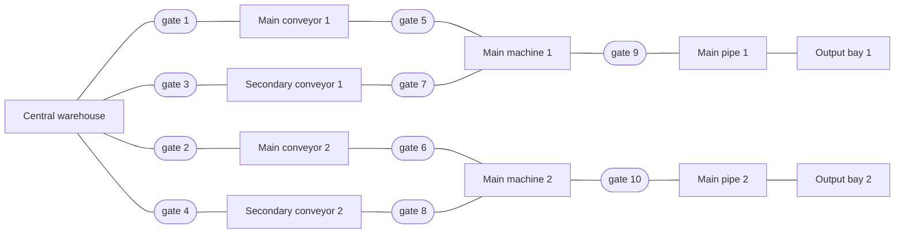
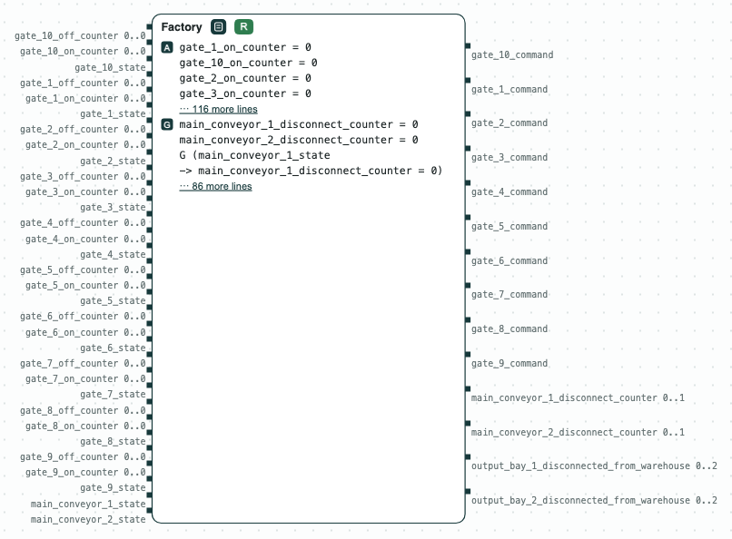

## A small factory: requirements from patterns

**The question.** The requirements of a small factory are written as
patterns over its architecture, not as formulas. Can the gates be
controlled so that the requirements hold when the main conveyors fail?



_The architecture of the factory: the controller opens and closes the gates._

The factory is that of the FDL 2024 paper. It is written in the
domain-specific language of CHASE (`dsl_factory_realizable.txt`): the
components and their types, how they are connected, and patterns such as
`never-disconnect(output bay 1, warehouse, 30, MS)`. The machines turn iron
into coins. CHASE turns the patterns into one contract in GR(1) for the
controller of the gates:

- its inputs are the states of the components and of the gates;
- its outputs are the commands of the gates;
- the timings become counters.

The requirements are:

- no two conveyors are connected through the central warehouse, or through
  a main machine;
- no two machines are connected through a pipe;
- a failed main conveyor is disconnected within 20 ms;
- an output bay is never cut off from the warehouse for more than 30 ms.

The gates open and close within 10 ms. Only the main conveyors may fail, at
most two of them.

### The steps

**Step 1. The requirements are realizable.** The controller can open and
close the gates so that the output bays keep their supply: when a main
conveyor fails, the secondary conveyor next to it takes its place.

<p align="center">
  
  <br>
  <em>Step 1: the contract of the controller of the gates is realizable.</em>
</p>

### Python Flow
The script needs the CHASE Python package, version 0.5.0, and slugs. From
the directory of the demo:

```
$> pip install chase-cps
$> chase-cps install slugs
$> python3 factory.py
```

The script prints the result and writes the diagram above in
`out/factory.html`, a page to open in a browser. With `--expect` the script
exits with code 1 when a result is not the expected one.

### Logic-based Flow
The same check with the console tools of CHASE and gr1c:

```
$> dsl_tool -i dsl_factory_realizable.txt -o factory -b gr1c
$> gr1c -r factory.spc
Realizable.
```
