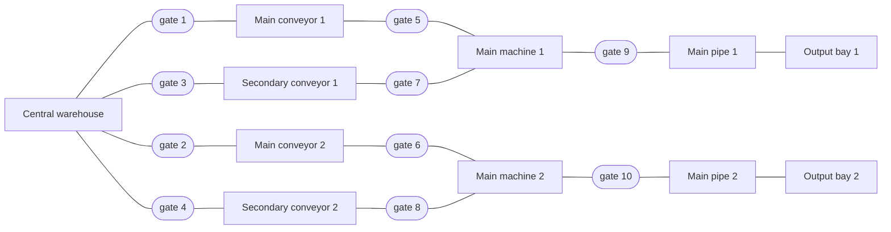
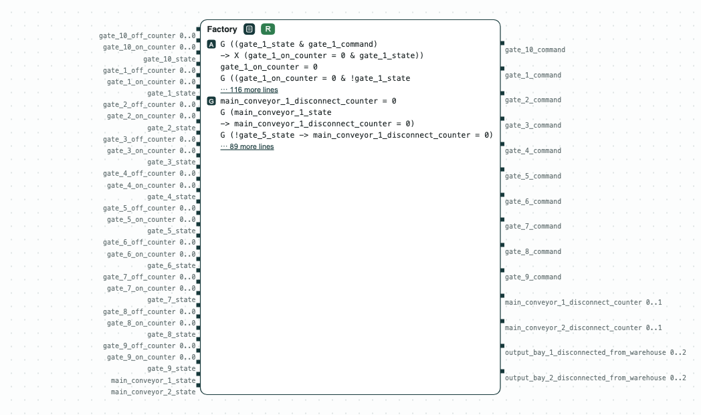

## A small factory: the controller of the gates, from patterns of requirements

**The question.** The requirements of a small factory are written as
patterns over its architecture, not as formulas. Can the gates be
controlled so that the requirements hold when the main conveyors fail?

**What it shows.**
- The domain-specific language of CHASE: the components, how they are
  connected, and patterns of requirements become one GR(1) contract for
  the controller of the gates: 32 inputs, 14 outputs, 60 assumptions, 18
  guarantees.
- Realizability (slugs, GR(1)): the contract is realizable, in 0.1 s.
- Two back ends for GR(1): the console writes the same contract for slugs
  and for gr1c, and both say that it is realizable.



_The architecture of the factory: the controller opens and closes the gates._

The factory is that of the FDL 2024 paper. It is written in the
domain-specific language of CHASE (`dsl_factory_realizable.txt`): the
components and their types, how they are connected, and patterns such as
`never-disconnect(output bay 1, warehouse, 30, MS)`. The machines turn iron
into coins. CHASE turns the patterns into one contract in GR(1) for the
controller of the gates:

- its inputs are the states of the gates and of the main conveyors, the
  only components that may fail;
- its outputs are the commands of the gates;
- the timings become counters (one step is 10 ms).

The requirements are:

- no two conveyors are connected through the central warehouse, or through
  a main machine;
- no two machines are connected through a pipe;
- a failed main conveyor is disconnected within 20 ms;
- an output bay is never cut off from the warehouse for more than 30 ms.

The gates open and close within 10 ms. Only the main conveyors may fail, at
most two of them.

### The steps

**Step 1. The requirements are realizable.** The controller can open and
close the gates so that the output bays keep their supply: when a main
conveyor fails, the secondary conveyor next to it takes its place.

<p align="center">
  
  <br>
  <em>Step 1: the contract of the controller of the gates is realizable (R).</em>
</p>

**Step 2. The same contract for gr1c.** `dsl_tool` writes the contract for
slugs (by default) or for gr1c (`-b gr1c`). Both tools say that it is
realizable, in a few hundredths of a second.

The same language describes the power system of an aircraft: `../DATE18`.

### Content of the directory
The directory of the demo contains:
- `dsl_factory_realizable.txt`: the factory and its requirements in the
  language of CHASE;
- `factory.py`: the check with the CHASE Python package;
- `out/factory.html`: the diagram above, written by `factory.py`.

### Run it

```
pip install chase-cps                       # version 0.5.0 or later
chase-cps install slugs
python factory.py --expect
```

The script prints the size of the contract and the result of the check,
and writes `out/factory.html`, a page to open in a browser. With
`--expect` the script exits with code 1 when the result is not the
expected one.

Console. `dsl_tool` writes the specification for slugs, or for gr1c with
`-b gr1c` (gr1c is installed separately; `$SLUGSCOMPILER` is `tools/StructuredSlugsParser/compiler.py`
of slugs):

```
$> dsl_tool -i dsl_factory_realizable.txt -o factory
$> python3 $SLUGSCOMPILER factory.structuredSlugs > factory.slugsin
$> slugs factory.slugsin
RESULT: Specification is realizable.
$> dsl_tool -i dsl_factory_realizable.txt -o factory -b gr1c
$> gr1c -r factory.spc
Realizable.
```
