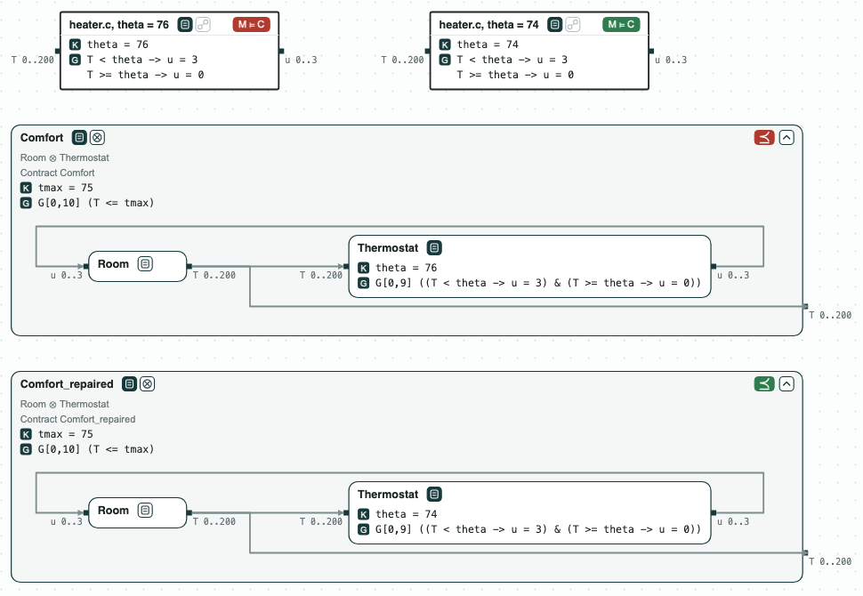

## Heater: repairing a thermostat, then checking its code

**The question.** A thermostat heats a room while the temperature is below a
threshold. The room must stay at most 75. Which threshold works, and does
the C code of the thermostat implement it?

The contracts are in `heater.ltl`, over 10 steps:

- `Room`: the temperature `T` starts at 60; at each step it rises by the
  heat `u` and falls by 1 (`G[0,9] (T' = T + u - 1)`).
- `Thermostat`: it heats (`u = 3`) while `T < theta`, and stops at or
  above it. `theta` is a constant, 76.
- `Comfort`: the requirement, `G[0,10] (T <= tmax)`, with the constant
  `tmax` at 75.
- `ThermostatStep`: one step of the thermostat, the contract of the C
  function `thermostat` in `heater.c`.

The formulas read a bounded number of steps (signal temporal logic in
discrete time), so z3 checks them.

### The steps

**Step 1. The thermostat overshoots.** `Room` and `Thermostat` composed do
not refine `Comfort`. The counterexample heats to 76, stops, cools to 75,
and heats again to 77. The worst case of `T <= 75` over the behaviors of
the system, its smallest robustness, is -2: 2 degrees too hot.

**Step 2. Repair the threshold.** `repair` changes `theta` as little as
possible so that the refinement holds: `theta = 74`, a change of 2. It is
optimal, and the refinement holds with it (z3). The worst case is then 0:
the room reaches 75 and no more.

**Step 3. Or repair the requirement.** Changing `tmax` instead gives 77:
the requirement accepts the overshoot. Which one to change is the
designer's choice; `repair` changes only the constants it is given.

**Step 4. The code.** `heater.c` heats while `T < 74`. ESBMC checks that it
implements `ThermostatStep` with `theta = 74`, and that it does not with
`theta = 76`. Asked the other way, `repair` finds the threshold that the
code implements: 74. Each round runs ESBMC and turns its counterexample (a
temperature where the code and the contract disagree) into a condition on
`theta`.

<p align="center">
  
  <br>
  <em>Before the repair (theta = 76, red) and after it (theta = 74, green): the refinement of Comfort, and heater.c against one step of the thermostat.</em>
</p>

### Content of the directory
The directory of the demo contains:
- `heater.ltl`: the contracts of the room, the thermostat, one step of the
  thermostat, and the requirement, in signal temporal logic in discrete
  time. The lines `# view:` at the top give the refinement and the C
  implementation that `chase-cps view` draws;
- `heater.c`: one step of the thermostat in C;
- `heater.py`: the steps with the CHASE Python package;
- `heater.results.json`: the results of `chase-cps view heater.ltl --check`;
- `out/heater.html`: the diagram above, written by `heater.py`.

### Run it

```
pip install "chase-cps[z3]"      # and ESBMC or CBMC for step 4
python heater.py --expect
chase-cps view heater.ltl --check -o out/heater-view.html
```
