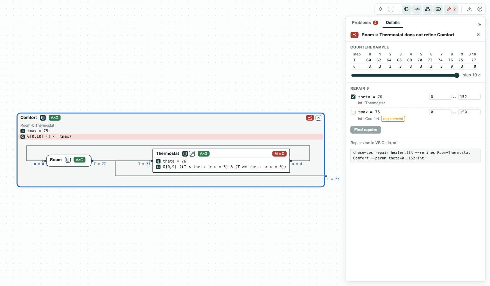
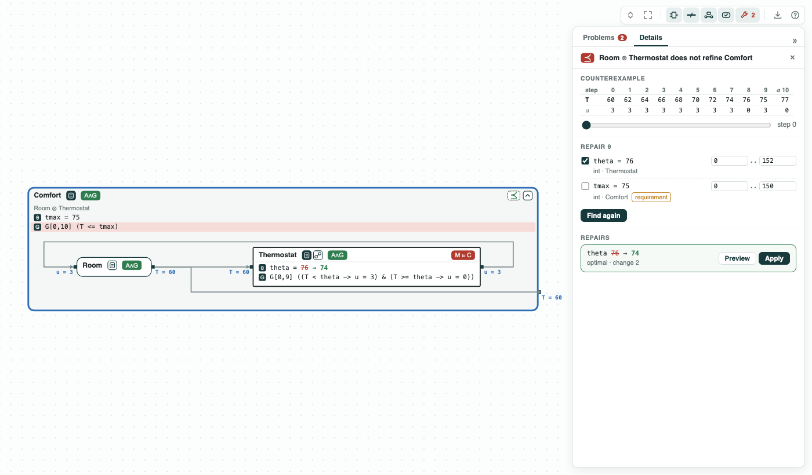
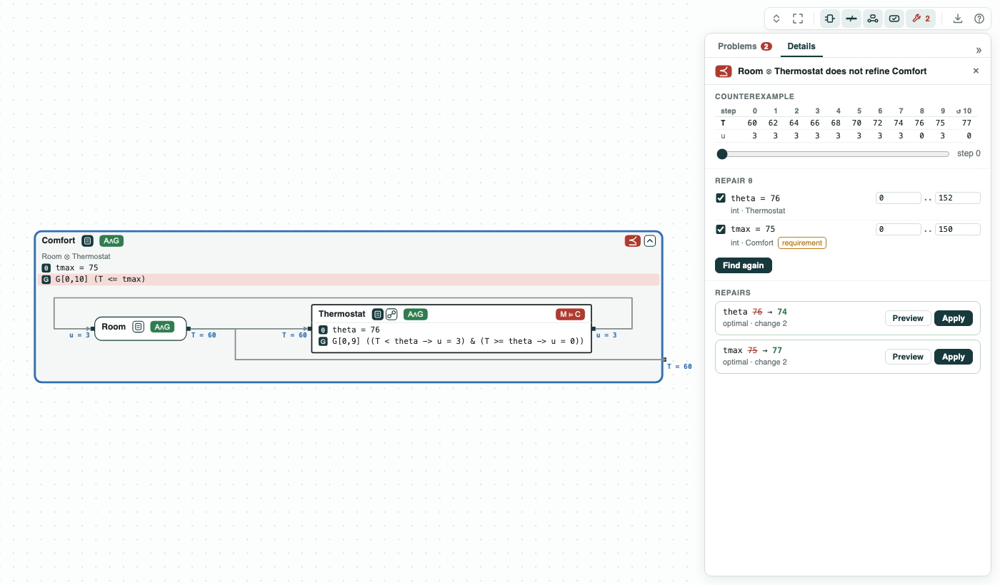
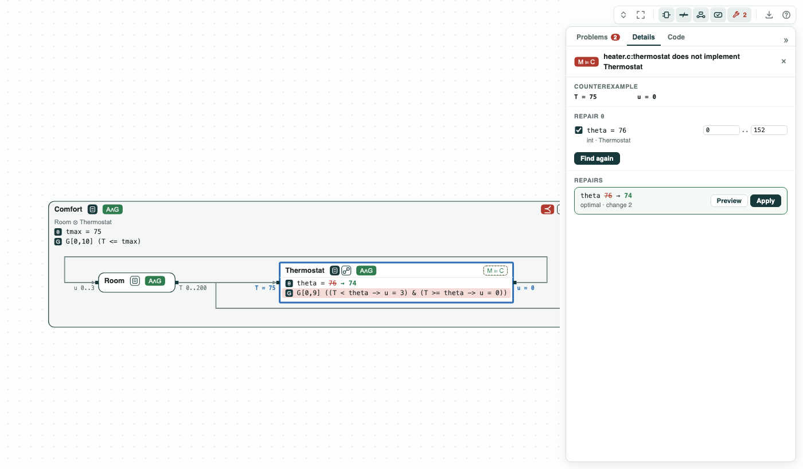

## Room heating: repairing a thermostat, then checking its C code

**The question.** A thermostat heats a room while the temperature is below a
threshold. The room must stay at most 75. Which threshold works, and does
the C code of the thermostat implement it?

**What it shows.**
- Counterexample over time: the room heats to 76, cools to 75, and heats
  again to 77 (signal temporal logic in discrete time, checked by z3).
- Robustness: the worst case of `T <= 75` over the behaviors is -2, 2
  degrees too hot; after the repair it is 0.
- Repair of a design constant: the threshold `theta = 74` (from 76),
  optimal, in 4 rounds and 0.1 s; or, if the requirement may change,
  `tmax = 77`.
- C code called once per step: ESBMC checks one call of `thermostat`
  against one step of the contract. The code implements the contract with
  `theta = 74`, not with 76 (with `T = 75` it returns 0), and repair finds
  the threshold that the code implements: 74.

<p align="center">
  
  <br>
  <em>Before the repair (theta = 76, ⪯ and M ⊨ C red) and after it (theta = 74, green): the thermostat with its C code.</em>
</p>

The contracts are in `heater.ltl`, over 10 steps:

- `Room`: the temperature `T` starts at 60; at each step it rises by the
  heat `u` and falls by 1 (`G[0,9] (T' = T + u - 1)`).
- `Thermostat`: it heats (`u = 3`) while `T < theta`, and stops at or
  above it. `theta` is a named constant (θ in the diagram), 76. Its code
  is the C function `thermostat` in `heater.c`, called once per step.
- `Comfort`: the requirement, `G[0,10] (T <= tmax)`, with the constant
  `tmax` at 75.

The formulas read a bounded number of steps (signal temporal logic in
discrete time), so z3 checks them.

### The steps

**Step 1. The thermostat overshoots.** `Room` and `Thermostat` composed do
not refine `Comfort`. The counterexample heats to 76, stops, cools to 75,
and heats again to 77 at step 10. The worst case of `T <= 75` over the
behaviors of the system, its smallest robustness, is -2: 2 degrees too hot.

<p align="center">
  
  <br>
  <em>The counterexample, step by step; the slider puts step 10 (T = 77) on the ports.</em>
</p>

**Step 2. Repair the threshold.** `repair` changes `theta` as little as
possible so that the refinement holds: `theta = 74`, a change of 2. It is
optimal, and the refinement holds with it (z3). The worst case is then 0:
the room reaches 75 and no more.

<p align="center">
  
  <br>
  <em>Find repairs: theta 76 → 74, optimal.</em>
</p>

**Step 3. Or repair the requirement.** Changing `tmax` instead gives 77:
the requirement accepts the overshoot. Which one to change is the
designer's choice; `repair` changes only the constants it is given. In the
viewer, `tmax` belongs to the requirement and is picked only by hand.

<p align="center">
  
  <br>
  <em>Both constants picked: theta 76 → 74, or tmax 75 → 77.</em>
</p>

**Step 4. The code.** `heater.c` heats while `T < 74`, and is called once
per step: each step of the thermostat is one call. So ESBMC checks one
call against the formula of one step of `Thermostat`
(`(T < theta -> u = 3) & (T >= theta -> u = 0)`): the code implements
`Thermostat` with `theta = 74`, and not with `theta = 76` (with `T = 75`
it returns 0). Asked the other way, `repair` finds the threshold that the
code implements: 74.

<p align="center">
  
  <br>
  <em>M ⊨ C: the call T = 75 returns 0; the threshold the code implements is 74.</em>
</p>

### Content of the directory
The directory of the demo contains:
- `heater.ltl`: the contracts of the room, the thermostat, and the
  requirement, in signal temporal logic in discrete time. The lines
  `# view:` at the top draw the room and the thermostat inside the
  requirement, the thermostat with its C code;
- `heater.c`: the thermostat in C, called once per step;
- `heater.py`: the steps with the CHASE Python package;
- `heater.results.json`: the results of `chase-cps view heater.ltl --check`;
- `out/heater.html`: the diagram before and after the repair, written by
  `heater.py`.

### Run it

```
pip install "chase-cps[z3]"      # and ESBMC or CBMC for step 4
python heater.py --expect
chase-cps view heater.ltl --check -o out/heater-view.html
chase-cps repair heater.ltl --refines Room+Thermostat Comfort --param theta=60..90:int
chase-cps repair heater.ltl --impl heater.c:thermostat Thermostat --param theta=0..200:int
chase-cps view heater.ltl --check --serve                     # Find repairs in the page
```
