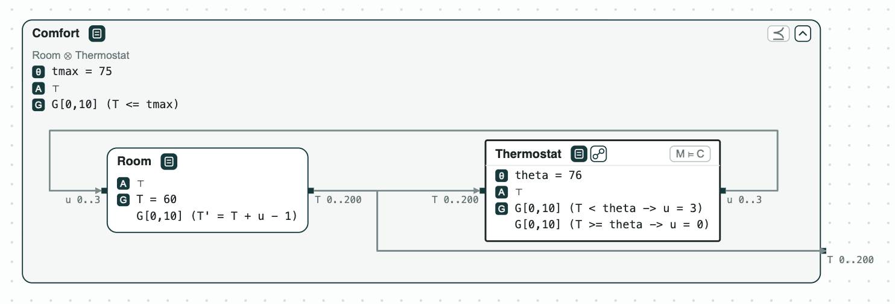

## Room thermostat: repairing the threshold, then checking its C code

**The system.** A thermostat keeps a room warm without overheating it. It
is a small example made for these pages. _Room_ starts at 60 degrees and,
at each step, gains the heat `u` and loses 1. _Thermostat_ heats
(`u = 3`) while the temperature `T` is below a threshold `theta`, here
76; it is also written in C, in `heater.c`. The requirement _Comfort_
asks `T <= tmax` (75 degrees) at every step. The contracts are written in
signal temporal logic in discrete time over 10 steps (`G[0,10]` is "at
each of the steps 0 to 10"), so the solver z3 checks them.

**The question.** Does the thermostat keep the room within 75 degrees?
If not, which threshold does, and does the C code implement it? The
designer needs a threshold that works before tuning the code.

<p align="center">
  
  <br>
  <em>The system: Room and Thermostat (with its C code) inside the requirement Comfort.</em>
</p>

### The steps

**Step 1. The thermostat overshoots.** _Room_ and _Thermostat_ composed
do not refine _Comfort_ (refine: every behavior of the parts meets the
requirement). The counterexample: the room heats to 76, cools to 75,
and heats again to 77 at step 10. CHASE also computes the robustness of
`T <= 75`, the margin by which it holds in the worst case: -2, two
degrees too hot.

<p align="center">
  
  <br>
  <em>Step 1: the counterexample; the slider puts step 10 on the ports.</em>
</p>

**Step 2. Repair the threshold.** `repair` changes a named constant as
little as possible so that the check passes. It gives `theta = 74`, a
change of 2, and shows that no smaller change works. The worst case is
then 0: the room reaches 75 and no more.

<p align="center">
  
  <br>
  <em>Step 2: theta 76 to 74, optimal.</em>
</p>

**Step 3. Or repair the requirement.** Changing `tmax` instead gives 77:
the requirement accepts the overshoot. In the viewer, `tmax` belongs to
the requirement and is picked only by hand.

<p align="center">
  
  <br>
  <em>Step 3: both constants picked, two repairs.</em>
</p>

**Step 4. The code.** Each step of _Thermostat_ is one call of the C
function, so ESBMC checks one call against one step of the formula
(the tag M ⊨ C). With `theta = 76` it fails: the call with `T = 75`
returns 0 where the contract asks for 3. `repair` finds the threshold
that the code implements: 74.

<p align="center">
  
  <br>
  <em>Step 4: M ⊨ C fails on T = 75.</em>
</p>

**Step 5. Between the samples.** A step is a sample taken every 20 s,
and the temperature changes at most 0.1 degree per second (its Lipschitz
constant: a bound on how fast it changes). Between two samples it can
then move by 2 degrees, so CHASE checks `T + 2 < 75` at the samples
(Fainekos and Pappas): if that holds, `T <= 75` holds at every instant.
With `theta = 74` the samples reach 75: the answer is unknown, not a
counterexample, since the margin is only sufficient. With `theta = 71`
the refinement holds in continuous time.

```
$> chase-cps check heater.ltl --period 20 --lipschitz T=0.1 --refines Room+Thermostat Comfort
```

The tags of the pictures are explained on the page
[Diagrams](https://chase-cps.github.io/interfaces/diagrams/#what-is-drawn).

### Run it

```
pip install "chase-cps[z3]"      # and ESBMC or CBMC for step 4
python heater.py --expect
chase-cps view heater.ltl --check --serve
```

### Content of the directory
- `heater.ltl`: the three contracts;
- `heater.c`: the thermostat in C, called once per step;
- `heater.py`: the steps with the CHASE Python package;
- `heater.results.json`: the results of `chase-cps view --check`;
- `out/heater.html`: the diagram before and after the repair;
  `out/heater-system.html`: the system, with no check.
