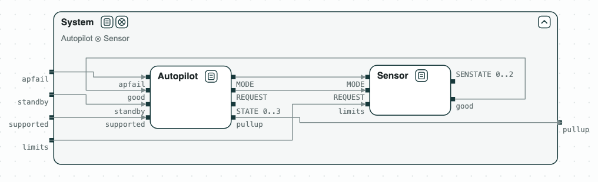
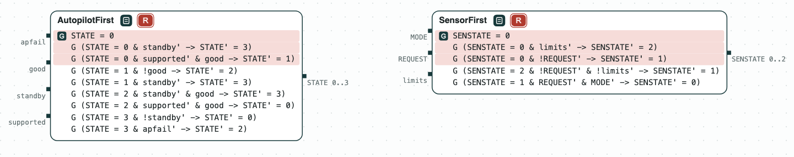
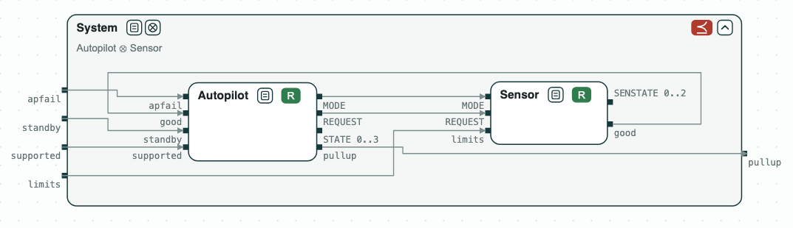
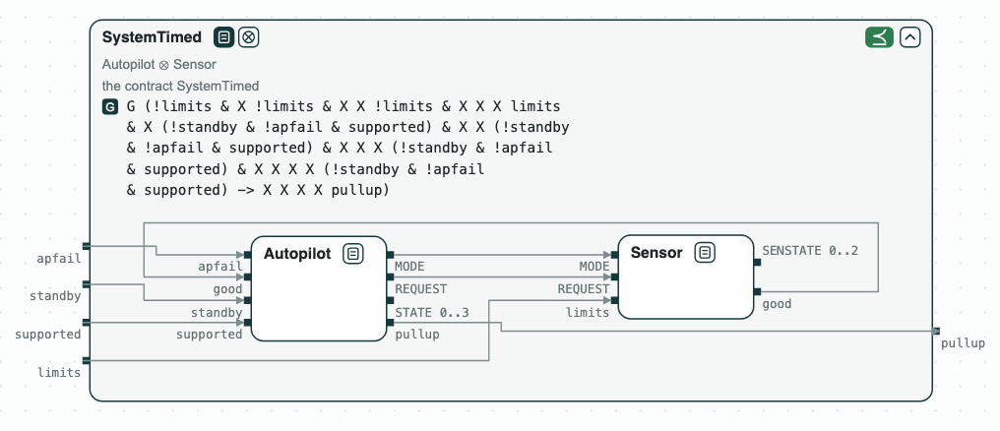

## Autopilot: conflicting requirements

**The question.** Which requirements of a state machine, as first written,
contradict each other? Once they are corrected, does the system command
the pullup when its requirement says?

<p align="center">
  
  <br>
  <em>The system: the autopilot and the sensor, which feed each other.</em>
</p>

An autopilot commands a safety maneuver (pullup) when a sensor reports a
hazard. The requirements are those of the finite state machine of the Ten
Lockheed Martin Cyber-Physical Challenges (Mavridou et al., RE 2020), as in
the FRET case study. The case study gives a first version of each
requirement and the corrected one (FSM-001 to FSM-011). Each requirement is
a transition:

- of the autopilot: `STATE` 0 to 3, that is TRANSITION, NOMINAL, MANEUVER,
  and STANDBY;
- or of the sensor: NOMINAL, TRANSITION, and FAULT.

### The steps

**Step 1. The first requirements.** _AutopilotFirst_ and _SensorFirst_ are
unrealizable. Each unrealizable core is made of the requirements that send
the machine to two different states for the same inputs, with the initial
state. For instance, in TRANSITION, with the pilot in control (`standby`),
the system supported (`supported`), and good sensor data (`good`), FSM-002
says STANDBY and FSM-003 says NOMINAL. A primed input is its value at the
next step: the autopilot reads the inputs of the step it moves to.

The script replaces each requirement of a core by its corrected version,
and checks again. It finds four conflicts in the autopilot and one in the
sensor, with the same fixes as FRET.

<p align="center">
  
  <br>
  <em>Step 1: the first requirements are unrealizable; the cores highlighted in red.</em>
</p>

**Step 2. The system.** The corrected _Autopilot_ and _Sensor_ are
realizable, but together they do not refine _System_ (FSM-001): the
counterexample the limits are exceeded and the pullup does not come at
once.

<p align="center">
  
  <br>
  <em>Step 2: Autopilot ∥ Sensor does not refine System.</em>
</p>

**Step 3. The system, with time.** The sensor and the autopilot each take a
step to react, and the autopilot must first reach NOMINAL from the start.
_SystemTimed_ (FSM-001t) gives the pullup that time: with the limits not
exceeded for three steps and then exceeded, the pilot not in control and no
failure, the pullup comes at the fifth step. The composition refines it.

<p align="center">
  
  <br>
  <em>Step 3: Autopilot ∥ Sensor refines SystemTimed.</em>
</p>

### Content of the directory
The directory of the demo contains:
- `requirements.txt`: the requirements, with the numbers of the paper;
- `fsm.ltl`: the contracts of the autopilot and of the sensor as the
  requirements were first written (_AutopilotFirst_, _SensorFirst_) and
  corrected (_Autopilot_, _Sensor_), and of the system (_System_,
  _SystemTimed_). The comment at the end of each line is the number of the
  requirement;
- `fsm.py`: the analysis with the CHASE Python package.

### Python Flow
The script needs the CHASE Python package, version 0.5.0, nuXmv, and
slugs. From the directory of the demo:

```
$> pip install chase-cps
$> chase-cps install nuxmv --accept-license
$> chase-cps install slugs
$> python3 fsm.py
```

The script prints the result of each step, with the five conflicts and
their fixes, and writes the diagrams above in `out/fsm.html`, a page to
open in a browser: a click on a name opens or closes the contract, and a
click on a red tag shows its core. The requirements are in
`requirements.txt`, and the contracts in `fsm.ltl`.

With `--expect` the script exits with code 1 when a result is not the
expected one.
