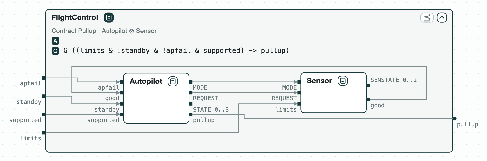
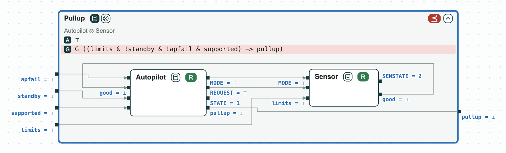
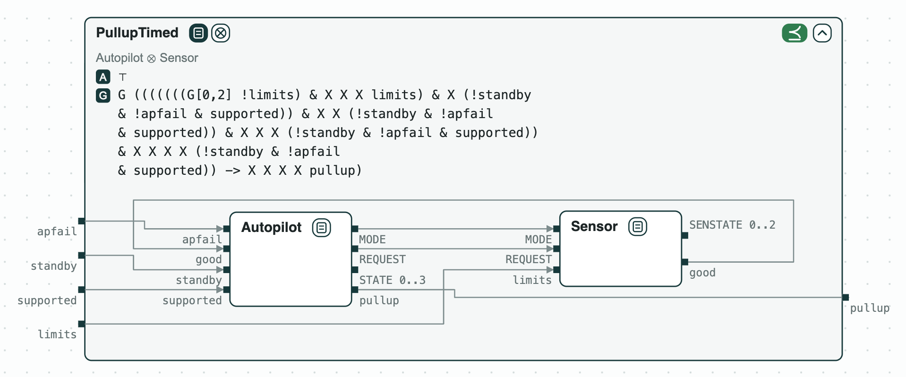

## Lockheed Martin autopilot: the requirements in conflict, and the time the pullup takes

**The system.** An autopilot of an aircraft commands a safety maneuver, a
pullup, when a sensor reports that the flight limits are exceeded. The
requirements come from the Ten Lockheed Martin Cyber-Physical Challenges
(Mavridou et al., RE 2020), first as written and then corrected, as in
the case study LMCPS of [FRET](https://github.com/NASA-SW-VnV/fret), the
requirements tool of NASA. Each
requirement is a transition of a state machine, written in LTL (`x'` is
`x` at the next step). _Autopilot_ has the states `STATE` 0 TRANSITION, 1
NOMINAL, 2 MANEUVER (the pullup), 3 STANDBY; it reads `standby` (the pilot
is in control), `apfail` (an external failure), `supported` (the system is
healthy), and `good` (the sensor sees no fault). _Sensor_ has the states
`SENSTATE` 0 NOMINAL, 1 TRANSITION, 2 FAULT; it reads `limits` (the limits
are exceeded) and the mode of the autopilot. The contracts assume nothing
of the environment. slugs checks realizability, nuXmv the refinements.

**The question.** Two questions. Which of the first requirements are in
conflict, so that no autopilot can meet them? And once they are
corrected, does the pullup come as soon as the system requirement says?
The first is asked before anyone builds the autopilot, the second before
anyone signs off its timing.

<p align="center">
  
  <br>
  <em>The system: the autopilot and the sensor, inside the system requirement, FSM-001.</em>
</p>

### The steps

The tags on the boxes give the results of the checks: green holds, red
fails; [Diagrams](https://chase-cps.github.io/interfaces/diagrams/) says
how to read them.

**Step 1. The first requirements.** A contract is
[realizable](https://chase-cps.github.io/tools/synthesis/#realizability-and-synthesis)
when some state machine meets it whatever the environment does. The first
requirements of the autopilot are not. CHASE finds an
[unrealizable core](https://chase-cps.github.io/tools/synthesis/#unrealizable-cores),
the smallest set of requirements that no machine meets together: the
initial state, `G ((STATE = 0 & standby') -> STATE' = 3)`, and
`G ((STATE = 0 & supported' & good) -> STATE' = 1)`. In TRANSITION, with
the pilot in control and good data, one says STANDBY and the other
NOMINAL. The script replaces one requirement per core by its corrected
version until the contract is realizable: four conflicts in the autopilot,
one in the sensor, the ones FRET reports. Finding them by reading 14
requirements is hard; each core points at two to four.

<p align="center">
  
  <br>
  <em>Step 1: the first requirements; the cores in red.</em>
</p>

**Step 2. The system.** The corrected _Autopilot_ and _Sensor_ are
realizable. Composed, they do not
[refine](https://chase-cps.github.io/contracts/checks/#verification-tasks)
_Pullup_, `G ((limits & !standby & !apfail & supported) -> pullup)`: a
pullup at the step the limits are exceeded. In the counterexample, the
limits are exceeded at step 1, but the autopilot is still in NOMINAL.

<p align="center">
  
  <br>
  <em>Step 2: the composition does not refine Pullup; the values at step 1.</em>
</p>

**Step 3. The system, with time.** The sensor and the autopilot each take
a step to react. _PullupTimed_ gives the pullup that time: after three
steps within the limits and one beyond, with the pilot not in control and
no failure, the pullup comes at the fifth step. The composition refines it.

<p align="center">
  
  <br>
  <em>Step 3: the composition refines PullupTimed.</em>
</p>

### Run it

```
pip install chase-cps
chase-cps install nuxmv --accept-license
chase-cps install slugs
python fsm.py --expect
```

### Content of the directory
- `requirements.txt`: the requirements, numbered as in the paper;
- `fsm.ltl`: the contracts of the autopilot and of the sensor, first and
  corrected, and of the system; each line ends with its number;
- `fsm.results.json`: the results of `chase-cps view --check`;
- `fsm.py`: the steps with the CHASE Python package;
- `out/fsm.html`: the diagrams above, written by `fsm.py`.
