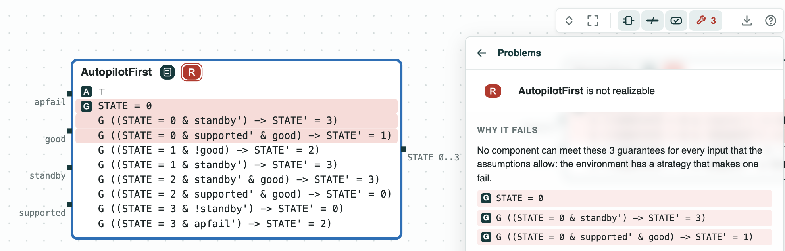
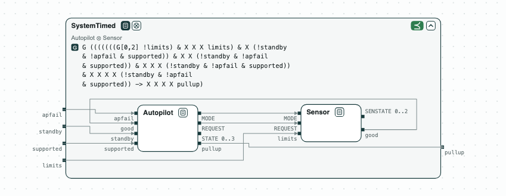

## Autopilot: the requirements in conflict, and the time the pullup takes

**The question.** An autopilot commands a safety maneuver (pullup) when a
sensor reports a hazard. Which requirements of its state machine, as first
written, contradict each other? Once they are corrected, does the system
command the pullup when its requirement says?

**What it shows.**
- Realizability (slugs, GR(1)): the first requirements of the autopilot and
  of the sensor are unrealizable.
- Unrealizable cores: each core is 3 to 5 requirements that send the
  machine to two states for the same inputs. Replacing one requirement of
  each core by its corrected version, the script finds four conflicts in
  the autopilot and one in the sensor, the same as FRET (1.8 s and 0.3 s).
- Composition with discharge: the autopilot and the sensor feed each other,
  and no assumption is left.
- Refinement (nuXmv): they do not refine the requirement of the system
  (FSM-001), with a counterexample of three steps; they refine the timed
  version (FSM-001t).
- The whole script runs in about 3 s.

<p align="center">
  
  <br>
  <em>The page of the demo: the first requirements (R red), and the corrected autopilot and sensor inside System (⪯ red) and SystemTimed (⪯ green).</em>
</p>

The requirements are those of the finite state machine of the Ten
Lockheed Martin Cyber-Physical Challenges (Mavridou et al., RE 2020), as in
the FRET case study. The case study gives a first version of each
requirement and the corrected one (FSM-001 to FSM-013). Each requirement is
a transition:

- of the autopilot: `STATE` 0 to 3, that is TRANSITION, NOMINAL, MANEUVER,
  and STANDBY;
- or of the sensor: `SENSTATE` 0 to 2, that is NOMINAL, TRANSITION, and
  FAULT.

A primed input is its value at the next step: the autopilot reads the
inputs of the step it moves to.

### The steps

**Step 1. The first requirements.** _AutopilotFirst_ and _SensorFirst_ are
unrealizable. Each unrealizable core is made of the requirements that send
the machine to two different states for the same inputs, with the initial
state. For instance, in TRANSITION, with the pilot in control (`standby`),
the system supported (`supported`), and good sensor data (`good`), FSM-002
says STANDBY and FSM-003 says NOMINAL: the core is AP-I, FSM-002, and
FSM-003.

The script replaces the requirement of each core that has a corrected
version (FSM-003, FSM-004, FSM-008, FSM-007 in this order), and checks
again until the contract is realizable. It finds four conflicts in the
autopilot and one in the sensor (SEN-I, FSM-010, FSM-011: FSM-011 is
replaced), with the same fixes as FRET.

<p align="center">
  
  <br>
  <em>Step 1: the first requirements are unrealizable; the terms of the cores are red.</em>
</p>

**Step 2. The system.** The corrected _Autopilot_ and _Sensor_ are
realizable. They feed each other (`good`, `MODE`, `REQUEST`), and are
composed with discharge: no assumption is left. Together they do not
refine _System_ (FSM-001: when the limits are exceeded, the pilot is not in
control, and the system is supported without failure, there is a pullup).
The counterexample: at step 1 the limits are exceeded, the pilot is not in
control, and there is no pullup, since the autopilot is still in NOMINAL.

<p align="center">
  
  <br>
  <em>Step 2: Autopilot ⊗ Sensor does not refine System; the values of the counterexample at step 1.</em>
</p>

**Step 3. The system, with time.** The sensor and the autopilot each take a
step to react, and the autopilot must first reach NOMINAL from the start.
_SystemTimed_ (FSM-001t) gives the pullup that time: with the limits not
exceeded for three steps and then exceeded, the pilot not in control and no
failure, the pullup comes at the fifth step. The composition refines it.

<p align="center">
  
  <br>
  <em>Step 3: Autopilot ⊗ Sensor refines SystemTimed (⪯ green).</em>
</p>

### Content of the directory
The directory of the demo contains:
- `requirements.txt`: the requirements, with the numbers of the paper;
- `fsm.ltl`: the contracts of the autopilot and of the sensor as the
  requirements were first written (_AutopilotFirst_, _SensorFirst_) and
  corrected (_Autopilot_, _Sensor_), and of the system (_System_,
  _SystemTimed_). The comment at the end of each line is the number of the
  requirement;
- `fsm.results.json`: the results kept by `chase-cps view fsm.ltl --check`;
- `fsm.py`: the steps with the CHASE Python package;
- `out/fsm.html`: the diagrams above, written by `fsm.py`.

### Run it

```
pip install chase-cps                       # version 0.5.0 or later
chase-cps install nuxmv --accept-license
chase-cps install slugs
python fsm.py --expect
chase-cps view fsm.ltl --check -o out/fsm-view.html
```

The script prints the result of each step, with the five conflicts and
their fixes, and writes `out/fsm.html`, a page to open in a browser: a
click on a name opens or closes the contract, and a click on a red tag
shows or hides its core and opens the panel of the check (for a
refinement, the counterexample, step by step). With `--expect` the script
exits with code 1 when a result is not the expected one.
