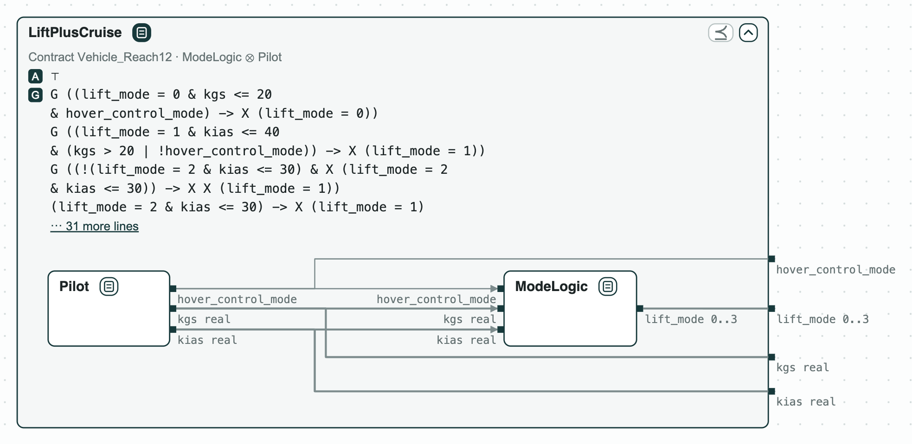

## NASA Lift-Plus-Cruise aircraft: what the pilot must do to hover in time

**The system.** Lift-Plus-Cruise is a NASA concept of an electric aircraft
that takes off and hovers on lift rotors and cruises on a wing. Its mode
logic sets `lift_mode`: 3 wing borne (flying on the wing), 2 semi wing
borne, 1 semi thrust borne, 0 thrust borne (hovering on the rotors). It
reads the airspeed `kias` and the ground speed `kgs` (knots), and the hover
control `hover_control_mode`, which the pilot turns on. The requirements
come from the LPC_mini example of
[FRET](https://github.com/NASA-SW-VnV/fret), the requirements tool of NASA
(Pressburger et al., REFSQ 2023), as LTL formulas over real numbers, one
formula per requirement. The vehicle is split in two parts: _ModeLogic_, with the requirements on the modes, and
_Pilot_, which sets the speeds and the hover control: it starts at 120
knots and changes the speed by at most 10 per step. The checks run on
nuXmv, with its SMT engine for the reals.

**The question.** The requirements say what the mode logic does, not what
the pilot does, so some flights hover within 12 steps and others never do.
What must the pilot do so that every flight hovers in time? A designer of
the pilot, or of a flight procedure, needs exactly this contract.

<p align="center">
  
  <br>
  <em>The system: the pilot drives the mode logic, inside the requirements with the deadline of 12 steps, which the pilot may not meet.</em>
</p>

### The steps

The tags on the boxes give the results of the checks: green holds, red
fails; [Diagrams](https://chase-cps.github.io/interfaces/diagrams/) says
how to read them.

**Step 1. Two deadlines.** With a deadline of 12 steps the requirements
are consistent (the tag G: the guarantees can hold together): some flight
meets them all. With 6 they are not (_Vehicle_Reach12_ and
_Vehicle_Reach06_ in the diagram: _Vehicle_ with the deadline _Reach12_ or
_Reach06_), and CHASE
finds the [unsat core](https://chase-cps.github.io/contracts/checks/#cores-why-a-check-fails),
the smallest set of requirements in conflict: 8 of 18. They say why:
`kias` starts at 120 and changes by at most 10 per step, the vehicle stays
wing borne above 90 and semi wing borne above 30, so it cannot hover by
step 6.

<p align="center">
  
  <br>
  <em>Step 1: consistent with 12 steps, not with 6; the core in red.</em>
</p>

**Step 2. The split.** _ModeLogic_ ⊗ _Pilot_ (their composition)
[refines](https://chase-cps.github.io/contracts/checks/#verification-tasks)
(the tag ⪯) _Vehicle_, the requirements without a deadline. _Pilot_ has
the requirements on the speeds and on the hover control at the start;
_ModeLogic_ has the others.

<p align="center">
  
  <br>
  <em>Step 2: the split refines the vehicle; the contracts of Pilot and ModeLogic open.</em>
</p>

**Step 3. What the pilot must do.** CHASE computes the
[quotient](https://chase-cps.github.io/contracts/algebra/#example-the-contract-of-a-missing-component)
Q12 = Reach12 / ModeLogic, the dashed box: the weakest contract of the
pilot with which every flight hovers within 12 steps. It is derived from
the requirements, not written by hand. The box around it, _Reach12_, says
`candidate: Pilot`: the part tried in the hole. _Pilot_, which only bounds
the change of speed, does not refine Q12: in the counterexample `kias`
stays at 120 and the vehicle never leaves the wing.

<p align="center">
  
  <br>
  <em>Step 3: Pilot does not refine Q12: <code>kias</code> stays at 120 (the values on the wires).</em>
</p>

**Step 4. A pilot that slows down.** _Slow_ lowers `kias` by 10 per step.
Slow says nothing of the hover control after the start; in the
counterexample it stays off, and the vehicle stops at semi thrust borne,
so _Slow_ does not refine Q12.

<p align="center">
  
  <br>
  <em>Step 4: Slow slows down, but the hover control stays off; at step 12 the vehicle is semi thrust borne (<code>lift_mode = 1</code>).</em>
</p>

**Step 5. A pilot that turns on the hover control.** _Decel_ also turns
the hover control on when `kgs` is below 20, and refines Q12: with the
mode logic, every flight hovers within 12 steps. It does not refine
Q06 = Reach06 / ModeLogic: no pilot can, as step 1 showed.

<p align="center">
  
  <br>
  <em>Step 5: Decel refines Q12.</em>
</p>

<p align="center">
  
  <br>
  <em>Step 5: Decel does not refine Q06: at step 6 the vehicle is still semi wing borne (<code>lift_mode = 2</code>).</em>
</p>

### Run it

```
pip install chase-cps
chase-cps install nuxmv --accept-license
python lpc.py --expect
```

### Content of the directory
- `requirements.txt`: the requirements in FRETish;
- `lpc.ltl`: the three contracts; the comment at the end of each line
  names the requirement;
- `lpc.chase`: step 1 with `logics_tool`;
- `lpc.py`: the steps with the CHASE Python package;
- `lpc.results.json`: the results of `chase-cps view --check`;
- `out/lpc.html`: the diagrams of the steps, and `out/lpc-system.html`:
  the system alone, written by `lpc.py`.
