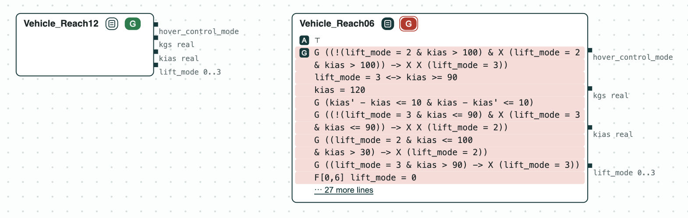
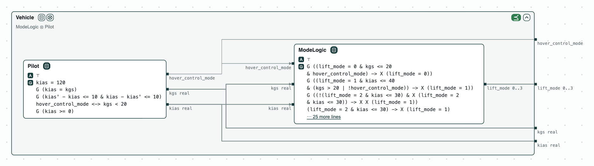
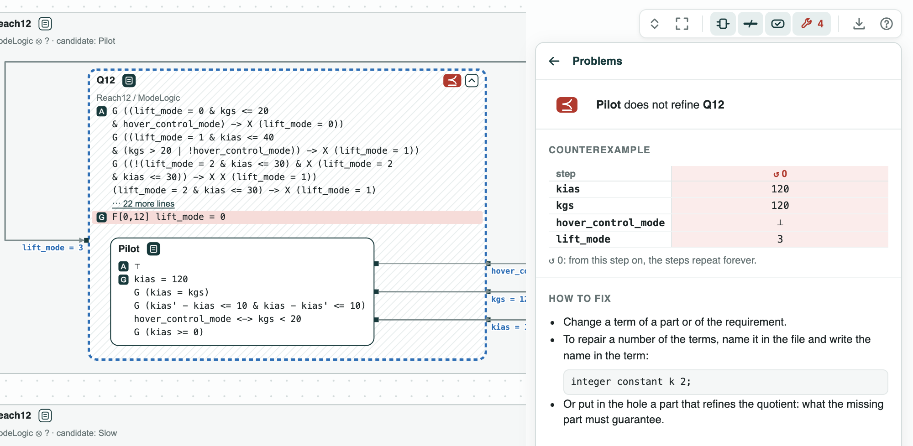
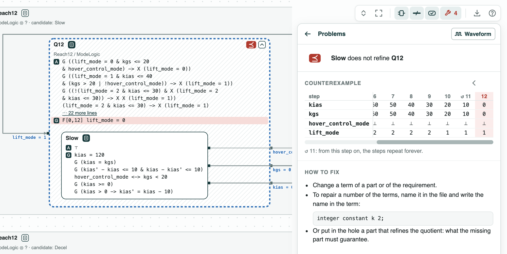
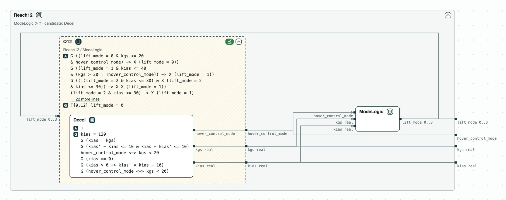
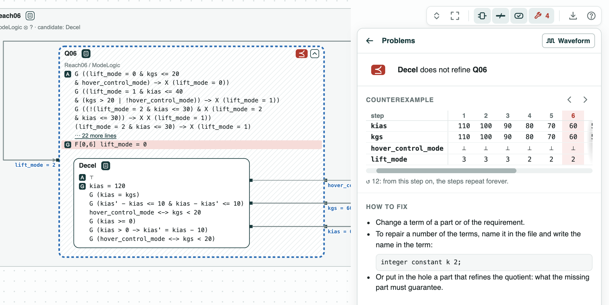

## Aircraft: what makes it hover in time

**The question.** Some flights of an aircraft meet its requirements and
hover within 12 steps. What must the pilot do so that every flight does?

**What it shows.**
- Requirements of NASA on real variables, checked with the SMT engine of
  nuXmv.
- Consistency and unsat cores: the requirements with a hover within 12
  steps are consistent, with a flight as witness (0.1 s); within 6 steps
  they are not, and the core is 8 requirements (0.9 s).
- Refinement: the mode logic and the pilot together refine the vehicle
  (0.1 s).
- Quotient: Q12 = Reach12 / ModeLogic, what the pilot must do. Two pilots
  fail it, with counterexamples; _Decel_ refines it (0.3 s), and does not
  refine Q06.
- A console flow: `logics_tool` conjoins the requirements and writes the
  consistency checks for nuXmv.

<p align="center">
  
  <br>
  <em>The requirements with the two deadlines, the vehicle split into the mode logic and the pilot, and four pilots in the place left by the mode logic.</em>
</p>

Lift-Plus-Cruise is an aircraft studied at NASA, with lift rotors for the
hover and a wing for the cruise. The requirements are those of the LPC_mini
project of [FRET](https://github.com/NASA-SW-VnV/fret) (Pressburger et al.,
REFSQ 2023). The variables are:

- `lift_mode`: the lift mode, given by the mode logic: 0 thrust borne
  (the hover), 1 semi thrust borne, 2 semi wing borne, 3 wing borne;
- `kias` and `kgs`: the airspeed and the ground speed, real numbers set by
  the pilot;
- `hover_control_mode`: the hover control mode, set by the pilot.

The airspeed is 120 at the start, and changes by at most 10 at each step.
The contracts are:

- _Vehicle_: all the requirements but the deadline of the hover;
- _Reach12_ and _Reach06_: the same, with a hover within 12 or 6 steps.

### The steps

**Step 1. Two deadlines.** The requirements with a hover within 12 steps
(_Vehicle_ and _Reach12_) are consistent; with a hover within 6 steps they
are not. The unsat core gives the reason: the vehicle stays wing borne while
`kias` is above 90, then semi wing borne while it is above 30, and `kias`
cannot fall from 120 to 30 by step 6. No pilot can hover within 6 steps.

<p align="center">
  
  <br>
  <em>Step 1: consistent with 12 steps, not with 6; the core highlighted in red.</em>
</p>

**Step 2. The split.** The vehicle is split into the mode logic and the
pilot, and _ModeLogic_ ∥ _Pilot_ refines _Vehicle_, without the deadline.

<p align="center">
  
  <br>
  <em>Step 2: the vehicle, the mode logic and the pilot.</em>
</p>

**Step 3. What the pilot must do.** The quotient Q12 = Reach12 / ModeLogic,
drawn as a dashed box, is the weakest contract of the pilot with which
every flight hovers within 12 steps. _Pilot_, which has only the
requirements on the speeds, does not refine it: `kias` may stay at 120.

<p align="center">
  
  <br>
  <em>Step 3: Q12, what the pilot must do; <em>Pilot</em> does not refine it: it stays at 120 knots (the counterexample in the panel).</em>
</p>

**Step 4. A pilot that slows down.** _Slow_ also lowers `kias` by 10 at each
step. It does not refine Q12: the hover control mode is never turned on, so
the vehicle never reaches the hover.

<p align="center">
  
  <br>
  <em>Step 4: <em>Slow</em> does not refine Q12: it slows down, but never turns the hover control on (the counterexample in the panel).</em>
</p>

**Step 5. A pilot that slows down and turns on the hover control.**
_Decel_ also turns the hover control mode on when `kgs` is below 20. It
refines Q12, so every flight hovers within 12 steps: _ModeLogic_ ∥ _Decel_
refines _Reach12_.

<p align="center">
   kgs < 20); the refinement tag of Q12 is green">
  <br>
  <em>Step 5: <em>Decel</em> refines Q12.</em>
</p>

**Step 6. Not within 6 steps.** As step 1 says, _Decel_ does not refine
Q06 = Reach06 / ModeLogic: in the counterexample `kias` falls by 10 at
each step, and the vehicle is still semi wing borne at step 6.

<p align="center">
  
  <br>
  <em>Step 6: <em>Decel</em> does not refine Q06; the term <code>F[0,6] lift_mode = 0</code> in red.</em>
</p>

### Content of the directory
The directory of the demo contains:
- `requirements.txt`: the requirements in FRETish, as in FRET;
- `lpc.ltl`: the requirements in the logics language of CHASE, written by
  hand from the LTL formulas that FRET gives for them. The contract
  _Vehicle_ has all of them but the two LPC_REACH_HOVER ones, the contracts
  _Reach12_ and _Reach06_ have one each. The comment at the end of each line
  is the name of the requirement;
- `lpc.chase`: the commands of the logics-based flow;
- `lpc.py`: the checks with the CHASE Python package;
- `lpc.results.json`: the results of `chase-cps view lpc.ltl --check`;
- `out/lpc.html`: the diagram above, written by `lpc.py`.

### Run it

```
pip install chase-cps
chase-cps install nuxmv --accept-license
python lpc.py --expect
chase-cps view lpc.ltl --check -o out/lpc-view.html
```

The script prints the result of each step, with the counterexamples, and
writes the diagram in `out/lpc.html`. With `--expect` the script exits with
code 1 when a result is not the expected one.

**Console.** The console of the `logics_tool` conjoins _Vehicle_ with
_Reach12_ and with _Reach06_, and writes the consistency checks:

`$> logics_tool -i lpc.ltl -o /tmp/lpc/ -c lpc.chase`

The console says that the files have real variables: NuSMV cannot read them,
and nuXmv checks them with its SMT engine:

`$> nuXmv -int /tmp/lpc/vehicle12.smv`\
`nuXmv > go_msat`\
`nuXmv > check_ltlspec_ic3`

The second formula, the negation of the guarantees, is false: the
requirements with LPC_REACH_HOVER_12 are consistent. The third one, the
negation of A & G, is false too: the assumptions and the guarantees can hold
together. With `/tmp/lpc/vehicle06.smv` the second and the third formulas
are true: the requirements with LPC_REACH_HOVER_06 are not consistent.
