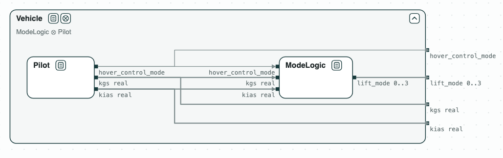
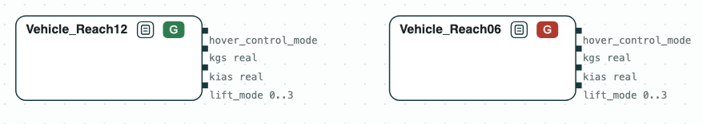
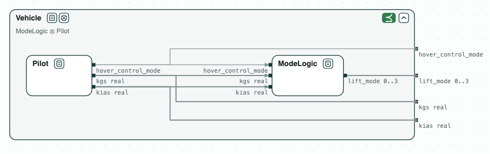
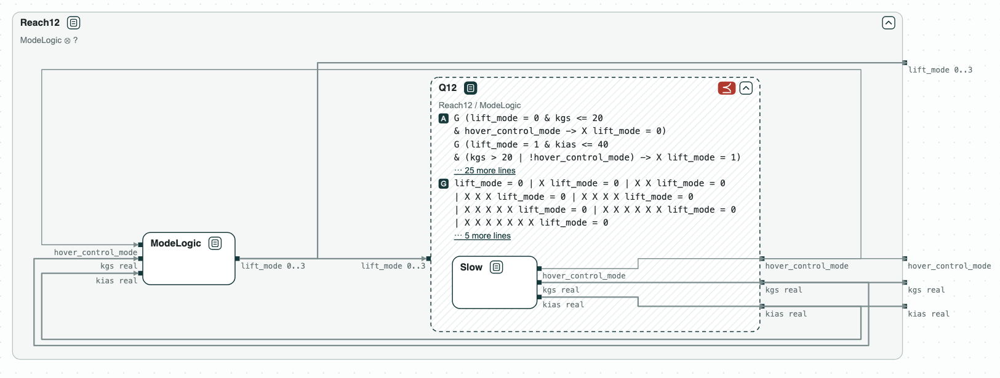
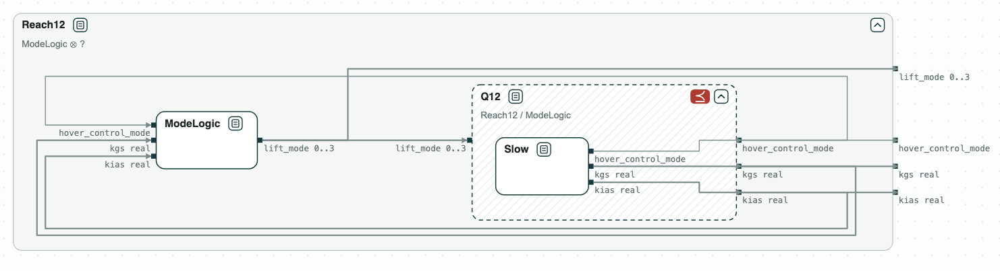
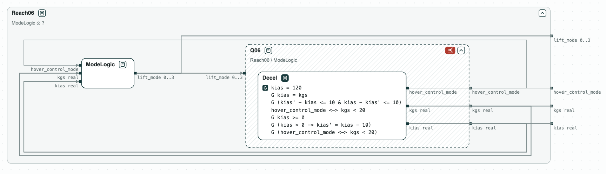

## Aircraft: what makes it hover in time

**The question.** Some flights of an aircraft meet its requirements and
hover within 12 steps. What must the pilot do so that every flight does?

<p align="center">
  
  <br>
  <em>The vehicle: the mode logic and the pilot.</em>
</p>

Lift-Plus-Cruise is an aircraft studied at NASA, with lift rotors for the
hover and a wing for the cruise. The requirements are those of the LPC_mini
project of [FRET](https://github.com/NASA-SW-VnV/fret) (Pressburger et al.,
REFSQ 2023). The mode logic gives the lift mode `lift_mode` (0 thrust borne,
i.e. hover; 1 semi thrust borne; 2 semi wing borne; 3 wing borne) from the
airspeed `kias` and the ground speed `kgs`, both real numbers. The pilot
sets the speeds and the hover control mode `hover_control_mode`. The
airspeed is 120 at the start and changes by at most 10 at each step.
_Vehicle_ has all the requirements but the deadline of the hover;
_Reach12_ and _Reach06_ add a hover within 12 or 6 steps.

### The steps

**Step 1. Two deadlines.** The requirements with a hover within 12 steps
(_Vehicle_ and _Reach12_) are consistent; with a hover within 6 steps they
are not. The unsat core gives the reason: the vehicle stays wing borne while
`kias` is above 90, then semi wing borne while it is above 30, and `kias`
cannot fall from 120 to 30 by step 6. No pilot can hover within 6 steps.

<p align="center">
  
  <br>
  <em>Step 1: consistent with 12 steps, not with 6; the core highlighted in red.</em>
</p>

**Step 2. The split.** The vehicle is split into the mode logic and the
pilot, as in the diagram at the top, and _ModeLogic_ ∥ _Pilot_ refines
_Vehicle_, without the deadline.

**Step 3. What the pilot must do.** The quotient Q12 = Reach12 / ModeLogic,
drawn as a dashed box, is the weakest contract of the pilot with which
every flight hovers within 12 steps. _Pilot_, which has only the
requirements on the speeds, does not refine it: `kias` may stay at 120.

<p align="center">
  
  <br>
  <em>Step 3: Q12, what the pilot must do; Pilot does not refine it.</em>
</p>

**Step 4. A pilot that slows down.** _Slow_ also lowers `kias` by 10 at each
step. It does not refine Q12: the hover control mode is never turned on, so
the vehicle never reaches the hover.

<p align="center">
  
  <br>
  <em>Step 4: Slow does not refine Q12.</em>
</p>

**Step 5. A pilot that slows down and turns on the hover control.**
_Decel_ also turns the hover control mode on when `kgs` is below 20. It
refines Q12, so every flight hovers within 12 steps. As step 1 says, it
does not refine Q06 = Reach06 / ModeLogic.

<p align="center">
  
  <br>
  <em>Step 5: Decel refines Q12.</em>
</p>

<p align="center">
  
  <br>
  <em>Step 5: Decel does not refine Q06.</em>
</p>

The checks are on real variables, with the SMT engine of nuXmv.

### Content of the directory
The directory of the demo contains:
- `requirements.txt`: the requirements in FRETish, as in FRET;
- `lpc.ltl`: the requirements in the logics language of CHASE, written by
  hand from the LTL formulas that FRET gives for them. The contract
  _Vehicle_ has all of them but the two LPC_REACH_HOVER ones, the contracts
  _Reach12_ and _Reach06_ have one each. The comment at the end of each line
  is the name of the requirement;
- `lpc.chase`: the commands of the logics-based flow;
- `lpc.py`: the checks with the CHASE Python package.

### Logic-based Flow

The console of the `logics_tool` conjoins _Vehicle_ with _Reach12_ and with
_Reach06_, and writes the consistency checks:

`$> logics_tool -i lpc.ltl -o /tmp/lpc/ -c lpc.chase`

The console says that the files have real variables: NuSMV cannot read them,
and nuXmv checks them with its SMT engine:

`$> nuXmv -int /tmp/lpc/vehicle12.smv`\
`nuXmv > go_msat`\
`nuXmv > check_ltlspec_ic3`

The second formula, the negation of the guarantees, is false: the
requirements with LPC_REACH_HOVER_12 are consistent. The third one, the
negation of A & G, is false too: the assumptions and the guarantees can hold
together. With `/tmp/lpc/vehicle06.smv` the second and the third formulas
are true: the requirements with LPC_REACH_HOVER_06 are not consistent.

### Python Flow
The script needs the CHASE Python package, version 0.5.0, and nuXmv. From
the directory of the demo:

```
$> pip install chase-cps
$> chase-cps install nuxmv --accept-license
$> python3 lpc.py
```

The script prints the result of each step, with the counterexamples, and
writes the diagrams above in `out/lpc.html`, a page to open in a browser: a
click on a name opens or closes the contract, and a click on a red tag
shows its core. The requirements in FRETish are in `requirements.txt`.

With `--expect` the script exits with code 1 when a result is not the
expected one.
