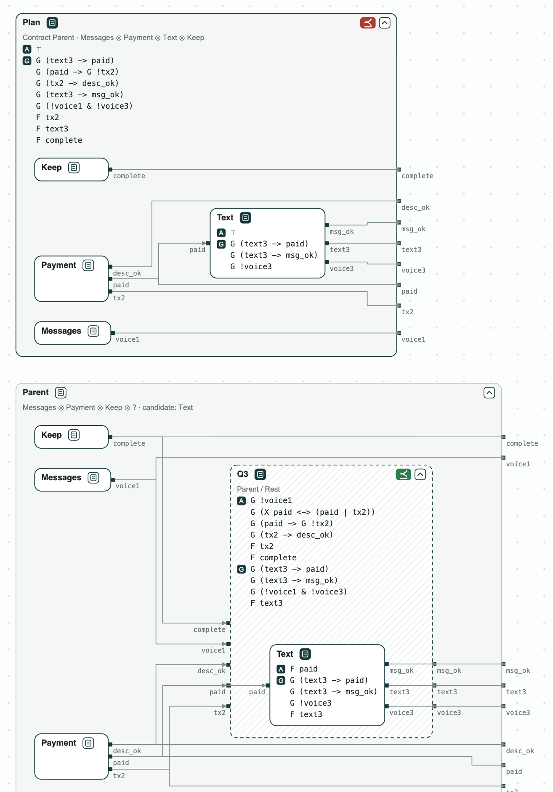
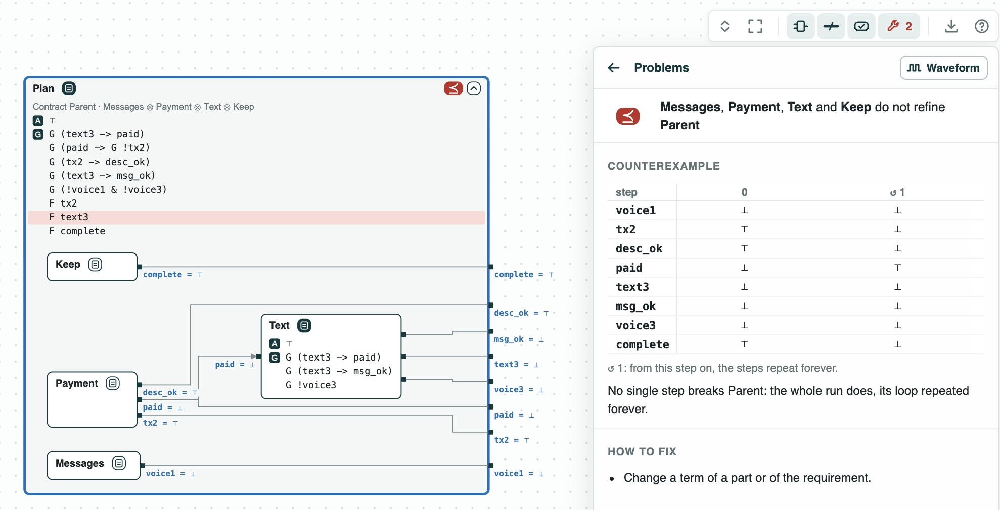
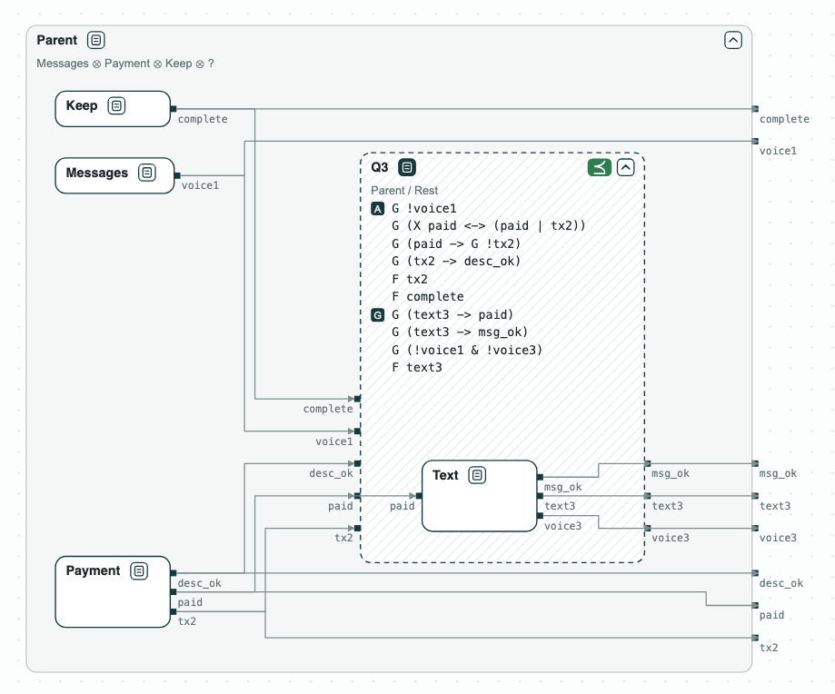
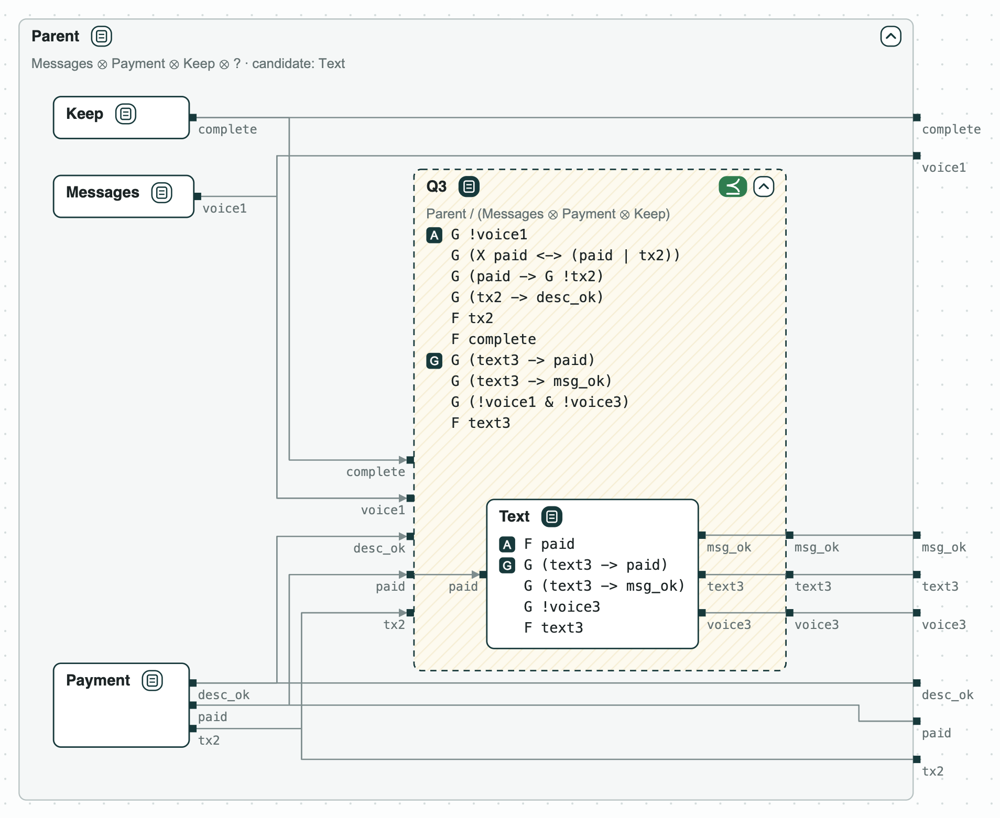
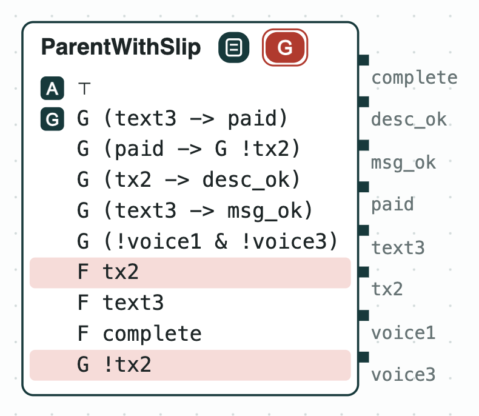

## Payment assistant agent: splitting a task among sub-agents

**The question.** An assistant agent splits a task among sub-agents, each
with a contract over its tool calls. Do the contracts of the sub-agents,
together, refine the contract of the parent agent? If not, what is missing,
and which sub-agent must do it?

**What it shows.**
- Refinement (LTL, nuXmv): the plan with the sub-agents as given does not
  refine the parent; the counterexample pays and never sends the text
  (0.5 s).
- Quotient: Q3 = Parent / (Messages ⊗ Payment ⊗ Keep), the weakest
  contract of sub-agent 3; it asks for `F text3`.
- Refinement: _Text_ with `F text3` refines Q3 (0.0 s), and the plan with
  it refines the parent (0.6 s).
- Unsat core: a parent that also says "never pay" is inconsistent; the
  core is the two clauses in conflict, `F tx2` and `G !tx2` (0.2 s).
- Diagrams: the plan inside the parent, and the quotient drawn as a dashed
  box with the candidate inside.

<p align="center">
  
  <br>
  <em>The plan of the sub-agents inside the parent, the quotient Q3 with <em>Text</em> inside it, and the parent with the slip.</em>
</p>

The task comes from [AppWorld](https://arxiv.org/abs/2407.18901) (task
530b157_1): pay Kristin back on Venmo the amount in her text messages, with
the note "Groceries", then text her "It is done.", and send no voice
message. The parent gives the task to three sub-agents, and marks the task
complete itself (_Keep_):

- _Messages_ (1) finds the amount;
- _Payment_ (2) pays;
- _Text_ (3) sends the text.

The variables are the tool calls and their arguments:

- `voice1`, `voice3`: a voice message of sub-agent 1 or 3;
- `tx2`: a Venmo payment;
- `desc_ok`: the note of the payment is right;
- `paid`: written by the Venmo tool once the payment is done;
- `text3`: a text;
- `msg_ok`: the words of the text are right;
- `complete`: the task is marked complete.

The contract of the parent guarantees:

- H1: the text is sent after the payment;
- H2: one payment;
- H3 and H4: the right note and the right words;
- H5: no voice message;
- H6 to H8: `F tx2`, `F text3`, and `F complete`.

### The steps

**Step 1. Contracts from the tools.** Each sub-agent gets the rules of the
tools it holds. _Text_ sends the text only after the payment, with the
right words, and no voice message. Together the sub-agents do not refine
the parent: the counterexample pays and never sends the text. No sub-agent
promises `F text3`.

<p align="center">
  
  <br>
  <em>Step 1: the plan does not refine the parent; in the counterexample <code>text3</code> stays false.</em>
</p>

**Step 2. What sub-agent 3 must do.** Only sub-agent 3 can send the text
(`text3`), so the quotient by the others, Q3 = Parent / (Messages ⊗ Payment
⊗ Keep), drawn as a dashed box, says what it must do: the weakest contract
with which the plan refines the parent. It asks for the rules of its tools
and `F text3`.

<p align="center">
  
  <br>
  <em>Step 2: Q3, what sub-agent 3 must do: its guarantees end with <code>F text3</code>.</em>
</p>

**Step 3. The repaired sub-agent.** _Text_ with `F text3` refines Q3, so
the plan refines the parent. It may assume that the payment is done sooner
or later (`F paid`): Q3 assumes it from what the other sub-agents
guarantee.

<p align="center">
  
  <br>
  <em>Step 3: <em>Text</em>, with <code>F text3</code>, refines Q3.</em>
</p>

**Step 4. A clause against the request.** If the parent also says "never
pay" (`G !tx2`, _ParentWithSlip_ in the picture), its contract is
inconsistent, and the unsat core is the two clauses in conflict: `F tx2`
and `G !tx2`.

<p align="center">
  
  <br>
  <em>Step 4: the inconsistent parent, with the core highlighted in red.</em>
</p>

### Content of the directory
The directory of the demo contains:
- `requirements.txt`: the task, the plan, the variables, the contract of
  the parent (H1 to H8), and the contracts of the sub-agents;
- `assistant.py`: the steps with the CHASE Python package;
- `out/assistant.html`: the diagram above, written by `assistant.py`.

### Run it

```
pip install chase-cps
chase-cps install nuxmv --accept-license
python assistant.py --expect
```

The script prints the result of each step and writes the diagram in
`out/assistant.html`, a page to open in a browser: a click on a name opens
or closes the contract, and a click on a red tag shows its counterexample.
With `--expect` the script exits with code 1 when a result is not the
expected one.
