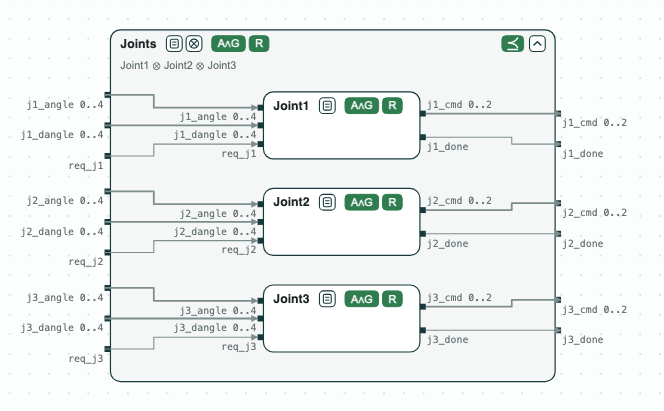
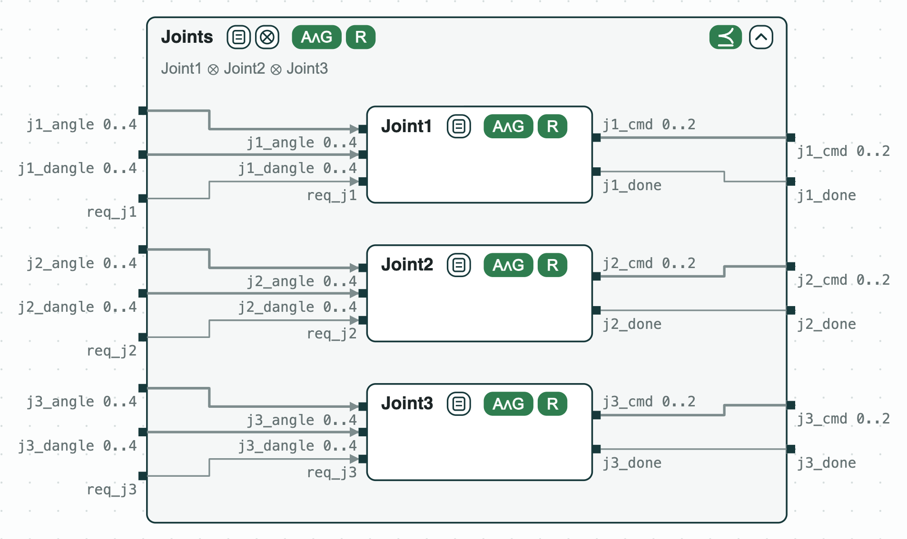

## Robotic arm joints: checked and synthesized one joint at a time

**The question.** A robotic arm moves its joints to the angles it asks for.
Do the joint contracts, composed, meet the contract of the arm? Can a
controller be built for each joint alone, and how does the check grow with
the number of joints?

**The result.**
- Joint1 ⊗ Joint2 ⊗ Joint3 refines _Joints_, the contract of the arm, and
  each joint is realizable (a controller exists for it).
- slugs synthesizes a controller of 72 states for each joint. The arm is
  realizable as a whole too, but its controller has at least 375,000 states.
- The refinement is proved for 1 to 8 joints, from about 1 s for 3 joints
  to 5 s for 8. When Joint1 drops its liveness guarantee, nuXmv finds a
  counterexample for every number of joints.

<p align="center">
  
  <br>
  <em>The three joints inside the contract of the arm: each one's assumptions and guarantees can hold together (A∧G), and it is realizable (R); together they refine Joints (⪯).</em>
</p>

The example was shown at CPS-IoT Week 2022 ([CPSWeek22](../CPSWeek22/CPSWeek22.md)).
Joint _i_ reads a request `req_ji`, the angle asked for `ji_dangle`, and its
angle `ji_angle` (0 to 4); it writes a command `ji_cmd` (stay, up, down)
and `ji_done`. It guarantees to be done infinitely often (`G F ji_done`).
_Joints_ has the assumptions and the guarantees of the three joints.

### The steps

**Step 1. The joints refine the arm.** `verification.chase` composes the
three joint contracts and writes the refinement check in `refinement.smv`
(the composition assumes no more than _Joints_ and guarantees at least as
much). nuXmv proves both formulas. `diagram.sh` draws the same check: all
green.

<p align="center">
  
  <br>
  <em>Step 1: Joint1 and Joints open: what one joint and the arm assume and guarantee.</em>
</p>

**Step 2. One controller per joint, not one for the arm.**
`synthesis.chase` writes one file for slugs per joint, and slugs
synthesizes a controller of 72 states for each. `singlemodel.chase` writes
_Joints_ alone: it is realizable, but its explicit controller has at least
375,000 states, about 72 x 72 x 72, and slugs does not finish writing it.

**Step 3. Scaling.** `scaling.py` builds the same contracts for N joints
and checks the refinement. It takes about 1 s
for 3 joints and 5 s for 8 (Apple M4 Pro, nuXmv 2.2.0). With `--broken`,
Joint1 does not guarantee `G F j1_done`, and nuXmv finds a counterexample
of 3 or 4 steps for every N.

### Run it

```
pip install chase-cps
chase-cps install nuxmv --accept-license
chase-cps install slugs
python scaling.py --joints 1 2 3 4 5 6 7 8 --broken --expect
```

`compositional_demo.sh` and `singlemodel_demo.sh` run steps 1 and 2 with the console.

### Content of the directory
- `specs.ltl`: the joints and the arm; `single_model.ltl`: the arm alone;
- `*.chase`: the commands of the console; `refinement.smv`: the check they
  write;
- `compositional_demo.sh`, `singlemodel_demo.sh`: steps 1 and 2;
- `scaling.py`, `plot_scaling.py`: step 3 and its plot; `results/`: older
  measurements;
- `diagram.sh`: draws `out/specs.html`, the diagrams above.
