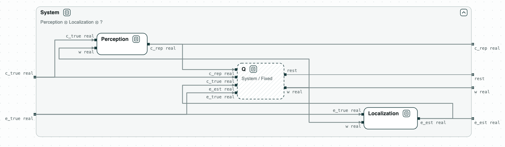
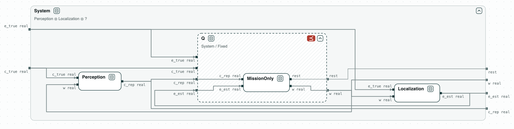
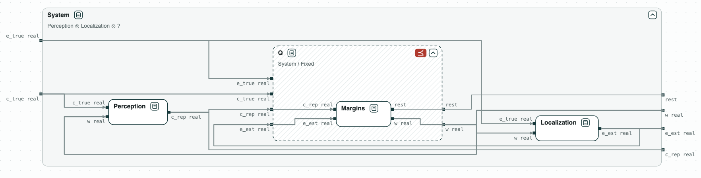
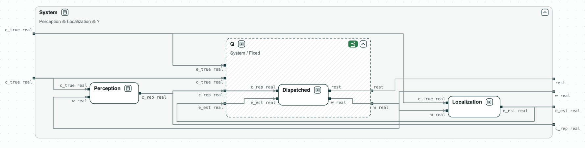

## Warehouse robot: a controller to delegate

**The question.** The local controller of a warehouse robot is given to a
designer while perception and localization stay as they are. What must the
controller satisfy for the robot to meet the requirements of the system?

<p align="center">
  
  <br>
  <em>The place of the controller: the hole Q next to perception and localization.</em>
</p>

The example is simplified from Damera, Matheu, and Baras, "Contract-Based
Agentic Systems Engineering: Delegation as Quotient for Assured System
Design" (arXiv 2610.33349, 2026). The robot keeps 0.40 m from a worker and
rests (`rest`) at a dock. The controller commands the yaw rate `w`. It sees
the clearance to the worker (`c_true`) only as perception reports it
(`c_rep`, at most 0.3 too high), and the distance to the dock (`e_true`)
only as localization reports it (`e_est`, at most 0.05 too low); it rests
when `e_true <= 0.1`. Perception bounds its error only if the robot turns
slowly, `|w| <= 0.8`, and localization only if `|w| <= 1.0`. The variables
are real numbers, and the composition of perception and localization is
called _Fixed_ in the diagrams.

### The steps

**Step 1. The contract of the controller.** The quotient Q = System /
(Perception ∥ Localization), drawn as a dashed box, is the weakest contract
of the controller with which the robot meets the requirements: the contract
to give to the designer. It guarantees the requirements of the system, and
what perception assumes of the controller: `|w| <= 0.8`.

**Step 2. The requirements of the mission.** _MissionOnly_, the
requirements written on what the controller sees, does not refine Q: in the
counterexample the reported clearance is 0.40 while the true one is
lower, and the robot turns faster than perception allows.

<p align="center">
  
  <br>
  <em>Step 2: MissionOnly does not refine Q.</em>
</p>

**Step 3. With margins for the errors.** _Margins_ adds the errors of
perception and localization to the bounds, and does not refine Q either: it
turns faster than perception allows, and the robot reaches the worker.

<p align="center">
  
  <br>
  <em>Step 3: Margins does not refine Q.</em>
</p>

**Step 4. With the yaw rate.** _Dispatched_, the contract given to the
designer, is _Margins_ with `|w| <= 0.8`. It refines Q, so the robot with
it meets the requirements of the system.

<p align="center">
  
  <br>
  <em>Step 4: Dispatched refines Q.</em>
</p>

The paper finds the same two failures in simulation.

### Content of the directory
The directory of the demo contains:
- `requirements.txt`: the variables, the contracts, and the three candidate
  contracts of the controller;
- `warehouse.py`: the steps with the CHASE Python package.

### Python Flow
The script needs the CHASE Python package, version 0.5.0, and nuXmv. From
the directory of the demo:

```
$> pip install chase-cps
$> chase-cps install nuxmv --accept-license
$> python3 warehouse.py
```

The script prints the result of each step, with the counterexamples, and
writes the diagrams above in `out/warehouse.html`, a page to open in a
browser: a click on a name opens or closes the contract. The contracts in
words are in `requirements.txt`.

With `--expect` the script exits with code 1 when a result is not the
expected one.
