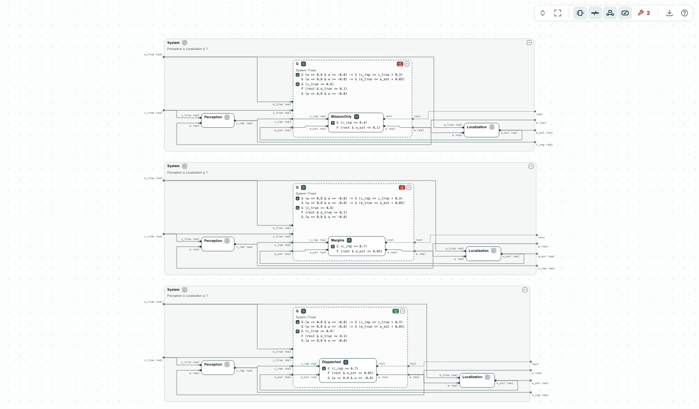
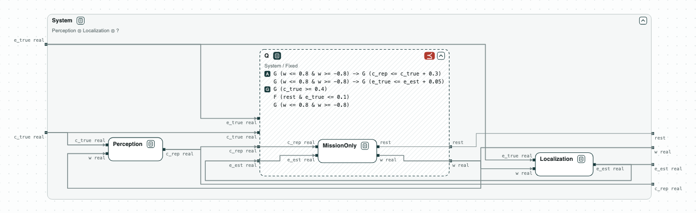
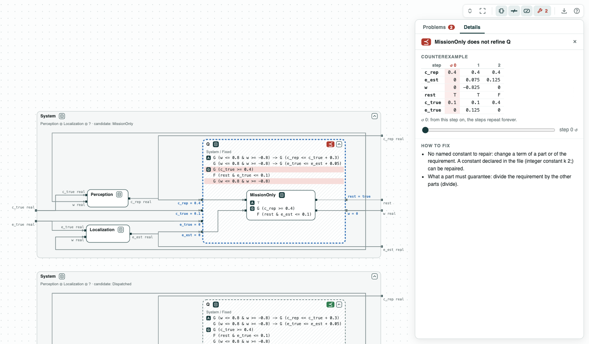
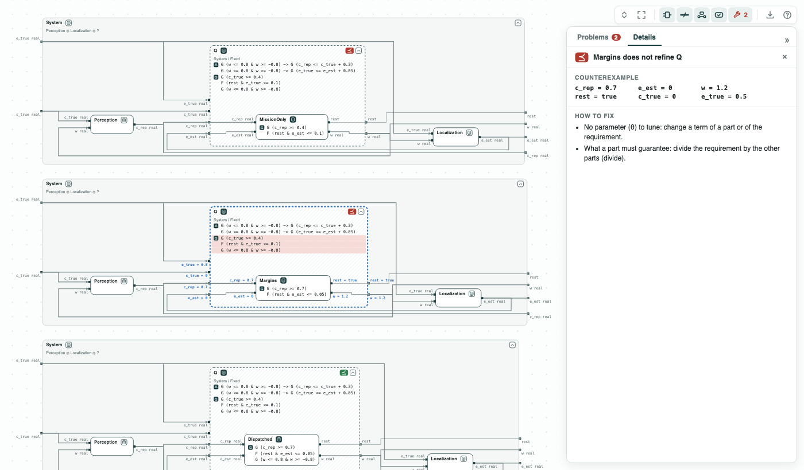
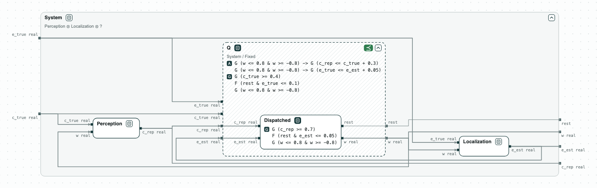

## Warehouse robot: the contract of a controller to delegate

**The question.** The local controller of a warehouse robot is given to a
designer; perception and localization stay as they are. What must the
controller satisfy for the robot to meet its requirements?

**The result.**
- The quotient Q (the weakest contract the controller must meet) asks for
  the requirements of the system and one more term: `|w| <= 0.8`, what
  perception assumes.
- The requirements written for the mission alone do not refine Q, nor do
  they with margins for the errors: in each counterexample the robot turns
  faster than perception allows.
- The margins with this bound on the yaw rate refine Q: this is the
  contract to give to the designer.

<p align="center">
  
  <br>
  <em>The three candidate contracts of the controller, each in its place: two fail, one holds.</em>
</p>

The example is simplified from Damera, Matheu, and Baras, "Contract-Based
Agentic Systems Engineering: Delegation as Quotient for Assured System
Design" (arXiv 2610.33349, 2026). The variables are real numbers (the SMT
engine of nuXmv):

- `w`: the yaw rate, commanded by the controller;
- `c_true`, `c_rep`: the clearance to a worker, true and reported by
  perception;
- `e_true`, `e_est`: the distance to the dock, true and estimated by
  localization.

The controller sees only `c_rep` and `e_est`. In the diagrams, _Fixed_ is
perception composed with localization.

### The steps

**Step 1. The contract of the controller.** Q = SafeMission / (Perception ⊗
Localization), drawn as a dashed box, guarantees the requirements of the
system (`c_true >= 0.4`, and a rest at the dock) and what perception
assumes: `|w| <= 0.8`.

<p align="center">
  
  <br>
  <em>Step 1: Q, the place of the controller, next to perception and localization.</em>
</p>

**Step 2. The requirements of the mission.** _MissionOnly_, the
requirements written on what the controller sees, does not refine Q: in
the counterexample the reported clearance is 0.4 while the true one is
0.1, and the robot turns faster than perception allows.

<p align="center">
  
  <br>
  <em>Step 2: <em>MissionOnly</em> does not refine Q; the counterexample on the wires.</em>
</p>

**Step 3. With margins for the errors.** _Margins_ adds the errors of
perception and localization to the bounds, and does not refine Q either:
it turns at `|w| = 1.2`, and the robot reaches the worker.

<p align="center">
  
  <br>
  <em>Step 3: <em>Margins</em> does not refine Q.</em>
</p>

**Step 4. With the yaw rate.** _Dispatched_ is _Margins_ with the bound
of perception on `w`. It refines Q, so the robot with it meets the
requirements of the system. The paper finds the same two failures in
simulation.

<p align="center">
  
  <br>
  <em>Step 4: <em>Dispatched</em> refines Q.</em>
</p>

### Run it

```
pip install chase-cps
chase-cps install nuxmv --accept-license
python warehouse.py --expect
```

### Content of the directory
- `requirements.txt`: the variables, the contracts, and the three
  candidates;
- `warehouse.py`: the steps with the CHASE Python package;
- `out/warehouse.html`: the diagrams above, written by `warehouse.py`.
